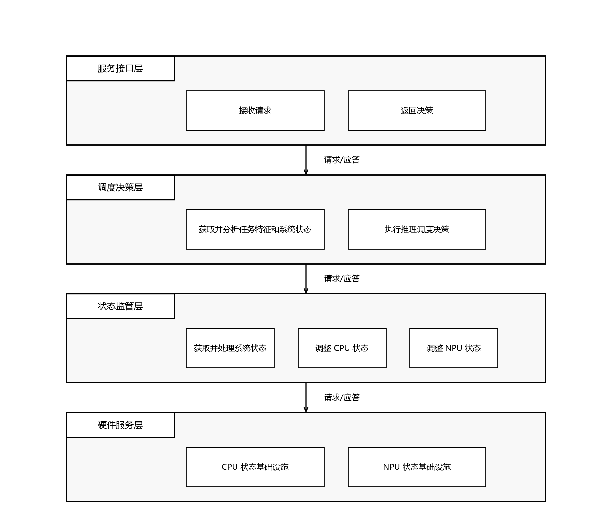
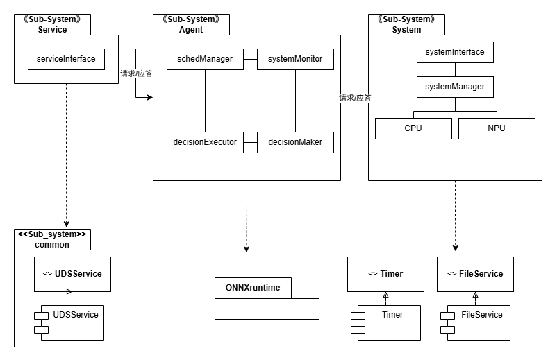
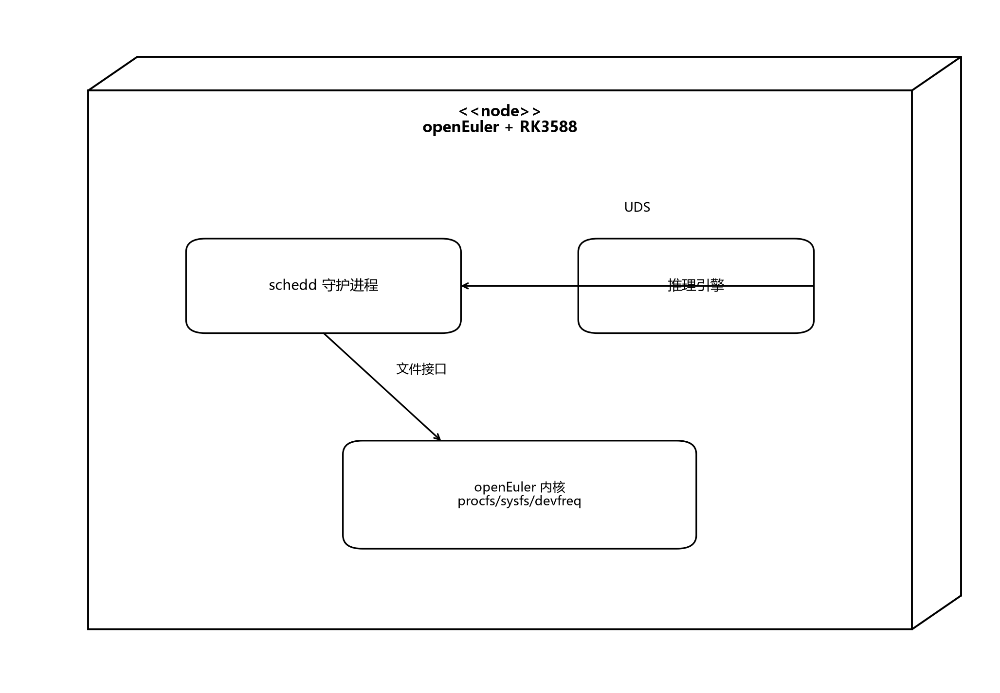

# 软件体系结构设计文档

## 1. 文档概述

### 1.1 编写目的

本文档用于描述"面向 CPU+XPU 异构系统的智能调度算法及中间件原型"的软件体系结构设计，为后续详细设计与编码实现提供顶层指导。

### 1.2 组织结构

- 第 2 章 系统概述
- 第 3 章 设计目标和原则
- 第 4 章 设计约束和现实限制
- 第 5 章 逻辑视点的体系结构设计
- 第 6 章 部署视点的体系结构设计

### 1.3 读者对象

项目开发团队成员、指导教师、评审人员。

### 1.4 术语定义

| 术语 | 说明 |
|---|---|
| DQN | 深度 Q 网络，用于调度决策的强化学习模型 |
| UDS | Unix Domain Socket，本机进程间通信机制 |
| HAL | 硬件抽象层，屏蔽底层硬件差异 |
| ONNX | 开放神经网络交换格式 |
| RK3588 | 瑞芯微边缘异构平台，集成 CPU+NPU |

### 1.5 参考文献

- 《软件需求规格说明书.md》
- 项目申请书《面向大模型推理任务的边缘异构平台智能调度算法研究与实现》

## 2. 系统概述

### 2.1 系统建设目标

构建一个可集成于 openEuler 的轻量化调度中间件，通过 DQN 模型实时推理，为 LLM 推理任务动态分配 CPU/NPU 资源、批处理大小及频率档位。

### 2.2 主要功能

- 接收推理引擎的调度请求
- 采集 CPU/NPU 系统状态
- 执行 DQN 推理并生成调度决策
- 调整 CPU/NPU 频率
- 提供管理人员运维接口

### 2.3 边界和范围

同《软件需求规格说明书》。

### 2.4 目标用户

推理引擎、管理人员。

### 2.5 运行环境

- openEuler 24.03 及以上
- RK3588 开发板
- 推理引擎：RKLLM（NPU 侧）/ llama.cpp（CPU 侧）

## 3. 设计目标和原则

### 3.1 设计目标

- 实现功能需求：请求推理调度、采集系统状态、调整处理器频率、查询/启停/切换模式（**切换模式 ≡ 切换决策模型**，由 Agent 侧当前所选模型承载，见详细设计）。
- 满足关键质量需求：毫秒级决策、状态定期刷新、可靠性降级与恢复。
- 支持可移植性：x86 仿真与 RK3588 实机共用代码，开发期使用虚拟 NPU。

### 3.2 设计原则

- **层次化**：按抽象级别分层，上层依赖下层，下层不反向依赖。
- **关注点分离**：将协议、决策、状态转换、设备访问四类职责分离。
- **可替换性**：通过抽象接口隔离硬件平台差异（真实 NPU / 虚拟 NPU）。
- **最小依赖**：优先使用平台自带能力，避免引入不必要的 SDK 或中间件。

## 4. 设计约束和现实限制

| 约束项 | 说明 |
|---|---|
| 操作系统 | 必须基于 openEuler 24.03 |
| 硬件平台 | 目标 RK3588，但开发阶段只有 x86 CPU 机 |
| 模型推理 | DQN 模型需导出为 ONNX，C++ 侧使用 ONNX Runtime |
| 进程间通信 | 与推理引擎同机部署，使用 UDS |
| NPU 模拟 | 开发阶段无真实 NPU，使用虚拟文件接口模拟 |

## 5. 逻辑视点的体系结构设计

### 5.1 关键需求识别

| 关键需求 | 对体系结构的影响 |
|---|---|
| 请求推理调度 | 需要服务接口层接收外部请求 |
| 毫秒级决策 | 需要独立决策模块，避免阻塞在 I/O 上 |
| 采集系统状态 | 需要状态监管模块周期性采样 |
| 调整处理器频率 | 需要硬件抽象层统一访问 sysfs/devfreq |
| 开发期无 NPU | 需要虚拟设备与真实设备可切换的抽象 |

### 5.2 体系结构风格

**采用层次风格。**

理由：
- 中间件天然是"底层硬件抽象 → 中间服务 → 上层业务"的结构。
- 层次风格能隐藏 openEuler/RK3588 平台差异，提高可移植性。
- 每层职责单一，便于独立测试和替换。

### 5.3 初步软件体系结构

将系统划分为四层：

| 层次 | 职责 | 对应功能需求 |
|---|---|---|
| **服务接口层** | 与推理引擎双向交互，接收请求并返回决策 | 请求推理调度 |
| **调度决策层** | 获取任务特征与系统状态，执行 DQN 推理，生成调度决策 | 请求推理调度 |
| **状态监管层** | 采集系统状态，将设备参数转换为决策可用的状态量，执行调整命令 | 采集系统状态、调整处理器频率 |
| **硬件服务层** | 通过文件接口读写 CPU/NPU 参数，屏蔽真实/虚拟设备差异 | 采集系统状态、调整处理器频率 |

层间调用方向：服务接口层 → 调度决策层 → 状态监管层 → 硬件服务层。

### 5.4 可重用的软件资源

| 资源 | 类型 | 用途 | 集成方式 |
|---|---|---|---|
| **UDS** | 平台设施（内核能力） | 推理引擎与中间件的本机进程通信 | `<sys/socket.h>`，服务接口层直接使用 |
| **ONNX Runtime** | 开源库 | 加载并执行 DQN 模型推理 | CMake 链接，调度决策层使用 |
| **Linux procfs/sysfs/devfreq** | 平台设施 | CPU/NPU 状态读取与频率设置 | 标准文件 I/O，硬件服务层使用 |

不在本系统引入的：数据库、消息中间件、通用开发框架。理由：系统为单机单进程、瞬时状态、点对点通信，这些设施引入成本高于收益。

### 5.5 精化软件体系结构设计

#### 5.5.1 公共基础设施及服务

- **运行平台：openEuler 24.03**——提供进程管理、文件系统接口、网络/IPC 等基础能力。
- **UDS 本地通信服务**——内核提供的本机进程通信机制，服务接口层依赖。
- **设备参数访问服务**——内核 procfs/sysfs/devfreq 提供的 CPU/NPU 状态与控制能力，硬件服务层依赖。

#### 5.5.2 设计元素

基于用例的业务相关性与分析类职责，将四层映射为三个子系统：

| 子系统 | 对应初步结构层次 | 职责 | 包含设计类 |
|---|---|---|---|
| **Service** | 服务接口层 | 与推理引擎双向交互 | `serviceInterface` |
| **Agent** | 调度决策层 | 推理调度过程控制 | `schedManager`、`systemMonitor`、`decisionMaker`、`decisionExecutor` |
| **System** | 状态监管层 + 硬件服务层 | 系统状态管理与设备参数访问 | `systemInterface`、`systemManager`、`CPU`、`NPU` |

各设计类职责：

| 设计类 | 所属子系统 | 职责 |
|---|---|---|
| `serviceInterface` | Service | 接收推理引擎请求，返回调度决策 |
| `schedManager` | Agent | 控制推理调度流程的总协调 |
| `systemMonitor` | Agent | 对 System 子系统的访问封装，为 Agent 内其他类提供统一入口 |
| `decisionMaker` | Agent | 基于 ONNX Runtime 执行 DQN 推理，输出决策 |
| `decisionExecutor` | Agent | 将决策落地为对 System 子系统的调整调用 |
| `systemInterface` | System | 子系统对外接口，封装状态读取与调整下发 |
| `systemManager` | System | 参数↔状态转换，维护系统状态快照 |
| `CPU` | System | CPU 设备参数的获取与设置 |
| `NPU` | System | NPU 设备参数的获取与设置（支持真实/虚拟切换） |

#### 5.5.3 子系统间关系

- **Service → Agent**：请求/应答。推理引擎请求经 Service 转发给 Agent，Agent 返回决策经 Service 回传。
- **Agent → System**：请求/应答。Agent 通过 `systemMonitor` 访问 System，读取状态或下发调整。
- **子系统内部**：设计类之间为协作/依赖关系。

## 6. 部署视点的体系结构设计

### 6.1 部署环境

- 节点：单节点 openEuler + RK3588
- 部署单元：`schedd` 守护进程
- 通信：UDS（推理引擎与 schedd 同机）

### 6.2 部署单元

| 部署单元 | 说明 |
|---|---|
| `schedd` | 调度中间件守护进程，包含 Service/Agent/System 三个子系统 |
| 推理引擎 | 独立的推理进程，通过 UDS 调用 schedd |
| systemd | 托管 schedd，负责启动、停止、自动恢复 |

### 6.3 部署图

- 单个计算节点（RK3588 + openEuler）内运行 `schedd` 和推理引擎。
- `schedd` 与推理引擎通过 UDS 通信。
- `schedd` 通过 procfs/sysfs/devfreq 访问操作系统。

## 7. 开发视点（可选）

- 源码组织：按子系统划分目录（service/、agent/、system/）。
- 构建系统：CMake，C++17。
- 测试策略：单元测试覆盖状态监管与 HAL，集成测试覆盖子系统间调用链。

## 8. 运行视点（可选）

- 三线程运行模型：服务线程接收 UDS 请求，监控线程周期性采集状态，决策线程执行 DQN 推理。
- 状态快照：监控线程写共享内存，决策线程读共享内存，减少同步开销。

## 9. 评审意见

| 评审方面 | 结论 |
|---|---|
| 满足性 | 体系结构设计覆盖全部功能需求与关键质量需求 |
| 可追踪性 | 每个子系统/设计类均有对应需求项 |
| 优化性 | 关键路径（请求→决策→执行）层次清晰，可独立优化 |
| 可扩展性 | 新增设备类型只需扩展 System 子系统；新增决策策略只需扩展 Agent 子系统 |
| 详略程度 | 停留在子系统和设计类高层职责，不过度展开实现细节 |

评审结论：通过。
