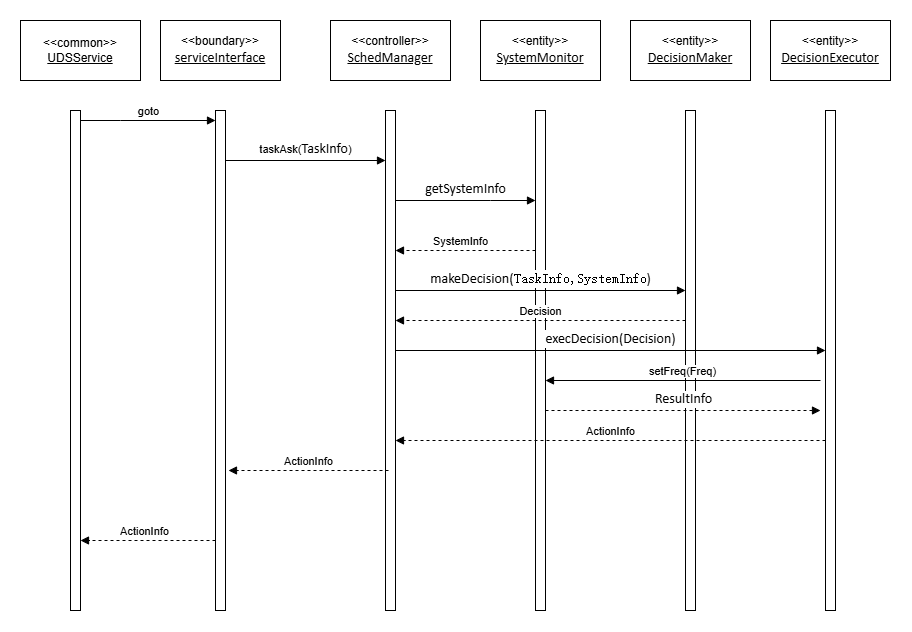
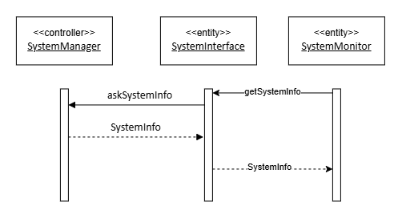
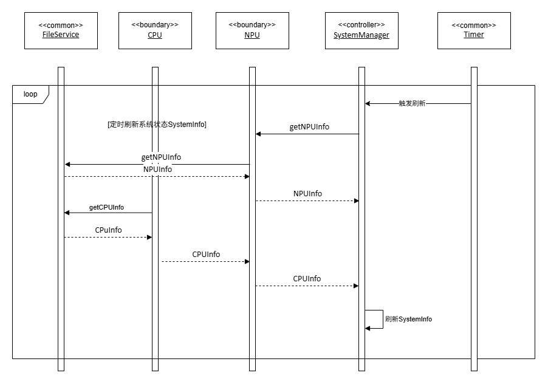
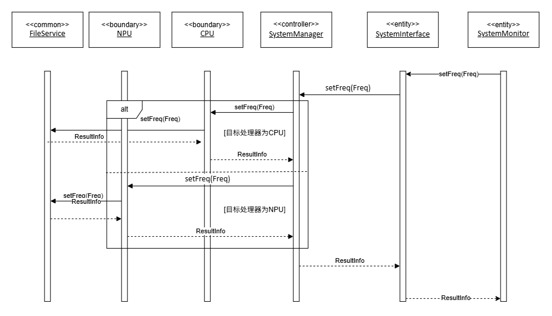
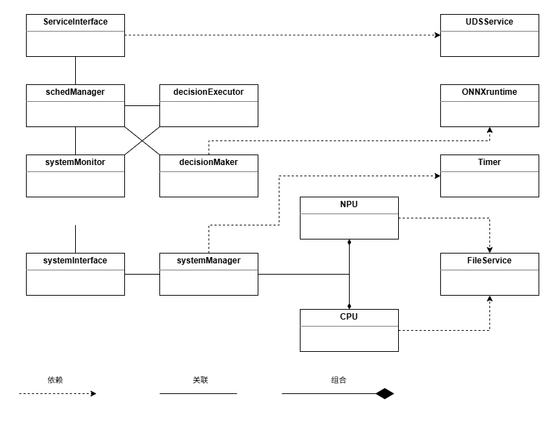

# 详细设计

> 面向 CPU+XPU 异构系统的智能调度算法及中间件原型 · 守护进程 `schedd`

| 项 | 内容 |
|---|---|
| 文档性质 | 软件详细设计说明书 |
| 目标平台 | openEuler / RK3588（首版验证走 llama.cpp 插桩路径，RKLLM 后置移植） |
| 版本 / 日期 | v1.0 / 2026-10-17 |
| 规模 | 13 个设计类 · 47 项属性 · 64 个方法 · 14 条类间关系 · 36 条设计裁决 |
| 阅读体例 | 每章开头给出该章回答的问题；设计取舍以 `【D-xx】` 就地写在相关节，§5 只作索引、**正文为权威** |

**文档地图**

| 章 | 回答什么 |
|---|---|
| §1 设计类清单 | 一共有哪些设计类，各属哪个子系统的哪一层、在哪一节展开 |
| §2 用例设计 | 每个用例由哪些类、按什么顺序协作，落到哪个方法实现 |
| §3 类设计 | 每个类的属性、方法、算法步骤，以及就地写下的裁决 |
| §4 数据设计 | 配置、模型契约、通信报文三种数据的形态与约定 |
| §5 设计裁决与说明汇总 | 36 条裁决的编号索引，供评审逐条追溯 |
| §6 运行模型 | 启动装配、两线程稳态、停机顺序 |

## 1. 设计类清单

本章给出全部 13 个设计类及其归属，作为后续各章的共同索引：§3 随后按同一顺序逐类展开，「所在节」列即该类的展开位置。

| 设计类 | 构造型 | 所属子系统 | 可见范围 | 所在节 |
|---|---|---|---|---|
| `serviceInterface` | boundary | Service | public | §3.1 |
| `UDSService` | common | common | public | §3.2 |
| `FileService` | common | common | public | §3.3 |
| `ONNXruntime` | common | common | public | §3.4 |
| `Timer` | common | common | public | §3.5 |
| `schedManager` | controller | Agent | public | §3.6 |
| `systemMonitor` | entity | Agent | private | §3.7 |
| `decisionMaker` | entity | Agent | private | §3.8 |
| `decisionExecutor` | entity | Agent | private | §3.9 |
| `systemInterface` | entity | System | public | §3.10 |
| `systemManager` | controller | System | private | §3.11 |
| `CPU` | boundary | System | private | §3.12 |
| `NPU` | boundary | System | private | §3.13 |

其中 `UDSService`、`FileService`、`ONNXruntime`、`Timer` 为 **common 子系统的公共基础设施类**，一律按**全静态类**设计（不实例化、无构造与析构，仅以类名调用其静态方法）。

## 2. 用例设计

本节给出各用例在**设计类层**的实现方案：由哪些设计类协作、按什么顺序交互、以及前置 / 后置 / 异常流。用例分析阶段的用例模型见《软件需求规格说明书》，本节是其到设计类的落地。

### 2.1 UC1 请求推理调度（askSched）

**实现方案**：推理引擎经 UDS 提交任务特征（`TaskInfo` 即其载体：**标识 + 命名特征表**，见 D-28）。`UDSService` 完成报文接收与协议分帧后，交给 `serviceInterface`；`serviceInterface` 将 `taskAsk(TaskInfo)` 转发给 Agent 的 `schedManager`。`schedManager` 依次索取系统状态（展开为 UC2）、执行 DQN 推理、下发动作（展开为 UC3），最终回传 `ActionInfo`。

| 步 | 设计类协作 | 说明 |
|---|---|---|
| 1 | 推理引擎 → `UDSService` | 经 UDS 发起调度请求 |
| 2 | `UDSService` → `serviceInterface` | 协议分帧后转交服务入口 |
| 3 | `serviceInterface` → `schedManager::taskAsk(TaskInfo)` | 路由到调度控制器（载荷即**任务特征**，见 D-28） |
| 4 | `schedManager` → `systemMonitor::getSystemInfo()` | 索取系统状态（展开为 UC2） |
| 5 | `systemMonitor` → `schedManager` | 返回 `SystemInfo` |
| 6 | `schedManager` → `decisionMaker::makeDecision(TaskInfo, SystemInfo)` | 经 `ONNXruntime` 执行模型推理（**任务特征 + 系统特征**按契约 `input_fields` 拼接 → 推理 → 动作解码） |
| 7 | `decisionMaker` → `schedManager` | 返回 `Decision` |
| 8 | `schedManager` → `decisionExecutor::execDecision(Decision)` | 下发唯一动作（CPU / NPU 二选一，无需拆解） |
| 9 | `decisionExecutor` → `systemMonitor::setFreq(Freq)` | 据决策中的目标处理器下发一次频率设置 |
| 10 | `systemMonitor` → `decisionExecutor` | 返回 `ResultInfo` |
| 11 | `decisionExecutor` → `schedManager` | 返回 `ActionInfo` |
| 12 | `schedManager` → `serviceInterface` | 回传结果 |
| 13 | `serviceInterface` → `UDSService` | 经 UDS 回写 |
| 14 | `UDSService` → 推理引擎 | 返回应答帧（`std::string`，载荷为 `ActionInfo` 的编码） |

后置条件：推理引擎收到与请求一一对应的 `ActionInfo`；Agent 内部模式状态不变（`schedManager::failCount` 的递增与随之触发的降级「切换默认模型或置停用」除外）。

**实现入口**：上表的协作链落到代码即 §3.6 `schedManager::taskAsk` 的算法步骤 S1~S7（决策在 S4、执行在 S6）；报文编解码见 §4.6，其中 `handleFrame` 只收「类型 + 纯载荷」（D-27）。



*图 2-1　请求推理调度用例设计顺序图*

### 2.2 UC2 采集系统状态（SystemInfo）

**实现方案**：分为两部分：前台请求读取 `systemManager` 的 `systemInfo`；后台定时刷新 `systemInfo`。

#### 2.2.1 前台请求处理
| 步 | 设计类协作 | 说明 |
|---|---|---|
| 1 | `systemMonitor` → `systemInterface::getSystemInfo()` | 获取系统状态 |
| 2 | `systemInterface` → `systemManager::askSystemInfo()` | 请求系统状态 |
| 3 | `systemManager` → `systemInterface` | 返回 `SystemInfo` |

**实现入口**：逐级转交见 §3.1 / §3.6 / §3.10 的 `getSystemInfo`，末端取缓存见 §3.11 `askSystemInfo`（持读锁取副本）。



*图 2-2　采集系统状态用例设计顺序图*

#### 2.2.2 后台定时刷新
| 步 | 设计类协作 | 说明 |
|---|---|---|
| 1 | `Timer::poll()` → `systemManager::refreshSystemInfo()` | 到期回调触发刷新（`Timer` 不建线程，由监控线程循环调 `poll()` 驱动） |
| 2 | `systemManager` → `NPU::getNPUInfo()` | 读取 NPU 参数 |
| 3 | `NPU` → `FileService` | 经文件服务读 NPU 设备节点 |
| 4 | `FileService` → `NPU` | 返回节点文本（`std::string`），由 `NPU` 解析组装为 `NPUInfo` |
| 5 | `NPU` → `systemManager` | 返回 `NPUInfo` |
| 6 | `systemManager` → `CPU::getCPUInfo()` | 读取 CPU 参数 |
| 7 | `CPU` → `FileService` | 经文件服务读 CPU 设备节点 |
| 8 | `FileService` → `CPU` | 返回节点文本（`std::string`），由 `CPU` 解析组装为 `CPUInfo` |
| 9 | `CPU` → `systemManager` | 返回 `CPUInfo` |
| 10 | `systemManager` → `systemManager::setSystemInfo` | 刷新 `SystemInfo` |

**实现入口**：到期判定见 §3.5 `Timer::poll`，采样体见 §3.11 `refreshSystemInfo`（读设备在锁外、写缓存持写锁），设备读取见 §3.12 / §3.13 的 `getCPUInfo` / `getNPUInfo`。



*图 2-3　定时采样（后台刷新）用例设计顺序图*

### 2.3 UC3 调整处理器频率（changeFreq）

**实现方案**：`systemInterface` 向 `systemManager` 发起频率设置请求。`systemManager` 经 `CPU` 边界调用 `FileService` 写入频率节点，并回读校验；结果以 `ResultInfo` 逐级返回。NPU 调频与此流程对称，由 `NPU` 边界经 `FileService` 写入 NPU devfreq 节点。

| 步 | 设计类协作 | 说明 |
|---|---|---|
| 1 | `systemMonitor` → `systemInterface::setFreq(Freq)` |设置处理器频率|
| 2 | `systemInterface` → `systemManager::setFreq(Freq)` | 请求设置频率 |
| 3 | 若目标处理器为 CPU，则 `systemManager` → `CPU::setFreq(Freq)` | 转发到 CPU 边界 |
| 3.1 | `CPU` → `FileService` | 系统调用：写入CPU频率节点 |
| 3.2 | `FileService` → `CPU` | 返回写入是否成功（`bool`），由 `CPU` 组装 `ResultInfo` |
| 3.3 | `CPU` → `systemManager` | 返回 `ResultInfo` |
| 4 | 若目标处理器为 NPU，则 `systemManager` → `NPU::setFreq(Freq)` | 转发到 NPU 边界 |
| 4.1 | `NPU` → `FileService` | 系统调用：写入NPU频率节点 |
| 4.2 | `FileService` → `NPU` | 返回写入是否成功（`bool`），由 `NPU` 组装 `ResultInfo` |
| 4.3 | `NPU` → `systemManager` | 返回 `ResultInfo` |
| 5 | `systemManager` → `systemInterface` | 返回 `ResultInfo` |
| 6 | `systemInterface` → `systemMonitor` | 返回 `ResultInfo` |

**实现入口**：五级流转（标识路由 → 二选一 → 档位夹取 → governor 检查 → 写节点）见 §3.11 `systemManager::setFreq`，设备侧见 §3.12 / §3.13 的 `setFreq`；失败原因经 `ResultInfo.reason` 上传（D-33）。

异常流：目标处理器不可用（freq 指向的设备未创建 / 标识未知）→ 返回 ResultInfo{ok=false, reason=Reason::deviceUnknown, message="unknown device"}，不误投到另一台设备；频率表不可用（档位表为空）→ 返回 ResultInfo{ok=false, reason=Reason::freqUnavailable, message="freq table unavailable"}，不写节点；频率越界 → 夹取到最近合法档位并置 adjusted = true（不判失败）；写入失败 → 返回 ResultInfo{ok=false, reason=Reason::writeFailed, message=...}，curFreq 保持原值；**回读值与目标不符不判失败**（驱动滞后，见 D-32），生效性由下一拍采样观察。以上失败均沿步 5 → 步 6 逐级回传；系统中至多一台设备的频率被改动（CPU / NPU 二选一，一次 setFreq 只走 alt 的一条分支）。**执行失败不参与降级判定**——降级只面向推理失败（D-08 / D-34），上述失败仅透传 `ok=false` 与 `reason` 并记日志。



*图 2-4　设置处理器频率用例设计顺序图*

### 2.4 UC4 / UC5 / UC6 管理类用例

| 用例 | 实现方案 |
|---|---|
| UC4 查询系统状态 | 管理人员在 `schedctl` 发起查询，经 `UDSService`（UDS）发 `GetState` → `serviceInterface` → `schedManager` → `systemMonitor::getSystemInfo()` → 原路返回，由界面侧格式化输出 |
| UC5 启停服务 | 管理人员在 `schedctl` 发起启停，由界面侧调用 `systemctl <动作> schedd`；守护进程生命周期由 systemd 管理，不进入 `schedd` 内部 |
| UC6 选择模型 | 管理人员在 `schedctl` 发起选择，经 `UDSService` 发 `SetModel` → `serviceInterface` → `schedManager::setModel()`；模型非法或不可用时返回错误 |

**实现入口**：`GetState` / `SetModel` 的载荷形态与应答外壳见 §4.6.4，分派与错误码映射归 `serviceInterface::handleFrame`（§3.1）；换模型走「先建后换」的原子切换（D-04 / D-11）。

## 3. 类设计

本章逐类整理 13 个设计类的**属性**与**方法**，每类一张表。排列顺序即**调用方向**：门面（§3.1）→ common 基础设施（§3.2~§3.5）→ Agent（§3.6~§3.9）→ System（§3.10~§3.13）；同一子系统内按「控制器 → 中间层 → 边界」由外向内展开，§3.14 收束为类图与 14 条实边。

- **表格体例**：第一列标识行性质（`类` / `属性` / `方法`，同类行纵向合并），其后依序罗列该类全部属性、全部方法。属性行给出名称、类型、可见性、初值；方法行按七要素给出名称、参数、返回、作用范围、前置、后置、功能说明。方法的具体执行过程另见各类表后的「**算法步骤**」小节。
- **构造约定**：凡有属性需赋初值、或有对象须注入的类，构造函数列为该类方法表的**首行**；**全静态类（`UDSService` / `FileService` / `ONNXruntime` / `Timer`）不设构造与析构**，方法表中不列这两行，其静态资源由各自的 `start()` / `load()` 建立。构造**只做赋值与对象创建、不做任何 I/O**，因而**构造不可失败**——监听建立、模型加载、设备节点读取一律推迟到各自的 `start()` / `load()` / 首次 Info（懒加载）。
- **析构约定**：析构函数紧随构造函数列为方法表**第二行**（**全静态类无析构**——其静态资源随进程退出回收，见 §3.4「静态会话生命周期」）。析构**只归还本类独占的资源**——注入所得的引用一律**不 `delete`**（所有者在外层、可能为跨类共享），成员容器与值语义对象交由语言自动销毁；释放失败静默处理、**析构不抛异常**。**析构不保证被调用**（进程由 systemd 托管，停机由信号路径经显式 `stop()` 接管），故正常清理一律以显式停止方法为准，**析构仅作兜底**。

### 3.1 `serviceInterface`（boundary · Service · public）

| 类 / 属性 / 方法 | 名称 | 类型 / 参数 | 可见性 / 返回 | 初值 / 前置 | — / 后置 | — / 功能说明 |
|---|---|---|---|---|---|---|
| 类 | `serviceInterface` | 门面类 · Service 子系统 | public | — | — | — |
| 属性 | `schedManager` | `schedManager*` | private | 初值 `nullptr` | — | 关联，构造装配注入 |
| 属性 | `running` | `bool` | private | 初值 `false` | — | 服务运行标志 |
| 属性 | `socketPath` | `std::string` | private | 初值 `""` | — | **全系统单存于此**，调 `UDSService` 时传参 |
| 属性 | `maxConn` | `int` | private | 初值 `16` | — | UDS 并发连接上限（来源 §4.3.1 `[server] max_conn`）；`start()` 调 `UDSService::start` 时传参 |
| 方法 | `serviceInterface` | `const std::string& socketPath`（UDS 监听路径，构造注入，来源 §4.3.1 `[server] socket_path`）、`schedManager* mgr`（关联，构造注入）、`int maxConn`（UDS 并发连接上限，构造注入，来源 §4.3.1 `[server] max_conn`） | public → — | 路径可为空（由 `start` S2 拒绝）；`mgr` 可为 `nullptr`（由各方法 S1 兜底） | `socketPath` 置注入路径、`schedManager` 指向注入对象、`maxConn` 置注入值（非正值回退 16）；`running = false` | 接收套接字路径、总控引用与并发上限并把运行标志置初值；**只做赋值、不做 I/O**（`UDSService` 为全静态类、无实例可创建，监听由 `start()` 直接调其静态方法建立），且不拥有 `schedManager` |
| 方法 | `~serviceInterface` | 无 | public → — | — | `running = false`；UDS 端点与连接全关闭 | 若 `running == true`：先置 `running = false` 再调 `UDSService::stop()` 关闭端点与连接（**先置标志再拆资源**）；**不删除 `schedManager`**（不拥有）。因**析构不保证被调用**，正常清理一律走显式 `stop()`，本析构仅作兜底 |
| 方法 | `taskAsk` | `const TaskInfo&` | public → `ActionInfo` | 服务已启动、`schedManager` 非空 | 返回一次推理结果，不改自身状态 | 受理 → 转交 `schedManager` → 返回其产出 |
| 方法 | `getSystemInfo` | 无 | public → `SystemStateSnapshot` | 同上 | 返回快照，无副作用 | 转交 `schedManager`（其经 `systemMonitor` 取 `SystemInfo`）；`SystemStateSnapshot` 为**对外应答载荷**（`SystemInfo` + 当前模型名），**非系统状态类型** |
| 方法 | `setModel` | `const std::string&`（模型完整路径；空串表示停用推理） | public → `bool` | 服务已启动 | 成功则所选模型更新 | 转交 `schedManager`，由其解析模型名并热切换 |
| 方法 | `start` | 无 | public → `bool` | `running == false`、`socketPath` 非空 | 成功则 `running = true`，UDS 监听就绪、**服务循环待 `serve()` 启动** | 以 `socketPath`、`maxConn` 与绑定 `this` 的 `handleFrame` 入口调 `UDSService::start(...)`（**静态调用，不创建实例**）→ 置标志；失败则 `running` 保持 `false` |
| 方法 | `stop` | 无 | public → `void` | `running == true` | `running = false`，端点关闭；已有连接由服务线程退出时释放 | 置标志 → 调 `UDSService::stop()` 关闭监听端点并经 `wakeFd` 唤醒服务循环 |
| 方法 | `handleFrame` | `const std::string&`（报文类型，取值 `TaskAsk` / `GetState` / `SetModel`）, `const std::string&`（载荷） | private → `std::string`（应答帧） | 服务已启动 | 无状态改变 | **`UDSService` 的回调入口**：入参只含「报文类型 + 纯载荷」，**不含 8 字节帧头**（D-27）；按类型分派到 `taskAsk` / `getSystemInfo` / `setModel`，结果编为四键外壳返回 |
| 方法 | `serve` | 无 | public → `void` | 服务已启动（`running == true`） | 返回即服务循环已退出 | **服务线程入口**：转调 `UDSService::serve()` 运行单线程事件循环；阻塞至循环退出，由装配层在自己的服务线程中调用（与 D-07 / D-35 的两线程模型一致） |

> **【D-01｜裁决】交互风格（同步语义）**：`taskAsk` / `getSystemInfo` 采用**同步**语义——方法阻塞至结果就绪后直接返回，与用例设计顺序图"一问一答"一致。

**算法步骤**

**`serviceInterface::serviceInterface(socketPath, mgr, maxConn)`**
- S1. 把 `socketPath` 赋给同名属性（可为空；**空值不在此处报错**，由 `start` S2 拒绝）。
- S2. 把 `mgr` 赋给 `schedManager` 属性（可为 `nullptr`，由各方法 S1 兜底）；**不拥有该对象**。
- S3. 把 `maxConn` 赋给同名属性；**非正值回退默认 16**（保证并发上限始终有效）。
- S4. 置 `running = false`；**本构造不做任何 I/O、不建立监听**——`UDSService` 为全静态类（无实例可创建），监听建立推迟到 `start()` 直接调其静态方法。

**`serviceInterface::~serviceInterface()`**
- S1. 若 `running == true` → 先置 `running = false`（阻止新请求进入），再调 `UDSService::stop()` 关闭端点与连接。
- S2. **不删除 `schedManager`**——注入引用，所有者在外层。
- S3. 释放失败静默忽略；**析构不保证被调用**（停机经信号路径走显式 `stop()`），本析构仅作兜底。

**`serviceInterface::taskAsk(request)`**
- S1. 前置校验（**两种失败分列，便于现场定位**）：
  - S1.1 服务未启动（`running != true`）→ 返回**无动作**的 `ActionInfo`：`ok=false`、`reason=Reason::serviceNotRunning`、`message="service not running"`（不抛异常）；
  - S1.2 服务已启动但依赖未装配（`schedManager == nullptr`）→ 返回**无动作**的 `ActionInfo`：`ok=false`、`reason=Reason::schedulerAbsent`、`message="scheduler not attached"`（不抛异常）。
- S2. 调用 `schedManager::taskAsk(request)`，**同步阻塞**至返回。
- S3. 原样返回其产出 `ActionInfo`；本方法**不改动自身任何属性**（无状态）。

**`serviceInterface::getSystemInfo()`**
- S1. 前置校验：`running == true` 且 `schedManager*` 非空；不满足 → 返回**空快照**（`system` 取零值 `SystemInfo`、`model` 置空串；快照本身无 `ok` 字段），由 `handleFrame` 依同一判据映射为 `1005` / `1006`。
- S2. 调用 `schedManager::getSystemInfo()`；**同步阻塞**。
- S3. 返回 `SystemStateSnapshot`（已含当前模型名），无副作用。

**`serviceInterface::setModel(modelPath)`**
- S1. 前置校验：`running == true` 且 `schedManager*` 非空；不满足 → 返回 `false`。
- S2. 调用 `schedManager::setModel(modelPath)`（**模型名解析与热切换均在彼侧完成**，本方法不重复校验）。
- S3. 返回其布尔结果；成功与否**本方法不改自身状态**。

**`serviceInterface::start()`**
- S1. 幂等保护：若 `running == true` → 直接返回 `true`（重复启动视为成功）。**此为对前置条件「`running == false`」的放宽**，属宽容式设计（前置是给调用方的契约，本步是幂等兜底）。
- S2. 校验 `socketPath` 非空；为空 → 返回 `false`（无法确定监听地址）。
- S3. 以 `socketPath`、`maxConn` 与**绑定 `this` 的 `handleFrame` 入口**调 `UDSService::start(socketPath, maxConn, handler)`（**全静态调用，不创建实例、不持指针**）。
- S4. 启动失败 → 返回 `false`（`running` 保持 `false`）；**无实例需释放**，静态类资源由 `UDSService::stop()` 自行归零。
- S5. 置 `running = true`；返回 `true`。

**`serviceInterface::stop()`**
- S1. 幂等保护：若 `running == false` → 直接返回（无事可做）。
- S2. 先置 `running = false`（**先置标志再拆资源**，避免新请求进入）。
- S3. 调 `UDSService::stop()` 关闭监听端点与全部已接受连接（内部唤醒阻塞的服务循环并移除套接字文件）。
- S4. 返回。

**`serviceInterface::handleFrame(type, payload)`**
- S1. 按报文类型分派：
  - S1.1 `TaskAsk` → 载荷解码：`request_id` 非空、`task` 为 JSON 对象且值为数值，调 `taskAsk(...)`；解码失败（非合法 JSON / 上述结构键缺失 / 类型不符）→ 回 `code=1004`、`data=null` 的外壳；**任务键是否齐全不在此判**——那需要契约，由 `decisionMaker` 判（D-28），缺键经 `schedManager` 映射 `2002`；
  - S1.2 `GetState` → 调 `getSystemInfo()`；
  - S1.3 `SetModel` → 取载荷的 `model_path` 键（空串表示停用），调 `setModel(...)`；键缺失或非字符串 → 回 `code=1004`；
  - S1.4 未知类型 → 返回 `code=1002`、`data=null` 的外壳（**不断连**）。
- S2. 把业务结果按 §4.6.2 编为**四键外壳**（`ok` / `code` / `message` / `data`）返回：`code` 由 `ActionInfo.reason` 经 D-33 的唯一映射表得到（`TaskAsk` 失败时 `data = null`，见 §4.6.4）；`GetState` 的前置失败由**本方法按同一判据自行判定**（`running != true` → `1005`、`schedManager == nullptr` → `1006`，失败时 `data = null`）——快照不含 `ok`，无 `Reason` 可读；`SetModel` 的成败直接映射 `0` / `2003`（走 `bool`、不经 `Reason`）；**本方法不改动自身属性**，**不加帧头**（加头归 `UDSService::route` S4）。
- S3. **不主动断连**——帧级故障才由 `UDSService` 侧关闭连接，与 §3.2 `route` S4 一致。

**`serviceInterface::serve()`**
- S1. 前置校验：`running == true`；否则直接返回（服务未启动，无循环可跑）。
- S2. 调 `UDSService::serve()`——**阻塞**至事件循环退出（`stop()` 置 `running = false` 并经 `wakeFd` 唤醒后返回）。
- S3. 返回；本方法**不改动自身属性**，不做资源回收（端点与连接由 `UDSService::stop()` 与 `serve()` 退出路径负责）。

### 3.2 `UDSService`（common · common · public）

| 类 / 属性 / 方法 | 名称 | 类型 / 参数 | 可见性 / 返回 | 初值 / 前置 | — / 后置 | — / 功能说明 |
|---|---|---|---|---|---|---|
| 类 | `UDSService` | 公共基础设施 · common 子系统 | public | — | — | **全静态类**：不实例化、无构造与析构；监听端点、连接集合与回调均为进程级静态资源，调用形如 `UDSService::start(...)` |
| 属性 | `listener` | `Socket` | private static | 初值无效端点 | — | 监听端点；`start()` 创建并注册进 epoll、`stop()` 关闭 |
| 属性 | `epfd` | `int` | private static | 初值 `-1` | — | epoll 实例句柄；`start()` 创建并注册 `listener` 与 `wakeFd`、`serve()` 退出时关闭并置 `-1`。**单线程事件循环**：只有服务线程调 `epoll_wait` |
| 属性 | `wakeFd` | `int` | private static | 初值 `-1` | — | `eventfd` 唤醒句柄；注册进 epoll 作可读事件，`stop()` 向它写入 1 以打断阻塞中的 `epoll_wait`（否则 `stop()` 只能靠超时轮询） |
| 属性 | `conns` | `std::vector<Conn>` | private static | 初值空 | — | 已接受连接集合，持有至对端断开；`Conn` 为本类内部结构体 `{ Socket fd; std::string inbuf; std::chrono::steady_clock::time_point lastActive; }`，`inbuf` 缓存该连接未切分的接收字节（应对粘包 / 半包），`lastActive` 记最后一次成功读到字节的时刻、**仅供半帧超时判定**，**仅服务线程访问** |
| 属性 | `socketPath` | `std::string` | private static | 初值空 | — | 监听路径；`start()` 写入、`stop()` 用后清空——全静态类无构造可传参，`unlink` 所需路径只能自持 |
| 属性 | `running` | `std::atomic<bool>` | private static | 初值 `false` | — | 服务循环运行标志；**原子类型**——`stop()` 与 `serve()` 分属不同线程，普通 `bool` 无跨线程可见性保证 |
| 属性 | `handler` | `Handler`，即 `std::function<std::string(const std::string&, const std::string&)>`（入参：报文类型、载荷；返回：应答帧） | private static | 初值空 | — | 报文处理回调；由 `start()` **带参写入**（`serviceInterface` 传入绑定其 `this` 的 `handleFrame` 入口） |
| 属性 | `maxConn` | `int` | private static | 初值 `16` | — | 并发连接上限；`accept` 后检查，**超限即关闭新连接**；由 `start()` 带参写入（非正值回退 16） |
| 方法 | `start` | `const std::string&`（套接字路径）, `int`（并发连接上限）, `Handler`（报文处理回调） | public static → `bool` | `running == false`、路径非空 | `listener` / `epfd` / `wakeFd` 建立、`socketPath` / `handler` / `maxConn` 写入、`running = true`、监听已就绪 | 建监听端点 → 绑定 / 监听（队列长度取 `maxConn`）→ 存回调与上限 → 建 epoll 与唤醒 fd 并注册 → 置标志；**不建线程、不启循环** |
| 方法 | `stop` | 无 | public static → `void` | `running == true` | `listener` 已关闭、`running = false`；`conns` 由 `serve()` 退出路径清空 | 置标志 → 唤醒服务循环 → 关闭监听端点 → 移除套接字文件；已有连接由 `serve()` 退出时统一关闭 |
| 方法 | `route` | `const std::string&`（请求帧） | public static → `std::string`（应答帧） | `running == true`、`handler` 非空 | 无状态改变 | 校验 8 字节帧头并**剥离前缀**（§4.6.1）→ 调 `handler` → 组四键外壳并**加头**（§4.6.2）；失败回可读失败体而非断连 |
| 方法 | `serve` | 无 | public static → `void` | `running == true` 且 `epfd` / `listener` 有效 | 退出时 `conns` 已清空、`epfd` 与 `wakeFd` 已关闭 | **服务循环（服务线程入口）**：`epoll_wait` 等事件 → `wakeFd` 可读则判停 → `listener` 可读则 accept（超 `maxConn` 立即关新连接）→ 连接可读则收字节入 `inbuf`、按帧切分后逐帧交 `route` 并把应答写回；对端关闭则移除；**每轮扫描半帧悬挂连接**（见 S4） |

> **【D-02｜裁决】报文回调归属**：报文处理回调由 `serviceInterface::start()` **带参传入**（绑定其 `this` 的 `handleFrame` 入口）并写入静态属性 `handler`，不新增类间关系、不改设计类图。**不采用构造注入**——本类为全静态类，无实例可承载构造参数。

**算法步骤**

**`UDSService::start(socketPath, maxConn, handler)`**
- S1. 幂等保护：`running == true` → 返回 `true`。
- S2. 校验 `socketPath` 非空；为空 → 返回 `false`。
- S3. 创建监听套接字（`AF_UNIX` / `SOCK_STREAM`）；失败 → 返回 `false`。
- S4. 若路径上已有残留套接字文件，先 `unlink` 再绑定（避免 `EADDRINUSE`）。
- S5. `bind(socketPath)` → `listen(maxConn)`（**`maxConn` 同时充当未 `accept` 队列长度**，避免队列长度另立配置）；任一步失败 → 关闭套接字、返回 `false`。
- S6. 写入回调与上限：`handler` 置入参；`maxConn` 置入参，**非正值回退 16**（保证并发上限始终有效）。
- S7. 将套接字存入 `listener`，`socketPath` 存下入参（供 `stop()` 移除文件）；创建 `epfd`（`epoll_create1`）与 `wakeFd`（`eventfd`），把 `listener` 与 `wakeFd` 一并注册进 epoll（可读事件）；任一步失败 → 关闭已建句柄并返回 `false`（`running` 保持 `false`）。
- S8. 置 `running = true` 并返回 `true`；**本步不启动任何循环**——监听已就绪，服务循环由 `serve()` 在装配层的服务线程中执行（线程归属见 D-07）。

**`UDSService::stop()`**
- S1. 幂等保护：`running == false` → 直接返回。
- S2. 置 `running = false`（先置标志，令收发循环退出）。
- S3. 已有连接**不在此处直接关闭**：`conns` 只由服务线程在 `serve()` 内增删，跨线程遍历会造成迭代器失效；改由 `serve()` 退出时统一 `close` 并清空（见 `serve` S8）。`serve()` 从未启动时 `conns` 必为空，无需处理。
- S4. 向 `wakeFd` 写入 1（`eventfd`）**唤醒阻塞中的 `epoll_wait`**，令 `serve()` 在下一次循环判定处退出；`wakeFd` 未创建（服务未启动）→ 跳过本步。**本方法不 join 服务线程**——线程回收归装配层，避免 `stop()` 阻塞在一个正在处理长推理的循环上。
- S5. 关闭 `listener` 并从 epoll 移除（此后不再接受新连接）。
- S6. 从文件系统移除套接字文件（`unlink(socketPath)`），清空 `socketPath`，返回。

**`UDSService::route(requestFrame)`**
- S1. 前置校验：`running == true` 且 `handler` 非空；不满足 → 返回 `code=1005`（未启动）/ `1006`（回调未注入）的外壳（**不断连**）。
- S2. **验头并剥离**（§4.6.1）：校验 `magic` / `length`，不符 → 返回 `code=1001` 的外壳并**标记断连**；`version` 非 `1` → `1003` 并**标记断连**；通过则取出 `type` 与**纯载荷**（8 字节头在此丢弃，不向业务层透传）；载荷非合法 JSON → `1004`，**连接保持**。
- S3. **分派并同步调用**：`TaskAsk` → `handler(TaskAsk, 载荷)`；`GetState` → `handler(GetState, "")`（无载荷，传空串占位，与双参签名一致）；`SetModel` → `handler(SetModel, 载荷)`；未知类型 → 返回 `code=1002` 的外壳、**不断连**。第一参为报文类型、第二参为**纯载荷**，**均不含帧头**（D-27）；`handler` 返回即业务结果（同步阻塞）。
- S4. **组壳加头**：业务结果按 §4.6.2 编为四键外壳（`ok` / `code` / `message` / `data`），再前置 8 字节头（`type` 置应答高位 `0x80`、`length` 为载荷字节数）返回；**失败一律回帧**，仅 §4.6.5 的帧级故障才由 `serve` 断连。

> **【D-03｜裁决】失败回帧不断连**：S2/S4 的"失败回帧不断连"对应《软件需求规格说明书》中"请求被拒绝 ≠ 连接失败"的约定，保证客户端能读到结构化错误而非空连接。

**`UDSService::serve()`**（由装配层的服务线程调用；单线程事件循环）
- S1. 循环条件：`running == true`；否则跳到 S8。
- S2. `epoll_wait(epfd, ..., 1000)` 等待就绪事件，**超时 1000 ms**；返回 0 表示本轮无事件（**不是错误**，用于周期性执行 S4）；被信号中断（`EINTR`）→ 回到 S1。
- S3. **唤醒事件**：`wakeFd` 可读 → 读走计数，回到 S1 重新判定 `running`（`stop()` 置假后在此退出）。
- S4. **半帧超时扫描**（**无论本轮有无事件均执行**）：遍历 `conns`，对 `inbuf` 非空且 `now - lastActive > 5 s` 的连接，按「`epoll_ctl(EPOLL_CTL_DEL)` → `close` → 从 `conns` 移除」清理；`inbuf` 为空的连接**不参与判定**——它属于空闲而非半帧，常驻客户端（如 `schedctl`）不受影响。
- S5. **监听事件**：`listener` 可读 → `accept()`；`conns.size() >= maxConn` → **立即 `close` 新连接、不入 `conns`**（不排队、不挤占已有连接）；否则注册进 epoll 并加入 `conns`，`inbuf` 置空、`lastActive` 置当前时刻。
- S6. **连接事件**：读一块字节**追加到该连接的 `inbuf`**，**并把 `lastActive` 置当前时刻**；`read` 返回 0 或出错 → 从 `conns` 移除并 `close`；读到数据则**按 §4.6.1 的 `length` 域反复切分 `inbuf`**（一次读到多帧逐帧处理，不足一帧留待下次），每切出完整帧调 `route(frame)` 并把应答帧写回；`length > 65536` 或 `route` 标记断连 → 关闭该连接。
- S7. **上限兜底**：任何时刻 `conns.size() > maxConn` → 关闭最后接入的连接（与 S5 同义，防注册竞态）。
- S8. 退出：逐个 `close` `conns` 剩余连接并清空 → 关闭 `epfd` / `wakeFd` 并置 `-1` → `running = false`；**不抛异常**。

### 3.3 `FileService`（common · common · public）

| 类 / 属性 / 方法 | 名称 | 类型 / 参数 | 可见性 / 返回 | 初值 / 前置 | — / 后置 | — / 功能说明 |
|---|---|---|---|---|---|---|
| 类 | `FileService` | 公共基础设施 · common 子系统 | public | — | — | **全静态类**：不实例化、无构造与析构，全部方法为静态成员，调用形如 `FileService::read(...)` |
| 属性 | — | — | — | — | — | **无设计层属性**；全静态类不持实例状态，亦无静态属性 |
| 方法 | `read` | `const std::string&`（路径） | public static → `std::string` | 路径非空 | 无副作用 | 打开 → **循环读到 EOF** → 返回；**失败回空串**，不抛异常 |
| 方法 | `write` | `const std::string&`（路径）, `const std::string&`（内容） | public static → `bool` | 路径非空 | 文件内容已更新 | 打开可写 → 写入 → 返回结果 |
| 方法 | `exists` | `const std::string&`（路径） | public static → `bool` | — | 无副作用 | 探测路径可访问性 → 返回布尔 |

**算法步骤**

**`FileService::read(path)`**
- S1. 校验 `path` 非空；为空 → 返回空串 `""`。
- S2. 以只读方式打开文件；打开失败（不存在 / 无权限）→ 返回空串，**不抛异常**。
- S3. **循环读取**：以固定块（4 KiB）反复 `read()` 直到返回 0（EOF），逐块追加到结果缓冲；累计超过 1 MiB → 停止读取并返回已读部分（防异常大文件拖死调用方）。**不得以 `st_size` 决定读取量**——`/proc` 下文件 `st_size` 恒为 0（会读回空串），sysfs 报 4096（会带入尾部 NUL）。
- S4. 关闭文件句柄（RAII 或显式关闭，保证异常路径也能释放）。
- S5. 按原样返回内容字符串；**不 trim、不做编码转换**。

**`FileService::write(path, content)`**
- S1. 校验 `path` 非空；为空 → 返回 `false`。
- S2. 以覆盖写方式打开文件（`truncate` 语义）；打开失败 → 返回 `false`。
- S3. 写入 `content` 全部字节，检查写入长度是否等于内容长度。
  - S3.1 若短写 → 视为失败（继续尝试与否由实现定，但返回值须为 `false`）。
- S4. 关闭句柄；返回写入是否完整成功。

**`FileService::exists(path)`**
- S1. 用可访问性探测（如 `access(path, F_OK)` 或 `stat`）判断路径是否存在。
- S2. 返回布尔结果；调用失败（如中间目录不可达）一律按"不存在"处理，返回 `false`。

### 3.4 `ONNXruntime`（common · common · public）

| 类 / 属性 / 方法 | 名称 | 类型 / 参数 | 可见性 / 返回 | 初值 / 前置 | — / 后置 | — / 功能说明 |
|---|---|---|---|---|---|---|
| 类 | `ONNXruntime` | 公共基础设施 · common 子系统 | public | — | — | **全静态类**：不实例化、无构造与析构；推理会话为进程级静态资源，调用形如 `ONNXruntime::load(...)` |
| 属性 | `env` | `Env` | private static | 进程级唯一，惰性创建 | — | ONNX Runtime 运行环境；**声明必须排在 `session` 之前**（保证环境先构造、后析构，会话不会活过环境）。首次 `load()` 创建、此后复用，进程退出由静态析构回收 |
| 属性 | `session` | `Session` | private static | 初值空会话 | — | 进程级唯一的推理会话；`load()` 建立或替换、`infer()` 反复使用。**惰性建立**：静态初值为空会话，首次 `load` 才创建 |
| 方法 | `load` | `const std::string&`（模型路径） | public static → `bool` | 路径非空且模型文件可读 | `session` 建立（或替换） | 读模型 → 建推理会话 → 存入 `session`；失败保持旧会话不变 |
| 方法 | `infer` | `const std::vector<float>&`（特征向量）, `int`（超时毫秒，可选；非正值取内部固化默认） | public static → `std::vector<float>`（动作值） | `session` 有效 | 无副作用 | 输入张量 → 执行会话（**受超时取消约束**）→ 取出输出张量转列表返回；**超时或失败一律返回空列表** |
| 方法 | `inputDim` | 无 | public static → `int` | `session` 有效 | 无副作用 | 读当前会话的**模型输入维度**（输入形状**末维**，即特征维）返回；`session` 无效 → 返回 `0`（调用方据此判失败） |

> **【D-04｜裁决】模型路径传参**：`ONNXruntime` 不持模型路径属性，`load` 以**参数**接收路径并直接建会话；`decisionMaker` 以属性 `modelPath` 记录**当前生效**路径，由 `setModelPath()` 带参写入——**先建后换**后才落属性，加载失败不污染属性。

> **【D-05｜裁决】静态会话生命周期**：`session` 为进程级静态成员，**不属于任何设计类**——首次 `ONNXruntime::load` 建立，再次 `load` 以替换语义覆盖（旧会话随之回收），进程退出时由静态对象析构回收。因此本类**不设显式构造/析构**，也**不提供 `reset()`**：停用推理（`model` 置空串）时仅停用调用路径、不销毁会话，以便切回时免重建。运行环境 `env` 与会话同属进程级静态资源，且在类内**声明在 `session` 之前**，保证环境先于会话构造、后于会话析构。

**算法步骤**

**`ONNXruntime::load(modelPath)`**
- S1. 校验 `modelPath` 非空且文件可读；不满足 → 返回 `false`。
- S2. 环境复用与建会话：`env` 尚未创建 → 先创建运行环境并存入 `env`（**环境必须是静态成员，不得在方法内建局部对象**——局部环境在方法返回时即销毁，而会话仍持有它，首次推理必崩溃）；随后以该环境调 `CreateSession` 建推理会话；创建失败 → 保留旧 `session` 不变，返回 `false`。
- S3. 会话创建成功 → 将新会话存入 `session`（**替换语义**：失败则旧会话不动，成功则整体替换，旧会话在此步回收）。
- S4. 返回 `true`。

**`ONNXruntime::infer(features, timeoutMs)`**
- S1. 前置校验：`session` 有效；无效 → 返回空 `std::vector<float>`（调用方据空判失败）。超时取值：`timeoutMs <= 0` → 用**内部固化默认**（即 §3.8 S3.2 的硬上限，**不给配置文件开口子**）。
- S2. 将 `features` 装入输入张量（形状按模型输入维度；维度不符 → 返回空列表）。
- S3. **建本地 `RunOptions` + 一次性看护线程**：`RunOptions` 是**本次调用的局部对象**（不设静态属性，避免两次调用互相取消）；看护线程 `wait_for(timeoutMs)`，到期且推理未完成 → 调 `SetTerminate()`，推理正常返回则立即被唤醒退出。**不常驻、不轮询、不建 timerfd**。
- S4. 以该 `RunOptions` 执行 `Run`；返回错误（含被 `SetTerminate` 取消）→ 返回空列表，不抛异常。**取消是协作式的**——执行器在算子边界检查终止标志，故返回是「尽快」而非「立即」，实现与文档均不得假设零延迟。
- S5. 取出**首个输出张量**，按行展开为 `std::vector<float>` 返回（动作值列表）。
- S6. **收尾**：无论成功或失败，返回前必须让看护线程退出并 `join`（置完成标志 → `notify`，或 `wait_for` 自然到期）；**不得留下持有 `RunOptions` 引用的游离线程**——那会在下一次推理时变成悬垂。

**`ONNXruntime::inputDim()`**
- S1. 前置校验：`session` 有效；无效（空会话不可用态）→ 返回 `0`。
- S2. 读取会话输入的**形状末维**（`shape.back()`，即特征维）作为模型输入维度；读取失败、形状为空或末维 ≤ 0（动态轴）→ 返回 `0`，不抛异常。**不得取首维**——ONNX 的 `shape[0]` 是批维，导出模型通常为 `-1`，与契约 `input_dim`（特征维）比对必然失败。
- S3. 返回该维度；**无副作用**（不建会话、不改 `session`）。

> **【D-06｜裁决】推理失败语义**：`infer` 一律以空列表表达失败，避免在热路径上使用异常；`decisionMaker` 据空列表判定本次推理失败并返回无效 `Decision`，失败计数由 `schedManager::handleDecideFailure` 维护。

> **【D-31｜裁决】推理超时的取消手段**：**同步 `Run()` 不能被打断**——调用方设个计时器只能做到「不再等待」，`Run` 仍占着线程与 CPU，下一次推理会被它堵住。故超时**在 `infer` 内部实现**：每次调用建**局部 `RunOptions`** + 一个**一次性看护线程**，到点调 `RunOptions::SetTerminate()`（ONNX Runtime 官方取消入口），`Run` 在算子边界检查标志后返回错误，`infer` 据此回空列表、由 `schedManager` 按推理失败计入 `failCount`。**不采用「独立推理线程 + 调用方超时」**——那只是把阻塞挪了个地方，会话仍被占住，还会引出 `session` 的跨线程替换问题（D-05 的静态会话只有一份）。看护线程必须在 `infer` 返回前 `join`。

### 3.5 `Timer`（common · common · public）

| 类 / 属性 / 方法 | 名称 | 类型 / 参数 | 可见性 / 返回 | 初值 / 前置 | — / 后置 | — / 功能说明 |
|---|---|---|---|---|---|---|
| 类 | `Timer` | 公共基础设施 · common 子系统 | public | — | — | **全静态类·不建线程**：不实例化、无构造与析构，**不创建任何线程**；到期判定由调用方循环驱动，调用形如 `Timer::poll()` |
| 属性 | `intervalMs` | `int` | private static | 初值 `500` | — | 定时间隔（毫秒），来源 §4.3.1 `[system] sample_interval_ms`；由装配层经 `start()` 传入，非正值回退 500 |
| 属性 | `lastTick` | `std::chrono::steady_clock::time_point` | private static | 初值装载时刻 | — | 上一次到期判定时刻；`start()` 置当前时刻，每次到期后重置 |
| 属性 | `callback` | `std::function<void()>` | private static | 初值空 | — | 到期回调；`start()` 带参写入、`stop()` 清空 |
| 属性 | `armed` | `bool` | private static | 初值 `false` | — | 装载标志；`start()` 置真、`stop()` 置假；`poll()` 仅在其为真时判定 |
| 方法 | `start` | `int`（定时间隔，毫秒）, `std::function<void()>`（到期回调） | public static → `bool` | 间隔为正、回调非空 | `intervalMs` / `callback` 写入、`lastTick` 置当前时刻、`armed = true` | 装载定时器；**不创建线程**——调用方在自己的循环里反复调 `poll()` 推进时间 |
| 方法 | `stop` | 无 | public static → `void` | — | `armed = false`、`callback` 清空 | 卸载定时器：先置标志再清回调；**不回收任何外部资源、不等待线程** |
| 方法 | `poll` | 无 | public static → `void` | `armed == true` | 到期则 `lastTick` 重置 | 取当前时刻，若距 `lastTick` 已达 `intervalMs` → **先重置 `lastTick` 再调 `callback`**；未到期或未装载 → 直接返回。**不阻塞、不睡眠、不建线程** |

> **【D-07｜裁决】`Timer` 不建线程**：`Timer` 只做**到期判定与回调派发**，线程由进程装配层创建（**服务 / 监控两线程**，见 §6）。因此 UC7 图中的 `Timer` → `systemManager::refreshSystemInfo()` 表示**回调内容**的实现依赖，而非 `Timer` 自己起线程去调——与「装配层划分两线程、分别启动」的进程模型一致。`poll()` 本身不阻塞、不睡眠，故监控线程每轮 `poll()` 后必须自行 `sleep_for`，否则退化为自旋。

**算法步骤**

**`Timer::start(intervalMs, callback)`**
- S1. 校验：`intervalMs > 0` 且回调非空；不满足 → 返回 `false`（属性均不变）。
- S2. 写入 `intervalMs`；写入 `callback`。
- S3. `lastTick` 置为当前 `steady_clock` 时刻（**首次到期从装载时刻算起**）。
- S4. `armed = true`；返回 `true`。**不创建线程、不注册信号、不打开 fd**。

**`Timer::stop()`**
- S1. `armed = false`（先停判定，避免在途 `poll()` 再触发一次）。
- S2. 清空 `callback`；**不阻塞、不等待任何线程**（本类无线程可等）。

**`Timer::poll()`**
- S1. 若 `armed == false` → 直接返回。
- S2. 取当前 `steady_clock` 时刻 `now`。
- S3. 若 `now - lastTick < intervalMs` → 未到期，返回。
- S4. **先重置** `lastTick = now`，再调 `callback()`（先重置后回调，保证回调耗时不计入下一次间隔，避免到期漂移累积）。
- S5. 回调抛出异常 → 就地吞掉（**定时链不断**），不向调用方传播。

### 3.6 `schedManager`（controller · Agent · public）

| 类 / 属性 / 方法 | 名称 | 类型 / 参数 | 可见性 / 返回 | 初值 / 前置 | — / 后置 | — / 功能说明 |
|---|---|---|---|---|---|---|
| 类 | `schedManager` | 总控类 · Agent 子系统 | public | — | — | — |
| 属性 | `monitor` | `systemMonitor*` | private | 初值 `nullptr` | — | 关联，构造注入 |
| 属性 | `maker` | `decisionMaker*` | private | 初值 `nullptr` | — | 关联，构造注入 |
| 属性 | `executor` | `decisionExecutor*` | private | 初值 `nullptr` | — | 关联，构造注入 |
| 属性 | `model` | `std::string` | private | **初值 `"default"`**（构造形参默认值） | — | 当前**目标模型名**（运行期由 `setModel` 按路径末段覆盖，不含路径与扩展名）；**单一事实源**；`default` 是约定目录里的**默认模型名**（`default.onnx`），与 `dqn` 同等对待、**不是哨兵**；**空串表示推理已停用**（由 `setModel("")` 或降级第②级产生）。**`model` 非空不蕴含会话已建**——就绪与否一律以 `decisionMaker::isReady()` 为准（D-10） |
| 属性 | `failCount` | `int` | private | 初值 `0` | — | **只统计连续推理失败**：推理成功清零、推理失败递增，达阈值 N 触发降级（两级阶梯，见 D-08）；**执行失败不计**（D-34） |
| 方法 | `schedManager` | `systemMonitor* monitor`, `decisionMaker* maker`, `decisionExecutor* executor`（三者关联，构造注入）, `const std::string& model = "default"`（目标模型名，**带默认值**，装配层可省略） | public → — | 三指针可为 `nullptr`（由方法侧前置校验兜底） | 三引用置注入值；`model` 置入参（**缺省即 `"default"`**）；`failCount = 0` | 接收监控器、推理器、执行器三个引用与目标模型名并置失败计数初值；**只做赋值、不做 I/O**，不拥有这三个引用，**也不加载模型**——首次加载由装配层在构造后调 `setModel`（D-11） |
| 方法 | `~schedManager` | 无 | public → — | — | 无状态改变 | **平凡析构**：`monitor` / `maker` / `executor` 均为注入引用，**一律不 `delete`**；`model` / `failCount` 为值语义成员，随对象自动销毁 |
| 方法 | `taskAsk` | `const TaskInfo&` | public → `ActionInfo` | 三引用已装配 | 返回结果；`failCount` 按成败清零或递增 | 取系统状态 → `makeDecision(TaskInfo, SystemInfo)` → 失败则 `handleDecideFailure()` → `execDecision()` → 组装返回 |
| 方法 | `getSystemInfo` | 无 | public → `SystemStateSnapshot` | `monitor` 已装配 | 无副作用 | `monitor->getSystemInfo()` 取 `SystemInfo`，**直接以 `SystemInfo` 本体作为状态分量** + 附当前 `model`，组装为对外应答载荷返回（`SystemStateSnapshot` **非系统状态类型**；字段见本节末「`SystemStateSnapshot` 字段定义」） |
| 方法 | `getModel` | 无 | public → `std::string` | — | 无副作用 | 直接读 `model` |
| 方法 | `setModel` | `const std::string&`（模型完整路径；空串表示停用推理） | public → `bool` | `maker` 非空（停用分流不要求） | 空串分流置空串；否则 `model` 更新为路径解析出的模型名 | 停用分流 → 交 `maker->setModelPath()` 换路径并加载 → 成功才改 `model` |
| 方法 | `handleDecideFailure` | 无 | private → `void` | 一次推理刚失败 | `failCount` 加一，达阈值 N 触发降级 | `++failCount`；达 N 则按当前层级降级（D-08）并重置计数 |

**算法步骤**

**`schedManager::schedManager(monitor, maker, executor)`**
- S1. 把三个引用分别赋给 `monitor` / `maker` / `executor`（均可为 `nullptr`，由各方法 S1 兜底）；**不拥有这三个对象**。
- S2. 把入参 `model` 赋给同名属性；**形参默认值 `"default"`**，故装配层可省略不传（省略即 `default`）。该值只是**目标模型名**，不代表会话已建；真实模型名由首次 `setModel(路径)` 成功后按路径末段解析覆盖。
- S3. 置 `failCount = 0`；**本构造不做任何 I/O、不加载模型**。

**`schedManager::~schedManager()`**
- S1. 无删除动作 —— `monitor` / `maker` / `executor` 均为注入引用，**所有者在外层**。
- S2. `model` / `failCount` 为值语义成员，交由语言自动销毁。

**`schedManager::taskAsk(request)`**
- S1. 调用 `monitor->getSystemInfo()` 读取系统状态缓存 `SystemInfo`（记为 `sysInfo`；该层永不失败，未装配时回零值快照）。
- S2. **停用判断**：若 `model` 为空串（推理已停用，由 `setModel("")` 或降级第②级产生）→ **不下发推理**，返回**无动作**的 `ActionInfo`：`action` 为零值、`result = ResultInfo{ok=false, adjusted=false, reason=Reason::modelNotReady, message="model not loaded"}`、`ok=false`、`reason=Reason::modelNotReady`；**不计 `failCount`**——没发生推理就不算推理失败。
- S3. 检查 `maker->isReady()`；未就绪 → 返回同 S2 形态（`reason=Reason::modelNotReady`、`message="model not ready"`），**不调 `handleDecideFailure()`**——会话未建立时没发生过推理，计数只会把「没就绪」误判成「推理坏了」。**`model` 非空但会话未建（装配期加载失败、或 `model_file` 留空后未加载）同样由本步拦下**——故 S2 只判「停用」、S3 判「未就绪」，两者不重叠。
- S4. 调 `maker->makeDecision(request, sysInfo)` 取得 `Decision`；返回的 `Decision` **未选中任何处理器**（推理失败）→ 调 `handleDecideFailure()`，返回 `ok=false`、`reason=Reason::inferenceFailed` 的无动作 `ActionInfo`（`message="inference failed"`），跳到 S7。
- S5. 推理成功 → **重置失败计数** `failCount = 0`。
- S6. 调 `executor->execDecision(decision)` 下发动作，取得 `ActionInfo`（含**本次唯一动作**及其 `ResultInfo`；`reason` 已由执行链按失败点填写，见 D-33）。执行失败（`ok=false`）**不回退 `failCount`、不触发降级**——降级只面向推理失败，设备写入失败换个模型也照错（D-34）。
- S7. 返回该 `ActionInfo`；`ok` / `message` / `reason` 由 `result` 镜像（§3.9 字段定义），**不再二次加工**。

**`schedManager::getSystemInfo()`**
- S1. 调 `monitor->getSystemInfo()` 读取系统状态缓存 `SystemInfo`；**载荷的状态分量即 `SystemInfo` 本体**。
- S2. 把上一步取到的 `SystemInfo` 作为 `system`、当前 `model` 作为 `model`，组装为 `SystemStateSnapshot` 返回；**无副作用**。

**`schedManager::getModel()`**
- S1. 直接返回 `model` 成员副本；无副作用（供界面侧 `get` 读取）。

**`schedManager::setModel(modelPath)`**
- S1. **停用分流**：`modelPath` 为空串 → 停用推理：置 `model` 为空串，**不改动 `decisionMaker`**（会话与当前路径保留，便于随时切回），返回 `true`。
- S2. 可用性判断：`maker == nullptr`，或 `modelPath` 以 `/` 结尾（末段为空、解析不出模型名）→ 返回 `false`，`model` 保持不变。
- S3. **先建后换（原子切换）**：调 `maker->setModelPath(modelPath)`，由其完成“校验 → 建新会话 → 成功才替换路径与就绪标志”；
  - S3.1 失败（路径不可读 / 会话建立失败）→ **`model` 原封不动**，返回 `false`（旧模型仍在服务）；
  - S3.2 成功 → 继续 S4。
- S4. **模型名解析**：取 `modelPath` 最后一个 `/` 之后的部分，去掉最后一个 `.` 及其后缀，得模型名写入 `model`（如 `/usr/lib/schedd/models/dqn.onnx` → `dqn`）。
- S5. 返回 `true`。

**`schedManager::handleDecideFailure()`**
- S1. `++failCount`（连续推理失败计数加一）。
- S2. 判断 `failCount >= N`（阈值 N，如 3）：
  - S2.1 未达阈值 → 直接返回，**保持当前模型**等待下次重试；
  - S2.2 达到阈值 → 先**重置 `failCount = 0`**，再按当前所处层级降级（D-08）：
    - S2.2.1 **尚未使用默认模型**（`!model.empty() && model != "default"`）→ 取 `MODEL_DIR` + `default.onnx` 拼出默认模型路径，调本类 `setModel(路径)` 切换；成功则 `model` 由 `setModel` S4 写成 `default`，失败则 `model` 置空串（推理停用）。
    - S2.2.2 **已在默认模型**（`model == "default"`，含装配期初值）或**已停用**（`model` 为空串）→ 无处可降：`model` 置空串，**不卸载会话、不改 `modelPath`**（仅停止调用路径，便于人工切回时免重建）。
- S3. 返回；降级**不自动恢复到原模型**，只能人工 `setModel` 切回；若已降至未加载，`taskAsk` 一律回 `2001`。

> **【D-08｜裁决】降级语义（两级阶梯）**：连续 N 次（默认 3）推理失败按两级降级——① 当前使用的是**非默认模型**（`!model.empty() && model != "default"`）→ 切到默认模型 `MODEL_DIR/default.onnx`；② **已在默认模型上**仍连续失败 N 次 → 置 `model` 为空串（推理停用），此后 `taskAsk` 一律回 `2001`。计数在 `taskAsk` S5（推理成功）与 `handleDecideFailure` S2.2（降级时）清零；降级**不自动恢复到原模型**，只能人工 `setModel` 切回。切默认模型走 `setModel`（先建后换），原会话由新会话覆盖回收；降至未加载只停调用路径、不销毁会话（D-05）。**路径拼接例外**：降级路径在运行期由 `schedManager` 自拼 `MODEL_DIR` + `default.onnx`——宏是编译期字面量、不依赖装配层存活，这是 §4.3.2「中间件不参与拼接」的唯一例外。

> **【D-34｜裁决】执行失败不参与降级**：`execDecision` 返回的 `ok=false`（`deviceUnknown` / `freqUnavailable` / `writeFailed`）**只透传、只记日志**，既不递增也不清零 `failCount`，**不触发 D-08 的任何一级降级**。三条理由：① 降级面向「模型不可用」——换模型的前提是「这个模型选的动作不对」，而三类执行失败都是**配置 / 权限 / 驱动**层问题（设备对象未创建、档位表为空、节点写不进），换哪个模型都照错；② `deviceUnknown` 在装配正常的 RK3588 上几乎不可达（`systemManager` 构造即创建 `CPU` / `NPU` 两个设备对象），为它设计降级逻辑收益为零；③ 「降级到默认模型」会把「调不动」变成「不知道调没调」，比显式失败更难排障——**失败要往可见的方向走，不是往静默的方向走**。可观测性由日志与 `ActionInfo.reason` 承载，客户端可据 `3001` / `3002` / `3003` 自行决定是否重试。

> **【D-09｜裁决】调度模式 ≡ 决策模型**：需求 UC6「切换调度模式」与「选择模型」为**同一功能**——所切换的“模式”即当前所选决策模型，由 `model` 属性**单一事实源**承载（初值写死 `default`，运行期取 `dqn` / `default` 等模型名；**空串表示推理已停用**）。故 `setModel` 即 UC6 的实现；`default` 是**默认模型的模型名**（`default.onnx`），与 `dqn` 同为普通取值，**既不承担「是否已加载」的判定、也不是哨兵**——「是否就绪」一律由 `decisionMaker::isReady()` 判定。

> **【D-10｜裁决】模型名与路径的职责划分**：`schedManager::model` 只存**模型名**，`decisionMaker::modelPath` 只存**完整路径**——`decisionMaker` 不需要知道“是什么模型”，只需知道“模型在哪里”。`setModel` **只收完整路径**（单一输入），模型名由路径末段解析派生（去掉最后一个 `.` 及其后缀），不单独传入。`modelPath` 为空串表示**停用推理**（`model` 亦置空串），此时不触碰 `decisionMaker`，会话与路径原样保留。**不变式**：`decisionMaker::ready == true` ⇒ 会话与契约已建、且 `model` 非空；反之 `model` 非空**不蕴含**已经就绪（构造期初值 `default` 即属此列）。`model` 与 `modelPath` 的对应由“先设路径（含加载）成功、再改 `model`”的顺序保证，任一失败两者均不变。

> **【D-11｜裁决】首次加载时机**：启动时由装配层取 §4.3.2 的宏定义目录 `MODEL_DIR` + `model_file` 拼出**模型**完整路径，**在 `new schedManager(...)` 之后直调 `schedManager::setModel(模型路径)`** 完成首次加载（`model` 由构造初值 `default` 被实际模型名覆盖）——**不经 `serviceInterface::setModel`**：其 `running == true` 前置只约束运行期 UC6，装配期服务尚未 `start()`，走门面必被拒；契约路径由 `decisionMaker` 按模型路径同名派生（`.onnx` → `.json`）并在同一次调用内载入。运行期换模型由界面经 `SetModel` 传入新路径，**契约随新模型名一并派生，无需单独指定**。构造注入的 `modelPath` 仅作**默认路径**预置，构造期不加载。**默认模型不由装配层预载**：`model_file` 留空时不隐式回落到 `default.onnx`；`default.onnx` 只经 `model_file` 显式指定或降级（D-08）进入。

**`SystemStateSnapshot` 字段定义**

它是 `GetState` 应答 `data` 位的**对外应答载荷**，**不属于系统状态类型**（D-15）；由 `schedManager::getSystemInfo` 组装、`serviceInterface::getSystemInfo` 原样转交，`handleFrame` 只负责套四键外壳。**不设 `ok`**——成败由外壳的 `ok` / `code` 表达，同一语义不在两层各存一份。

| 字段 | 类型 | 说明 |
|---|---|---|
| `system` | `SystemInfo` | `monitor->getSystemInfo()` 取得的缓存副本（值语义，可整体复制） |
| `model` | `std::string` | 当前**目标**模型名（初值 `default`，装配加载成功后被实际名覆盖）；**空串表示推理已停用**；是否就绪由 `TaskAsk` 的 `2001` 侧观察 |

### 3.7 `systemMonitor`（entity · Agent · private）

| 类 / 属性 / 方法 | 名称 | 类型 / 参数 | 可见性 / 返回 | 初值 / 前置 | — / 后置 | — / 功能说明 |
|---|---|---|---|---|---|---|
| 类 | `systemMonitor` | 监控门面 · Agent 子系统 | private | — | — | — |
| 属性 | `sys` | `systemInterface*` | private | 初值 `nullptr` | — | 关联，构造注入 |
| 方法 | `systemMonitor` | `systemInterface* sys`（关联，构造注入） | 同子系统 → — | `sys` 可为 `nullptr`（由 `getSystemInfo` S1 兜底） | `sys` 置注入值 | 接收 System 门面引用；**不拥有 `sys`，本类不缓存不采样** |
| 方法 | `~systemMonitor` | 无 | 同子系统 → — | — | 无状态改变 | **平凡析构**：不拥有 `sys`，本类无自有资源 |
| 方法 | `getSystemInfo` | 无 | 同子系统 → `SystemInfo` | `sys` 已装配 | 无副作用 | 转发 `sys->getSystemInfo()` 读取 System 侧缓存 `systemInfo`；本类**不采样、不缓存**（刷新由后台 `systemManager::refreshSystemInfo` 承担） |
| 方法 | `setFreq` | `const Freq&` | 同子系统 → `ResultInfo` | `sys` 已装配 | 动作已下发；本地状态不变 | **转发** `sys->setFreq(freq)`，本类只作通道、**不加工结果**（`ok` / `message` / `adjusted` 原样透传）；由此 `systemMonitor` 成为 **Agent 侧通往 System 的唯一出口** |

**算法步骤**

**`systemMonitor::systemMonitor(sys)`**
- S1. 把 `sys` 赋给同名属性（可为 `nullptr`，由 `getSystemInfo` S1 兜底）；**不拥有该对象**。
- S2. 本类**不缓存不采样**——状态缓存位于 `systemManager`，本构造无其他初始化动作。

**`systemMonitor::~systemMonitor()`**
- S1. 无删除动作 —— `sys` 为注入引用，本类无自有资源。

**`systemMonitor::getSystemInfo()`**
- S1. 前置校验：`sys` 非空；为空 → 返回零值 `SystemInfo`。
- S2. 调 `sys->getSystemInfo()` 读取 `systemManager` 的缓存 `systemInfo`（由后台定时刷新维护）。
- S3. 原样返回；**无采样副作用、无本地状态**（本方法永不失败）。

**`systemMonitor::setFreq(freq)`**
- S1. 前置校验：`sys` 非空；为空 → 返回 `ResultInfo{ok=false, reason=Reason::schedulerAbsent, message="monitor not ready"}`。
- S2. 调用 `sys->setFreq(freq)` 并**原样返回其结果**——不改写 `ok` / `message` / `adjusted` 任一字段；本方法无本地状态变更。

### 3.8 `decisionMaker`（entity · Agent · private）

| 类 / 属性 / 方法 | 名称 | 类型 / 参数 | 可见性 / 返回 | 初值 / 前置 | — / 后置 | — / 功能说明 |
|---|---|---|---|---|---|---|
| 类 | `decisionMaker` | 推理器 · Agent 子系统 | private | — | — | — |
| 属性 | `modelPath` | `std::string` | private | 初值 `""` | — | **当前生效**模型的完整路径（由 `setModelPath()` 写入）；空串表示未加载。本类**不关心模型名**，只关心模型位置 |
| 属性 | `contract` | `Contract` | private | 初值空 | — | 已解析契约（`input_dim` / `input_fields` / `output_dim` / `actions`，见 §4.4）；由 `loadContract()` 写入 |
| 属性 | `ready` | `bool` | private | 初值 `false` | — | 就绪标志：模型会话与契约**均已加载**才为真；`isReady()` 直接读它 |
| 方法 | `decisionMaker` | `const std::string& modelPath`（模型完整路径，取宏定义目录 `MODEL_DIR` + `model_file`，来源 §4.3.2） | 同子系统 → — | 路径可为空串（空串表示未加载） | `modelPath` 置注入值（仅作**默认路径**）；`contract` 为空、`ready = false` | 接收模型路径并把就绪标志置假；**不在构造期加载模型与契约**——契约路径不预存，由 `setModelPath()` 按模型路径同名派生后加载 |
| 方法 | `~decisionMaker` | 无 | 同子系统 → — | — | 契约数据释放，就绪标志转假 | 释放已加载的契约数据并置 `ready = false`；**不释放推理会话**（`ONNXruntime::session` 为进程级静态资源、不属本类）；**释放失败静默忽略**。模型**热切换**由 `setModelPath()` 的先建后换完成，与本析构无关 |
| 方法 | `isReady` | 无 | 同子系统 → `bool` | — | 无副作用 | 直接返回 `ready`（模型会话与契约均已就绪） |
| 方法 | `setModelPath` | `const std::string&`（模型完整路径） | 同子系统 → `bool` | 路径非空 | 成功则 `modelPath` 更新、`ready` 转真；失败则模型与契约均不变 | 路径校验 → **文件级校验**（`ModelFile::modelValidate`）→ **先建新会话** → **按模型路径派生契约路径并加载**（`.onnx` → `.json`）→ 两者都成功才替换并使 `ready` 转真 |
| 方法 | `loadContract` | `const std::string&`（契约完整路径，由 `setModelPath()` 按模型路径派生后传入）, `int`（**新建会话的模型输入维度**，由 `setModelPath()` 读出后传入） | private → `bool` | 路径非空、维度为正 | 成功则 `contract` 替换；失败则原契约不变 | 经 `ContractFile` 解析并校验契约（§4.4 前两道）→ **第三道与入参维度比对** → 全过才写入 `contract`；**本方法不访问推理会话**，可脱离会话单独测试 |
| 方法 | `makeDecision` | `const TaskInfo&`, `const SystemInfo&` | 同子系统 → `Decision` | `isReady() == true` | 无副作用 | 按契约 `input_fields` 顺序拼接**任务特征与系统特征**并归一化 → `ONNXruntime` 推理 → **解码出唯一的目标处理器与目标频率**（CPU / NPU **二选一**）→ 返回 |

**算法步骤**

**`decisionMaker::decisionMaker(modelPath)`**
- S1. 把 `modelPath` 赋给同名属性（可为空串；**空串即“未加载”语义**，由 `isReady` 判定）。
- S2. 置 `contract` 为空、`ready = false`；**不在构造期加载模型与契约**（模型由 `setModelPath()` 建立，契约在同一调用内按模型路径派生后加载）。注入的路径仅作**默认路径**预置；**契约路径不存属性**——它恒等于「当前模型路径换扩展名」。

**`decisionMaker::~decisionMaker()`**
- S1. **不释放推理会话**——`ONNXruntime::session` 为进程级静态资源、跨调用共享，其生命周期不由本类承担（见 §3.4「静态会话生命周期」）。
- S2. 释放已加载的 `contract`（`actions` / `input_dim` 等）。
- S3. 置 `ready = false`；释放失败静默忽略。

**`decisionMaker::isReady()`**
- S1. 返回 `ready`（模型会话与契约均已加载时为真）。
- S2. **无副作用**。

**`decisionMaker::loadContract(contractPath, modelInputDim)`**
- S1. 前置校验：契约路径非空且 `modelInputDim > 0`；不满足 → 返回 `false`，`contract` 不变。
- S2. 经 `ContractFile::loadContract(contractPath, tmp)` 解析契约到**临时副本**；失败（文件缺失 / 格式非法 / 字段缺失）→ 返回 `false`，`contract` 保持原值。
- S3. 经 `ContractFile::contractValidate(contractPath)` 校验内部一致性（§4.4 前两道）；失败 → 返回 `false`。
- S4. **第三道校验**：入参 `modelInputDim` 与 `tmp.input_dim` 一致；不一致 → 返回 `false`（**契约与模型不配对**）。比的是**新会话**的维度（由调用方读出后传入）——本方法不持会话，避免热切换时误比旧模型。
- S5. 三道全过 → 临时副本提交为 `contract`，返回 `true`（**先校验后提交**，失败不污染已生效契约）。

**`decisionMaker::setModelPath(modelPath)`**
- S1. 路径校验：入参非空；为空 → 返回 `false`，属性与就绪状态均不变。随后**文件级校验**：在本方法内局部构造 `ModelFile`（该类属 §4.5 封装类，**不设属性、不进 §3.14 边表**）调 `modelValidate(路径)`；不通过 → 返回 `false`，属性与就绪状态均不变。
- S2. **幂等**：入参与当前 `modelPath` 相同且 `ready == true` → 直接返回 `true`，不重建会话、不重载契约。
- S3. 经 `ONNXruntime::load(modelPath)` **建立新会话**（此时旧会话、旧路径与旧契约仍可用），随后调 `ONNXruntime::inputDim()` **读出新会话的模型输入维度**（输入形状末维，记为 `inDim`）。
  - S3.1 失败 → 丢弃新会话，`modelPath` / `contract` / `ready` 原封不动，返回 `false`。
- S4. **派生并加载契约（与模型成对）**：把入参 `modelPath` 末段的扩展名换成 `.json` 得契约路径（`.../dqn.onnx` → `.../dqn.json`，**与模型同目录同名**），调 `loadContract(契约路径, inDim)`——**契约与模型在同一次调用内一并切换**。
  - S4.1 失败（含第三道维度校验不通过）→ **丢弃新会话**，`modelPath` / `contract` / `ready` 原封不动（旧模型仍在服务），返回 `false`。
- S5. 两步均成功 → 替换会话、`modelPath` 更新为入参、`contract` 已提交、`ready = true`，返回 `true`。

**`decisionMaker::makeDecision(taskInfo, sysInfo)`**
- S1. 前置校验：`isReady() == true`；不就绪 → 返回**无效 `Decision`**（未选中任何处理器，表示推理失败）。
- S2. **特征编码（按契约拼接）**：`TaskInfo.task` 与 `SystemInfo` 都以**命名键值**存放，本步按契约顺序组装一维向量，分五小步：
  - S2.1 遍历 `contract.input_fields`——**数组顺序即模型输入位置**，是特征顺序的唯一真相源；项数恒等于 `contract.input_dim`（第 1 道校验已在 `loadContract` 时保证）。
  - S2.2 `source == "task"` → 按 `name` 从 `TaskInfo.task` 取值；`source == "system"` → 按 `name` 取 `SystemInfo` 的对应分量。
  - S2.3 **键齐全性**：契约要求而载荷未提供的任务键（或值非数值）→ 返回**无效 `Decision`**（与 S1 同义，由 `schedManager` 映射 `2002`）；**多余的键一律忽略**，与 `GetState` 忽略未知键同口径。
  - S2.4 **归一化（两次仿射，标度全部取自契约）**，分三小步：
    - S2.4.1 **原始量 → `[0,1]`**：`v = (x - raw_min) / (raw_max - raw_min)`；`raw == raw_min` 的**退化分量**取中值 `v = 0.5`（该分量不携带信息），**不做除零**；
    - S2.4.2 **仿射到目标区间**：`v = min + v * (max - min)`（常规 `min=0` / `max=1` 时即 S2.4.1 结果）；
    - S2.4.3 **夹取**：结果夹到 `[0,1]`（越界不判失败，与频率越界夹取同风格）；得到长度恒为 `input_dim` 的 `vector<float>`。**客户端不再负责长度**，故第 3 道校验不会因「客户端长度不符」而失败。
  - S2.5 **不得硬编码分母**：本步只允许读 `contract.input_fields` 的 `raw_min` / `raw_max`，实现里出现任何字面量量程（如 `2256000`）都属违约（D-30）。
- S3. 调 `ONNXruntime::infer(encoded)` 执行推理。
  - S3.1 返回空列表（推理失败）→ 返回**无效 `Decision`**（未选中任何处理器，与 S1 同义置空）。
  - S3.2 **超时由推理层硬取消**：单次推理耗时有**硬上限**（阈值由本类内部固化，**不由配置文件提供**），到点即取消本次推理并按失败处理，返回无效 `Decision`（与 S3.1 同义，由 `schedManager::handleDecideFailure` 计入失败）。取消**必须由 `ONNXruntime::infer` 内部完成**——同步 `Run()` 不可从外部打断，本方法自己起计时器只能「停止等待」而不能让 `Run` 让出 CPU；具体机制见 §3.4 S3 与 D-31。
- S4. **动作解码**：对输出动作值取 `argmax` 得动作编号，按 `contract.actions` 查出**一个「目标处理器 + 目标频率（kHz）」**并直接构造 `Freq` 承载，映射为 `Decision`——CPU 与 NPU **二选一**，不存在同一决策同时下发两台设备的情形；频率可用性由 `CPU` / `NPU::setFreq` S1 的可承载性夹取兜底。
- S5. 返回 `Decision`；无副作用。

### 3.9 `decisionExecutor`（entity · Agent · private）

| 类 / 属性 / 方法 | 名称 | 类型 / 参数 | 可见性 / 返回 | 初值 / 前置 | — / 后置 | — / 功能说明 |
|---|---|---|---|---|---|---|
| 类 | `decisionExecutor` | 执行器 · Agent 子系统 | private | — | — | — |
| 属性 | `monitor` | `systemMonitor*` | private | 初值 `nullptr` | — | 关联，构造注入（设备访问通道，与 UC2 采集链路共用 Agent 侧统一出口） |
| 方法 | `decisionExecutor` | `systemMonitor* monitor`（关联，构造注入） | 同子系统 → — | `monitor` 可为 `nullptr`（由 `execDecision` S1 兜底） | `monitor` 置注入值 | 接收监控门面引用（Agent 侧通往 System 的唯一出口）；**只做赋值、不做 I/O**，且不拥有 `monitor` |
| 方法 | `~decisionExecutor` | 无 | 同子系统 → — | — | 无状态改变 | **平凡析构**：不拥有 `monitor`；本类不持有设备句柄或会话 |
| 方法 | `execDecision` | `const Decision&` | 同子系统 → `ActionInfo` | `monitor` 已装配；`decision` 已选中目标处理器 | **产物恒为「一条动作 + 一个结果」**；失败亦占位返回 | 取决策中**唯一**的 `Freq` → 经 `monitor->setFreq` 下发（由 `systemManager` **二选一**路由到 `CPU` 或 `NPU`）→ 组装 `ActionInfo` 返回 |

> **【D-12｜裁决】Agent → System 通道唯一**：Agent 侧通往 System 的出口**唯一**——即 `systemMonitor`（架构 §5.5.3「Agent 通过 `systemMonitor` 访问 System，读取状态或下发调整」）。故 `decisionExecutor` 持关联属性 `monitor` 并在 §3.14 记为一条关联边；**不直连** `systemInterface` / `CPU` / `NPU`，与 UC2 采集链路共用同一出口。

**算法步骤**

**`decisionExecutor::decisionExecutor(monitor)`**
- S1. 把 `monitor` 赋给同名属性（可为 `nullptr`，由 `execDecision` S1 兜底）；**不拥有该对象**。
- S2. 本构造**只做赋值、不做 I/O**（本类无其他属性需初始化）。

**`decisionExecutor::~decisionExecutor()`**
- S1. 无删除动作 —— `monitor` 为注入引用。
- S2. 本类不持有设备句柄或会话，无其他独占资源。

**`decisionExecutor::execDecision(decision)`**
- S1. 从 `decision` 中取出**唯一**的 `Freq`（目标处理器 + 目标频率）。
  - S1.1 取不到（`decision` 无效 / 未选中处理器）→ 返回置 `ok=false` 的空 `ActionInfo`，**不下发任何请求**。
- S2. **施加动作**：经 `monitor->setFreq(freq)` 交由 `systemMonitor` 转发，再由 `systemInterface` / `systemManager` 据 `freq` 的设备标识**二选一**路由到 `CPU::setFreq` 或 `NPU::setFreq`。
- S3. 取得该动作的 `ResultInfo`（含 `ok` / `message` / `adjusted`）。
- S4. 将本次动作与其结果**组装为 `ActionInfo` 返回**——**一次 `execDecision` 恒产生一条动作与一个结果**。

> **【D-13｜裁决】单次语义（CPU / NPU 二选一）**：据项目申请书，一次调度决策**只在一台处理器上设置频率**——`Decision` 承载**唯一**的 `Freq`（目标处理器 + 目标频率），CPU 与 NPU **互斥**（UC3 顺序图以 `alt` 片段表达，用例表步 3 / 步 4 为互斥分支）。故 `execDecision` **不遍历动作组**，`ActionInfo` 恒含**一条**动作及其 `ResultInfo`——它因而退化为**一元结构**（本次动作 + 本次结果），不再是多个结果的汇总容器。此前"结果与动作严格对位、大小恒等""单设备失败不短路"的表述随之失效，一律以本裁决为准。

**`ActionInfo` / `ResultInfo` / `Reason` 字段定义**

`ActionInfo` 与 `ResultInfo` 是**设计层数据类型**（非设计类，不进 §1 清单与 §3.14 的边）。因产出与汇聚都在本节，字段定义统一置于此，供 Agent 侧与协议层共用。

| 类型 | 字段 | 类型 | 说明 |
|---|---|---|---|
| `ActionInfo` | `action` | `Freq` | 本次唯一动作；**无动作时为零值**（设备标识非法、频率为 0） |
| | `result` | `ResultInfo` | 本次动作的执行结果；无动作时取 `ok=false` 的默认值 |
| | `ok` | `bool` | `result.ok` 的**只读镜像**，供协议层直读 |
| | `message` | `std::string` | `result.message` 的只读镜像 |
| | `reason` | `Reason` | `result.reason` 的只读镜像；`ok == true` 时恒为 `none` |
| `ResultInfo` | `ok` | `bool` | 本次操作是否成功 |
| | `message` | `std::string` | **人读文本**，仅供日志与排障，**不参与程序判定** |
| | `adjusted` | `bool` | 目标频率被夹取到最近合法档位（**不判失败**） |
| | `reason` | `Reason` | 失败类别；`ok == true` 时恒为 `none`；协议码**由它映射**，不由 `message` 推断 |

`Reason` 取值与协议码的**唯一映射表**：

| `Reason` | 含义 | 协议码 |
|---|---|---|
| `none` | 成功 | `0` |
| `serviceNotRunning` | 服务未启动 | `1005` |
| `schedulerAbsent` | 调度链未装配（`schedManager` / `systemMonitor` / `systemManager` 为空） | `1006` |
| `modelNotReady` | 推理已停用（`model` 为空串）/ 推理会话未就绪 | `2001` |
| `inferenceFailed` | 推理失败（空结果 / 超时取消 / 契约键缺失） | `2002` |
| `deviceUnknown` | 目标设备标识非法或未创建 | `3001` |
| `freqUnavailable` | 档位表不可用 | `3002` |
| `writeFailed` | 写频率节点失败（含 `governor` 切换失败） | `3003` |

> **【D-33｜裁决】失败原因用内部枚举，不用文本、也不下沉协议码**：`ResultInfo` 增加 `reason`（`Reason` 枚举），由**最靠近失败点**的类填写——设备边界写 `deviceUnknown` / `freqUnavailable` / `writeFailed`，调度层写 `modelNotReady` / `inferenceFailed`，门面层写 `serviceNotRunning` / `schedulerAbsent`；`handleFrame` 只做 `switch` 映射。三条理由：① `message` 是给人读的，文案一改判定就崩；② 反查当前状态（如 `getModel().empty()`）取的是**现在**，而失败发生在**过去**，降级刚触发时必然误判；③ 协议码属传输层契约，下沉到设备类会污染分层。`governor` 切换失败并入 `writeFailed`（同为「未能写入目标频率」），差异留在 `message` 里。

### 3.10 `systemInterface`（entity · System · public）

| 类 / 属性 / 方法 | 名称 | 类型 / 参数 | 可见性 / 返回 | 初值 / 前置 | — / 后置 | — / 功能说明 |
|---|---|---|---|---|---|---|
| 类 | `systemInterface` | 门面类 · System 子系统 | public | — | — | — |
| 属性 | `mgr` | `systemManager*` | private | 初值 `nullptr` | — | 关联，构造注入 |
| 方法 | `systemInterface` | `systemManager* mgr`（关联，构造注入） | public → — | `mgr` 可为 `nullptr`（由 `getSystemInfo` / `setFreq` S1 兜底） | `mgr` 指向注入对象 | 接收 System 管理器引用；**只做赋值、不做 I/O**（本类无其他属性需初始化），且不拥有 `mgr` |
| 方法 | `~systemInterface` | 无 | public → — | — | 无状态改变 | **平凡析构**：不拥有 `mgr`；`CPU` / `NPU` 的所有者是 `systemManager`，设备对象的销毁由其析构承担 |
| 方法 | `getSystemInfo` | 无 | public → `SystemInfo` | `mgr` 已装配 | 无副作用 | 转交 `mgr->askSystemInfo()`，汇聚设备状态返回 |
| 方法 | `setFreq` | `const Freq&` | public → `ResultInfo` | `mgr` 已装配；`freq` 目标设备存在 | 设备状态改变 | 转交 `mgr->setFreq(freq)`，原样返回其 `ResultInfo`（`ok` / `message` / `adjusted`） |

**算法步骤**

**`systemInterface::systemInterface(mgr)`**
- S1. 把 `mgr` 赋给同名属性（可为 `nullptr`，由 `getSystemInfo` / `setFreq` S1 兜底）；**不拥有该对象**。
- S2. 本构造**只做赋值、不做 I/O**（本类无其他属性需初始化）。

**`systemInterface::~systemInterface()`**
- S1. 无删除动作 —— `mgr` 为注入引用；`CPU` / `NPU` 的所有者是 `systemManager`。

**`systemInterface::getSystemInfo()`**
- S1. 前置校验：`mgr` 非空；为空 → 返回零值 `SystemInfo`。
- S2. 转交 `mgr->askSystemInfo()`，由其汇聚 CPU/NPU 设备状态。
- S3. 原样返回汇聚结果；**本方法只做转发，不做加工**（门面零逻辑透传）。

**`systemInterface::setFreq(freq)`**
- S1. 前置校验：`mgr` 非空；为空 → 返回 `ResultInfo{ok=false, reason=Reason::schedulerAbsent, message="system not ready"}`。
- S2. 转交 `mgr->setFreq(freq)`，由其按目标设备类型**二选一**路由到 `CPU` 或 `NPU`。
- S3. 原样返回其 `ResultInfo`；**本方法零加工透传**，不改自身状态。

### 3.11 `systemManager`（controller · System · private）

| 类 / 属性 / 方法 | 名称 | 类型 / 参数 | 可见性 / 返回 | 初值 / 前置 | — / 后置 | — / 功能说明 |
|---|---|---|---|---|---|---|
| 类 | `systemManager` | 管理器 · System 子系统 | private | — | — | — |
| 属性 | `cpu` | `CPU*` | private | 初值 `nullptr` | — | **组合**（生存期由本类负责） |
| 属性 | `npu` | `NPU*` | private | 初值 `nullptr` | — | **组合**（生存期由本类负责） |
| 属性 | `systemInfo` | `SystemInfo` | private | 初值零值快照 | — | 最近一次刷新的 `SystemInfo` 缓存（含设备原始量 + 特征分量），后台 `refreshSystemInfo` 定时刷新、前台 `askSystemInfo` 纯读；**跨线程读写受 `sysMutex` 保护** |
| 属性 | `sysMutex` | `std::mutex` | private | 默认构造 | — | 保护 `systemInfo` 的跨线程读写：监控线程写（`refreshSystemInfo` → `setSystemInfo`）、服务线程读（`askSystemInfo`）。**只保护内存缓存，不保护设备 I/O**（I/O 在锁外进行，避免长时间持锁） |
| 方法 | `systemManager` | `const std::string& cpuFreqPath`, `const std::string& npuFreqPath`, `const std::string& procStatPath`（三者设备/统计文件路径，可注入伪 sysfs）、`int cpuFreqMin = 0`, `int cpuFreqMax = 0`, `int npuFreqMin = 0`, `int npuFreqMax = 0`（四个档位收窄上下限，来源 §4.3.3） | 同子系统 → — | 路径可为空（为空则退化为对应宏定义默认：`CPU_FREQ_PATH` / `NPU_FREQ_PATH` / `PROC_STAT_PATH`）；四个收窄值非负（`0` 表不限） | `cpu`、`npu` 指向**新建**的设备对象（**组合**，生存期归本类）；`systemInfo` 为零值快照 | 创建并持有 `CPU` 与 `NPU` 设备对象，把各自路径与档位收窄上下限分别注入二者（**本类不保留这四个值**——它们是设备的约束，落 `CPU::freqMin/freqMax`、`NPU::freqMin/freqMax`）；**不在构造期读设备节点**（`freqTable` 由首次 `getCPUInfo` / `getNPUInfo` 懒加载，收窄亦在彼时进行）；**`systemInfo` 置零值快照（不采样，缓存由后台 `refreshSystemInfo` 首次刷新）** |
| 方法 | `~systemManager` | 无 | 同子系统 → — | — | `cpu` / `npu` 两设备对象销毁并置 `nullptr` | **本类是 `CPU` / `NPU` 的唯一所有者**（组合），析构删二者并置空；`systemInfo` 值语义成员随对象自动销毁 |
| 方法 | `askSystemInfo` | 无 | 同子系统 → `SystemInfo` | — | 无副作用 | **持 `sysMutex` 读锁**取缓存 `systemInfo` 副本后返回（纯读；采集/刷新由后台 `refreshSystemInfo` 承担） |
| 方法 | `refreshSystemInfo` | 无 | public → `bool` | `cpu`、`npu` 已创建（构造装配） | `systemInfo` 刷新；失败保持原值 | 定时刷新入口（由 `Timer` 到期回调驱动，见 §3.5）：读 CPU/NPU → 组装 `SystemInfo`（含特征分量）→ `setSystemInfo` 写缓存；**读设备不持锁，写锁在 `setSystemInfo` 内获取** |
| 方法 | `setSystemInfo` | `const SystemInfo&` | public → `void` | — | `systemInfo` 覆盖更新 | **持 `sysMutex` 写锁**覆盖式写入 `systemInfo` 缓存（纯 setter，不采集、不计算） |
| 方法 | `setFreq` | `const Freq&` | 同子系统 → `ResultInfo` | `freq` 设备标识合法；目标设备未创建时按异常流返回（**不解引用空指针**） | 目标设备状态改变 | 按目标设备类型**二选一**路由 → 先验目标设备已创建，未创建（`nullptr`）→ 返回 `ResultInfo{ok=false, reason=Reason::deviceUnknown, message="unknown device"}`；已创建则调 `cpu->setFreq()` 或 `npu->setFreq()`（**每次只走其中一条分支**），原样返回其 `ResultInfo` |

> **【D-14｜约定】`Freq` 语义**：`Freq` 为**设计层动作类型**——既是 UC1 决策产出的动作单元，也是 UC3 调频的入参，承载「**目标设备标识 + 目标频率**」。`systemManager::setFreq` 据其中的设备标识判定路由方向（`CPU` / `NPU`），`decisionExecutor` 据其下发**一次**。设备边界类只处理目标设备与自身匹配的 `freq`；**一次 `setFreq` 只通向其中一台设备**（CPU / NPU 互斥，无"同时下发"或"逐个下发"语义）。**物理写频率**由私有的 `writeFreq(int)` 承担，与对外同名、返回 `ResultInfo` 的 `setFreq(const Freq&)` 职责分离（同一类内不得两名同职、亦不得一名两职）。

> **【D-15｜约定】系统状态类型划分**：`SystemInfo`（系统级）、`CPUInfo` / `NPUInfo`（设备级）**三类并列**——**无继承关系**；`SystemInfo` 在系统层面**聚合**两份设备状态（`refreshSystemInfo` 在此汇聚）并承载特征分量，`CPUInfo` / `NPUInfo` 各自只描述单一设备。**`SystemInfo` 为具体结构体（值语义）**，成员为 `cpuInfo` / `npuInfo`（各一份设备状态）+ 四个特征分量 `ucpu` / `unpu` / `cpuFreqKHz` / `npuFreqKHz`——**可复制、可按值传返**，故 §2 与 §3 各处「按值返回 `SystemInfo`」的写法成立。`SystemStateSnapshot`（对外应答载荷）**不属于系统状态类型**。

> **【D-16｜约定】有效性不设字段**：有效性**由定时刷新保证**——缓存只由 `refreshSystemInfo` 定时覆盖写入，读到即在时效内有效（陈旧度 ≤ 一个 `Timer::intervalMs`）；读节点失败**按零值兜底并照常组装**。三类状态类型均**不设 `valid` 类字段**，不中断采集、不回退旧快照；调用方据数值本身判断可用性。

**算法步骤**

**`systemManager::systemManager(cpuFreqPath, npuFreqPath, procStatPath, cpuFreqMin, cpuFreqMax, npuFreqMin, npuFreqMax)`**
- S1. **创建** `CPU` 对象（以 `cpuFreqPath`、`procStatPath` 与 `cpuFreqMin`、`cpuFreqMax` 构造注入），指针存入 `cpu`——**组合**，生存期归本类。
- S2. **创建** `NPU` 对象（以 `npuFreqPath` 与 `npuFreqMin`、`npuFreqMax` 构造注入），指针存入 `npu`——**组合**，生存期归本类。
- S3. **本类不留存四个收窄值**——它们已随 S1 / S2 注入设备对象，**档位收窄由设备的 `readFreqTable` 在装配期完成**（§4.3.4 裁决），故本类无需对应属性。
- S4. **不在构造期读任何设备节点**——`freqTable` 由首次 `getCPUInfo` / `getNPUInfo` 懒加载；故构造不可失败。
- S5. 置 `systemInfo` 为零值快照；**不在构造期采样**——缓存由后台 `refreshSystemInfo` 首次刷新；**采样节拍由 `Timer` 承载（§3.5），本类不持间隔属性**。

**`systemManager::~systemManager()`**
- S1. 删除 `cpu` 与 `npu` 指向的设备对象（**组合，本类是唯一所有者**），两指针置 `nullptr`。
- S2. 无其他独占资源（`systemInfo` 为值语义成员，随对象自动销毁；**本类不持线程**，无需停止任何循环）。

**`systemManager::askSystemInfo()`**
- S1. **持 `sysMutex` 读锁**取 `systemInfo` 副本，释放锁后返回（纯读，无采集副作用；缓存由后台 `refreshSystemInfo` 定时刷新）。**不得持锁返回引用**——锁释放后副本仍安全。

**`systemManager::refreshSystemInfo()`**
- S1. 调 `npu->getNPUInfo()` 得 `NPUInfo`；调 `cpu->getCPUInfo()` 得 `CPUInfo`（各自读失败兜底，不中断采集）。
- S2. 组装 `SystemInfo`（含特征分量计算：`ucpu` ← CPU 利用率；`unpu` ← NPU 利用率（0~1，口径同 `NPUInfo`，不设多分量）；`cpuFreqKHz` / `npuFreqKHz` ← 取对应 `curFreq`（单位已统一 kHz，无需折算））。
- S3. 调 `setSystemInfo(info)` 覆盖写缓存（**写锁在该方法内获取**，本步不持锁）；返回 `true`。

**`systemManager::setSystemInfo(info)`**
- S1. **持 `sysMutex` 写锁**覆盖式写入 `systemInfo`（纯 setter，不采集、不计算）；锁在作用域结束时释放。

**`systemManager::setFreq(freq)`**
- S1. 读取 `freq` 的目标设备标识。
- S2. **按设备类型路由**（每条分支**先验设备已创建**，未创建不得解引用）：
  - S2.1 目标为 CPU：`cpu == nullptr`（设备未创建）→ 返回 `ResultInfo{ok=false, reason=Reason::deviceUnknown, message="unknown device"}`；否则调 `cpu->setFreq(freq)`；
  - S2.2 目标为 NPU：`npu == nullptr`（设备未创建）→ 返回 `ResultInfo{ok=false, reason=Reason::deviceUnknown, message="unknown device"}`；否则调 `npu->setFreq(freq)`；
  - S2.3 未知设备类型 → 返回 `ResultInfo{ok=false, reason=Reason::deviceUnknown, message="unknown device"}`（不误投到具体设备）。
- S3. 原样返回路由目标设备的 `ResultInfo`（本层不改写 `ok` / `message` / `adjusted`）。
- S4. **互斥性**：上述分支**至多执行一条**，本方法返回后系统中**恰有一台**设备的频率被改动（失败分支下**零台**被改动）。

### 3.12 `CPU`（boundary · System · private）

| 类 / 属性 / 方法 | 名称 | 类型 / 参数 | 可见性 / 返回 | 初值 / 前置 | — / 后置 | — / 功能说明 |
|---|---|---|---|---|---|---|
| 类 | `CPU` | 设备边界类 · System 子系统 | private | — | — | — |
| 属性 | `devPath` | `std::string` | private | 构造注入 | — | 频率设备节点路径；默认即生产路径，测试可注入伪 sysfs |
| 属性 | `procStatPath` | `std::string` | private | 构造注入（默认宏 `PROC_STAT_PATH`） | — | 状态文件路径（宏 `PROC_STAT_PATH`，即 `/proc/stat`） |
| 属性 | `freqMin` | `int` | private | 初值 `0`（不限） | — | 档位收窄下限（kHz），构造注入，来源 §4.3.3 `cpu_freq_min`；**`0` 表示不限、不参与比较** |
| 属性 | `freqMax` | `int` | private | 初值 `0`（不限） | — | 档位收窄上限（kHz），构造注入，来源 §4.3.3 `cpu_freq_max`；**`0` 表示不限、不参与比较** |
| 属性 | `freqTable` | `std::vector<int>` | private | 初值空 | — | 可用频率表（kHz），首次采集后记住；**已按 `freqMin` / `freqMax` 收窄** |
| 属性 | `curFreq` | `int` | private | 初值 `0` | — | 当前频率（kHz） |
| 属性 | `prevTotal` / `prevIdle` | `uint64` | private | 初值 `0` | — | 上次采样的累计 jiffies（差分基准） |
| 属性 | `hasPrevSample` | `bool` | private | 初值 `false` | — | 是否已有差分基准 |
| 方法 | `CPU` | `const std::string& devPath`（频率设备节点路径）、`const std::string& procStatPath = PROC_STAT_PATH`（统计文件路径，默认宏展开为 `/proc/stat`；二者均可注入伪 sysfs）、`int freqMin = 0`、`int freqMax = 0`（档位收窄上下限，来源 §4.3.3 `cpu_freq_min` / `cpu_freq_max`；`0` 表不限） | 同子系统 → — | 路径非空（为空时用宏定义默认）；`freqMin >= 0`、`freqMax >= 0` | `devPath` / `procStatPath` / `freqMin` / `freqMax` 置注入值；`freqTable` 空、`curFreq = 0`；`prevTotal` / `prevIdle` = 0、`hasPrevSample = false` | 注入设备节点路径、统计文件路径与档位收窄上下限，并把频率表、当前频率、差分基准四项置初值；**不在构造期读文件**（`freqTable` 由首次 `getCPUInfo` 懒加载，收窄动作亦在彼时 `readFreqTable` 内完成） |
| 方法 | `~CPU` | 无 | 同子系统 → — | — | 无资源待还 | **平凡析构**：不持有常开文件句柄（每次读写即时开闭），`freqTable` 为值语义成员自动销毁 |
| 方法 | `getCPUInfo` | 无 | 同子系统 → `CPUInfo` | `devPath` 已注入 | 对外可见状态不变（差分基准与 `freqTable` 属内部采样状态） | 确保频率表已读 → 读状态文件原始累计值 + 读当前频率 → 组装返回 |
| 方法 | `setFreq` | `const Freq&` | 同子系统 → `ResultInfo` | `devPath` 已注入 | `curFreq` 刷新为回读的真实值；失败保持原值 | 校验目标频率（**越界则夹取并置 `adjusted`**）→ 确保策略为 `userspace` → `writeFreq()` → 回读**刷新** `curFreq`（`ok` 只取写入结果，**不比对读数**，见 D-32）→ 返回 `ResultInfo` |
| 方法 | `readFreqTable` | 无 | private → `bool` | `devPath` 已注入 | 填充 `freqTable` | 读可用频率节点 → 解析列表 → 写入 `freqTable` |
| 方法 | `writeFreq` | `int`（kHz） | private → `bool` | `freqKHz` 已在 `freqTable` 内 | 频率节点已写入 | 经 `FileService` 写频率节点 → 返回写入结果 |

**算法步骤**

**`CPU::CPU(devPath, procStatPath, freqMin, freqMax)`**
- S1. 把 `devPath` 与 `procStatPath` 赋给同名属性（默认取宏定义 `CPU_FREQ_PATH` / `PROC_STAT_PATH`，即生产路径；测试可注入伪 sysfs）。
- S2. 把 `freqMin` / `freqMax` 赋给同名属性（**均为 `0` 时表示不限、不参与比较**；二者矛盾时按下限优先，由 `readFreqTable` S3 兜底）。
- S3. 置 `freqTable` 为空、`curFreq = 0`。
- S4. 置差分基准 `prevTotal = 0`、`prevIdle = 0`、`hasPrevSample = false`（**首帧利用率取占位值**，因无差分基准；详见 `getCPUInfo` S3.3）。
- S5. **不在构造期读任何文件**——频率表由首次 `getCPUInfo` 懒加载，档位收窄亦在彼时进行；故构造不可失败。

**`CPU::~CPU()`**
- S1. 无动作 —— 无常开文件句柄（每次读写即时开闭），`freqTable` 为值语义成员自动销毁。

**`CPU::getCPUInfo()`**
- S1. 若 `freqTable` 为空 → 调 `readFreqTable()` 确保频率表已读；失败不阻断（`freqTable` 保持空，后续校验会兜底）。
- S2. 读 `/proc/stat` 首行（`cpu` 汇总行）得累计 `total` 与 `idle` jiffies。
- S3. **利用率差分计算**：
  - S3.1 若 `hasPrevSample == true`：`dTotal = total - prevTotal`、`dIdle = idle - prevIdle`；
  - S3.2 `util = (dTotal > 0) ? (1 - dIdle / dTotal) : 0`（除零保护）；
  - S3.3 若 `hasPrevSample == false`（首次）→ `util = 0`（无基准无法算差分）。
- S4. 更新差分基准：`prevTotal = total`、`prevIdle = idle`、`hasPrevSample = true`。
- S5. 读当前频率节点得 `curFreq`。
- S6. 组装 `CPUInfo`（利用率、当前频率、频率表）返回；本方法自身不改变对外可见状态（基准更新属内部采样所需）。

**`CPU::setFreq(freq)`**
- S1. **可承载性判定**：`freqTable` 为空 → 返回 `ResultInfo{ok=false, reason=Reason::freqUnavailable, message="freq table unavailable"}`；`freqKHz` 不在表内 → **夹取**到最近合法档位并置 `adjusted = true`（越界按 UC3 异常流处理，**不判失败**）。
- S2. **调频策略就绪检查**：读 `devPath + "/scaling_governor"`，非 `userspace` 则写入 `userspace`；每次设频前检查、不缓存结果。**切换失败 → 返回 `ResultInfo{ok=false, reason=Reason::writeFailed, message="governor switch failed"}`，不写频率**（非 `userspace` 下内核拒写 `scaling_setspeed`，硬写只会回读到旧值）。
- S3. 调 `writeFreq(freqKHz)` 写入频率节点；失败 → 返回 `ResultInfo{ok=false, reason=Reason::writeFailed, message=...}`，`curFreq` 保持原值。
- S4. **回读刷新真实值**：读回频率节点写入 `curFreq`（读失败则保留写入前的值）；**回读值不与目标值比对、不作成败判据**（见 D-32）——`ok` 只取 S3 写入系统调用的结果；返回 `ResultInfo{ok=true, adjusted=...}`。

**`CPU::readFreqTable()`**
- S1. 经 `FileService::read` 读可用频率节点；读失败或为空 → 返回 `false`。
- S2. 解析节点内容（空白 / 逗号分隔）为整数数组 `raw`，**去重并按升序排列**——`setFreq` 的"最近合法档位"夹取依赖表有序，而内核节点不保证有序。
- S3. **档位收窄**（§4.3.3 `cpu_freq_min` / `cpu_freq_max`，已由构造注入 `freqMin` / `freqMax`）：剔出 `< freqMin` 的项（`freqMin == 0` 则不作下限过滤）与 `> freqMax` 的项（`freqMax == 0` 则不作上限过滤）；**收窄仅在此装配期执行，而非另设一张限制表**，故后续 `setFreq` 的越界夹取自然落进允许区间。
- S3.1 收窄后为空 → **保留 `raw` 原表**并返回 `false`（不计为配置错误，与 §4.3.4 约定一致）；此时 `freqTable` 写入 `raw`。
- S4. 收窄结果非空 → 写入 `freqTable`；返回 `true`。

**`CPU::writeFreq(freqKHz)`**
- S1. 前置校验：`freqKHz` 已在 `freqTable` 内；否则返回 `false`（不允许设表外频率）。
- S2. 经 `FileService::write` 将 `freqKHz` 写入频率节点。
- S3. 返回写入是否成功。

> **【D-17｜提示】CPU 节点命名（实现层提示）**：CPU 侧频率节点名须用 **cpufreq** 语义（`scaling_available_frequencies` / `scaling_cur_freq` / `scaling_setspeed`），**不可沿用 devfreq 命名**；`scaling_setspeed` 直接位于 policy 目录下，无 `userspace/` 子目录。NPU 侧为 devfreq 挂点，命名不同。

> **【D-18｜提示】CPU 频率单位**：本类对外**统一 kHz**，而 CPU 侧 sysfs 为 **cpufreq** 语义，`scaling_available_frequencies` / `scaling_cur_freq` / `scaling_setspeed` 节点**原生即为 kHz**——与设计层同单位，**读入可直接解析为 `freqTable` / `curFreq`，`freqKHz` 亦可直接写入，无须任何折算**（**不要**做 ×1000 处理）。

> **【D-32｜裁决】回读不作成败判据**：`setFreq` 的 `ok` **只取写入系统调用的结果**，回读频率节点仅用于把 `curFreq` 刷成设备**真实值**，**不与目标值比对**。三条理由：① `scaling_cur_freq` 相对 `scaling_setspeed` 存在驱动 / 固件滞后，写完立即回读常仍是旧值，比对会把成功判成失败，进而误增 `failCount`、误触发降级；② 内核可能因 thermal / policy 在允许档位间自行跳变，回读值不等于目标值**未必是失败**；③ 热路径上重试比对要多次文件 I/O，延迟不可控。**生效性由下一拍观察**：`refreshSystemInfo` 在 `Timer::intervalMs`（默认 500 ms）后读到的 `cpuFreqKHz` / `npuFreqKHz` 即设备真实状态；若长期与目标不符，属 `governor` 被外部改回或驱动拒绝，按「动作无效果」**记日志告警、由运维发现；中间件不做闭环校正**（重试调频会引出「调频—滞后—再调」的震荡），也**不在本层误报**。`CPU` 与 `NPU` 同此口径。

### 3.13 `NPU`（boundary · System · private）

| 类 / 属性 / 方法 | 名称 | 类型 / 参数 | 可见性 / 返回 | 初值 / 前置 | — / 后置 | — / 功能说明 |
|---|---|---|---|---|---|---|
| 类 | `NPU` | 设备边界类 · System 子系统 | private | — | — | — |
| 属性 | `devPath` | `std::string` | private | 构造注入 | — | 设备节点路径（devfreq 挂点），测试可注入伪 sysfs |
| 属性 | `freqMin` | `int` | private | 初值 `0`（不限） | — | 档位收窄下限（kHz），构造注入，来源 §4.3.3 `npu_freq_min`；**`0` 表示不限、不参与比较** |
| 属性 | `freqMax` | `int` | private | 初值 `0`（不限） | — | 档位收窄上限（kHz），构造注入，来源 §4.3.3 `npu_freq_max`；**`0` 表示不限、不参与比较** |
| 属性 | `freqTable` | `std::vector<int>` | private | 初值空 | — | 可用频率表（kHz），首次采集后记住；**已按 `freqMin` / `freqMax` 收窄** |
| 属性 | `curFreq` | `int` | private | 初值 `0` | — | 当前频率（kHz） |
| 方法 | `NPU` | `const std::string& devPath`（devfreq 挂点路径，可注入伪 sysfs）、`int freqMin = 0`、`int freqMax = 0`（档位收窄上下限，来源 §4.3.3 `npu_freq_min` / `npu_freq_max`；`0` 表不限） | 同子系统 → — | 路径非空（为空时用宏定义默认 `NPU_FREQ_PATH`）；`freqMin >= 0`、`freqMax >= 0` | `devPath` / `freqMin` / `freqMax` 置注入值；`freqTable` 空、`curFreq = 0` | 注入 devfreq 设备节点路径与档位收窄上下限，并把频率表与当前频率置初值；**不在构造期读文件**，且不读 procfs——NPU 不持差分基准（利用率**单帧即得**，直接取 `load` 节点） |
| 方法 | `~NPU` | 无 | 同子系统 → — | — | 无资源待还 | **平凡析构**：同 `CPU`；devfreq 节点的生命期归属于驱动而非本对象 |
| 方法 | `getNPUInfo` | 无 | 同子系统 → `NPUInfo` | `devPath` 已注入 | 对外可见状态不变（`freqTable` 属内部采样状态） | 确保频率表已读 → 读当前频率 → 读 `load` 节点得利用率 → 组装返回；**利用率取 devfreq `load`**（0~100，归一到 `[0, 1]`，**读失败填 0**），不做 `/proc/stat` 差分 |
| 方法 | `setFreq` | `const Freq&` | 同子系统 → `ResultInfo` | `devPath` 已注入 | `curFreq` 刷新为回读的真实值；失败保持原值 | 校验目标频率（**越界则夹取并置 `adjusted`**）→ 确保策略为 `userspace` → `writeFreq()` → 回读**刷新** `curFreq`（`ok` 只取写入结果，**不比对读数**，见 D-32）→ 返回 `ResultInfo` |
| 方法 | `readFreqTable` | 无 | private → `bool` | `devPath` 已注入 | 填充 `freqTable` | 读可用频率节点 → 解析列表 → 写入 `freqTable` |
| 方法 | `writeFreq` | `int`（kHz） | private → `bool` | `freqKHz` 已在 `freqTable` 内 | 频率节点已写入 | 经 `FileService` 写频率节点 → 返回写入结果 |

> **【D-19｜说明】`CPU` / `NPU` 同构**：`CPU` 与 `NPU` 两类**方法集合同构**（`getCPUInfo` ↔ `getNPUInfo`、`setFreq`、`readFreqTable`、`writeFreq`），**属性差异**：`CPU` 多出 `procStatPath` / `prevTotal` / `prevIdle` / `hasPrevSample`（用于读 `/proc/stat` 差分算利用率）；NPU 无 procfs，故无此四项。设备节点语义亦不同（CPU 为 cpufreq 挂点、NPU 为 devfreq 挂点）。**利用率算法亦不同**：CPU 读 `/proc/stat` 累计值需**两帧差分**（故持 `prevTotal` / `prevIdle` / `hasPrevSample`，首帧利用率为占位值），NPU 读 `load` 节点**单帧即得**（故无差分基准四项，亦无首帧占位问题）。

**算法步骤**

**`NPU::NPU(devPath, freqMin, freqMax)`**
- S1. 把 `devPath` 赋给同名属性（为空则用宏定义默认 `NPU_FREQ_PATH`；测试可注入伪 sysfs）。
- S2. 把 `freqMin` / `freqMax` 赋给同名属性（**均为 `0` 时表示不限、不参与比较**；矛盾时按下限优先，由 `readFreqTable` S3 兜底）。
- S3. 置 `freqTable` 为空、`curFreq = 0`；**不置差分基准**——NPU 无 procfs，利用率单帧即得（对比 `CPU` 构造 S4）。
- S4. **不在构造期读任何文件**——频率表由首次 `getNPUInfo` 懒加载，收窄亦在彼时进行；故构造不可失败。

**`NPU::~NPU()`**
- S1. 无动作 —— 同 `CPU`；且无差分基准需清理。

**`NPU::getNPUInfo()`**
- S1. 若 `freqTable` 为空 → 调 `readFreqTable()`；失败不阻断。
- S2. 读当前频率节点（`devPath + "/cur_freq"`）得 `curFreq`。
- S3. **读利用率节点** `devPath + "/load"`（0~100）：`util = 读值 / 100`，夹取到 `[0, 1]`；**读失败或内容不可解析 → `util = 0`**（该节点由驱动可选导出，缺失不应中断采集）。**NPU 无 procfs，故不做差分**——利用率单帧即得，**不存在 `CPU::getCPUInfo` S3.3 的首帧占位问题**。
- S4. 组装 `NPUInfo`（利用率、当前频率、频率表）返回。

**`NPU::setFreq(freq)`**
- S1. **可承载性判定**：`freqTable` 为空 → 返回 `ResultInfo{ok=false, reason=Reason::freqUnavailable, message="freq table unavailable"}`；`freqKHz` 不在表内 → **夹取**到最近合法档位并置 `adjusted = true`（越界按 UC3 异常流处理，**不判失败**）。
- S2. **调频策略就绪检查**：读 `devPath + "/governor"`，非 `userspace` 则写入 `userspace`；每次设频前检查、不缓存结果。**切换失败 → 返回 `ResultInfo{ok=false, reason=Reason::writeFailed, message="governor switch failed"}`，不写频率**（仅 `userspace` 允许写 `userspace/set_freq`）。
- S3. 调 `writeFreq(freqKHz)` 写入频率节点；失败 → 返回 `ResultInfo{ok=false, reason=Reason::writeFailed, message=...}`，`curFreq` 保持原值。
- S4. **回读刷新真实值**：读回频率节点写入 `curFreq`（读失败则保留写入前的值）；**回读值不与目标值比对、不作成败判据**（见 D-32）——`ok` 只取 S3 写入系统调用的结果；返回 `ResultInfo{ok=true, adjusted=...}`。

**`NPU::readFreqTable()`**
- S1. 经 `FileService::read` 读可用频率节点（devfreq 挂点）；读失败或为空 → 返回 `false`。
- S2. 解析节点内容（空白 / 逗号分隔）为整数数组 `raw`，**去重并按升序排列**——`setFreq` 的"最近合法档位"夹取依赖表有序，而内核节点不保证有序。
- S3. **档位收窄**（§4.3.3 `npu_freq_min` / `npu_freq_max`，已由构造注入 `freqMin` / `freqMax`）：剔出 `< freqMin` 的项（`freqMin == 0` 则不作下限过滤）与 `> freqMax` 的项（`freqMax == 0` 则不作上限过滤）；**收窄仅在此装配期执行，而非另设一张限制表**。
- S3.1 收窄后为空 → **保留 `raw` 原表**并返回 `false`（不计为配置错误）；此时 `freqTable` 写入 `raw`。
- S4. 收窄结果非空 → 写入 `freqTable`；返回 `true`。

**`NPU::writeFreq(freqKHz)`**
- S1. 前置校验：`freqKHz` 已在 `freqTable` 内；否则返回 `false`。
- S2. 经 `FileService::write` 将 `freqKHz` 写入频率节点。
- S3. 返回写入是否成功。

> **【D-20｜说明】`NPU` 与 `CPU` 差异**：`NPU` 的 `getNPUInfo` **不做** `/proc/stat` 差分（无 procfs）；其余三个方法（`setFreq` / `readFreqTable` / `writeFreq`）算法与 `CPU` **完全同构**，仅设备节点路径不同。

> **【D-21｜提示】NPU 频率单位**：本类对外**统一 kHz**，而 NPU 侧为 **devfreq** 挂点，`available_frequencies` / `cur_freq` / `userspace/set_freq` 节点**原生单位为 Hz**——**系统调用（写节点）的参数必须按 Hz 给出**，故本类 `writeFreq` **写出前须 ×1000**、读入后**须 ÷1000** 折算回设计层 kHz（`freqTable` / `curFreq` 及 `freqMin` / `freqMax` 的收窄比较**一律在 kHz 上进行**）。**漏折算会使 `freqTable` 被 kHz 量级的上下限整表剔空。**

### 3.14 设计类图与类间关系

用例设计涉及的 13 个设计类及其静态关系如下图所示。图中**实线**表示子系统内或跨子系统的设计类关联；**虚线箭头**表示设计类对 common 子系统公共基础设施（`UDSService`、`FileService`、`ONNXruntime`、`Timer`）的依赖。



*图 3-1　设计类图（用例设计视图）*

#### 3.14.1 关系说明（14 条边）

- `serviceInterface` **依赖** `UDSService`（全静态类：仅以类名调 `start()` / `stop()`，不持实例、无所有权）；
- `serviceInterface` **关联** `schedManager`，作为推理请求入口；
- `schedManager` **关联** `systemMonitor`（获取状态）、`decisionExecutor`（执行动作）、`decisionMaker`（发起 DQN 推理）；
- `systemMonitor` **关联** `systemInterface`（进入 System 子系统）；
- `decisionExecutor` **关联** `systemMonitor`（下发设备动作，与 UC2 采集链路共用 Agent 侧统一出口）；
- `systemInterface` **关联** `systemManager`；
- `systemManager` **组合** `CPU`、`NPU`（管理器强拥有设备边界对象）；
- `CPU`、`NPU` **依赖** `FileService` 完成底层文件 I/O；
- `decisionMaker` **依赖** `ONNXruntime` 完成模型推理；
- `Timer` **依赖** `systemManager`：到期回调的内容即 `refreshSystemInfo()`（本类不建线程，由监控线程循环调 `poll()` 驱动，故为依赖而非关联）。

#### 3.14.2 关系汇总表

| # | 边 | 语义 | 数量 |
|---|---|---|---|
| 1 | `serviceInterface` → `UDSService` | 依赖 | 1:1 |
| 2 | `serviceInterface` — `schedManager` | 关联 | 1:1 |
| 3 | `schedManager` — `systemMonitor` | 关联 | 1:1 |
| 4 | `schedManager` — `decisionExecutor` | 关联 | 1:1 |
| 5 | `schedManager` — `decisionMaker` | 关联 | 1:1 |
| 6 | `systemMonitor` — `systemInterface` | 关联 | 1:1 |
| 7 | `systemInterface` — `systemManager` | 关联 | 1:1 |
| 8 | `systemManager` ◆— `CPU` | 组合 | 1:1 |
| 9 | `systemManager` ◆— `NPU` | 组合 | 1:1 |
| 10 | `CPU` → `FileService` | 依赖 | 1:1 |
| 11 | `NPU` → `FileService` | 依赖 | 1:1 |
| 12 | `decisionExecutor` — `systemMonitor` | 关联 | 1:1 |
| 13 | `decisionMaker` → `ONNXruntime` | 依赖 | 1:1 |
| 14 | `Timer` → `systemManager` | 依赖 | 1:1 |

合计 14 条：组合 2 条、关联 7 条、依赖 5 条。

## 4. 数据设计

本章单独成篇：数据设计不并入 Service / Agent / System 三个设计子系统，其内容包括持久数据的形态、访问方式、配置文件与模型契约的字段约定、通信报文的帧格式与载荷约定，以及对数据操作的封装（§4.5 三个封装类只做读取与校验、不计入 §1 的 13 个设计类）。

### 4.1 需要持久保存的数据

中间件为瞬时状态与点对点通信系统，无业务数据库需求。需要持久保存的仅为配置与模型资产，全部为 `schedd` 的只读输入。

| 数据 | 持久性 | 载体 | 写入方 | 读取方 |
|---|---|---|---|---|
| 调度配置 | 持久 | `CONFIG_PATH`（`/etc/schedd/schedd.conf`） | 运维 | `ConfigFile` 解析 → 装配层注入各承载类 |
| 模型文件 | 持久 | `/usr/lib/schedd/models/<model_file>`（如 `dqn.onnx`） | Python 训练侧 | `ONNXruntime::load`（经 `decisionMaker`） |
| 模型契约 | 持久 | `/usr/lib/schedd/models/<模型名>.json`（与模型同名，如 `dqn.json`） | Python 训练侧 | `decisionMaker::loadContract`（经 `ContractFile`） |
| 实时状态量 | 易失 | `systemManager::systemInfo`（进程内） | 采集链路 | 决策链路 |

运行日志**不保存**：仅输出至 stdout/stderr，由 systemd 的 `StandardOutput=journal` 接管，属诊断流，不参与决策与恢复；`schedd` 自身不持有日志文件。单机单进程、无并发写、无查询需求，故**不引入数据库**。

### 4.2 持久数据的访问方式

三类持久数据均可读、可写、可检查；区别仅在于**写的方式**。

| 数据 | 读 | 写 | 检查 | 写的方式 |
|---|---|---|---|---|
| 配置数据 | ✔ | ✔ | ✔ | 逐键就地改写（唯一可局部修改者） |
| 模型文件（`.onnx`） | ✔ | ✔ | ✔ | **整体文件替换** |
| 模型契约（`.json`） | ✔ | ✔ | ✔ | **整体文件替换** |

三类的差异只在**写的方式**与**检查的含义**：

- **配置数据**：逐键就地改写，运维可单独调整某个键（如 `model_file`、`cpu_freq_max`）；检查指打开文件核对当前取值。
- **模型文件**：整体替换，训练侧产出新模型后覆盖旧文件；检查指加载校验——能否成功加载，以及实际输入维度是否与契约的 `input_dim` 一致。
- **模型契约**：整体替换，不做单键局部修改；检查指内部一致性校验。

**设计侧对应**

| 数据 | 设计中对应的接口 | 替换后的生效方式 |
|---|---|---|
| 配置 | `ConfigFile::getConfig` / `configValidate` | 重启 `schedd` 后生效（无热重载） |
| 模型 | `ONNXruntime::load(模型路径)` | **热切换**（经 `SetModel`）；加载失败保持旧模型 |
| 契约 | `decisionMaker::loadContract`（经 `ContractFile`） | 随模型**成对切换**（`setModelPath` 内重载）；校验失败保持旧契约 |

模型与契约的替换通过改配置的 `model_file` 指向新文件，或直接覆盖同路径文件（目录固定、契约名随模型名派生，均不可通过配置改）。运行期亦可通过 `SetModel` **热切换**：**先建后换**——新建会话加载新模型，成功才原子替换，失败则丢弃新会话、旧模型原封不动（无需回滚逻辑）。

### 4.3 配置文件设计（`CONFIG_PATH`，即 `/etc/schedd/schedd.conf`）

采用 INI 风格，由配置加载器解析，启动时读取一次。

> **【D-22｜裁决】路径一律宏定义**：配置文件路径由 `#define CONFIG_PATH "/etc/schedd/schedd.conf"` 给出（与 `MODEL_DIR` / `CPU_FREQ_PATH` / `NPU_FREQ_PATH` / `PROC_STAT_PATH` 同置公共头文件、全项目唯一出处；预处理期字面量替换，**不是变量也不是常量对象**）。命令行 `--config <路径>` 可覆盖宏值，覆盖后不再使用宏。

> **【D-23｜裁决】装配归属与生命周期**：启动装配入口（`main()`，**不属于 §1 的 13 个设计类、不进 §3.14 的边**）依次执行：创建 `ConfigFile` → `configValidate(配置路径)` → `getConfig(配置路径)` → 逐键取值（`getString` / `getInt` / `has`）→ 拼出模型完整路径 → 构造注入 `serviceInterface` / `systemManager` / `decisionMaker` → 调 `Timer::start(sample_interval_ms, …)` 装载监控节拍（回调内容为 `systemManager::refreshSystemInfo()`，见 §3.5）。**校验失败或单个键缺失一律取默认值、不阻塞启动**，由降级链兜底；`ConfigFile` **生命周期止于装配期**，取键后即销毁，不进运行期对象图。逐类的构造拓扑序（14 步）与两条时序约束见 **§6.1**。

#### 4.3.1 `[server]` 节

| 键 | 类型 | 默认值 | 说明 | 承载类 |
|---|---|---|---|---|
| `socket_path` | string | `/run/schedd.sock` | UDS 监听路径 | `serviceInterface::socketPath` |
| `max_conn` | int | 16 | 最大并发连接数（同时作 `listen` 队列长度） | `serviceInterface::maxConn`（`start()` 时经 `UDSService::start` 传入） |

#### 4.3.2 `[agent]` 节

| 键 | 类型 | 默认值 | 说明 | 承载类 |
|---|---|---|---|---|
| `model_file` | string | `dqn.onnx` | 模型文件名（**目录固定、契约名由它派生**，见下） | 装配层（与宏定义 `MODEL_DIR` 拼成完整路径后经构造注入 `decisionMaker::modelPath`） |

**目录固定、命名成对**：模型与契约统一放在**宏定义目录** `MODEL_DIR` 之下——由预处理指令 `#define MODEL_DIR "/usr/lib/schedd/models/"` 给出（定义于公共头文件，全项目唯一出处；**预处理期字面量替换：不是变量、也不是常量对象，不占存储、无地址、运行期不可改写**），**该目录不设配置键**。文件名一律遵循 **`模型名.扩展名`**：模型为 `<模型名>.onnx`，契约为同名的 `<模型名>.json`；**只配 `model_file`，契约名由模型名换扩展名（`.onnx` → `.json`）派生**——两者基名恒同，既配不错也放不错，热切换时契约自动跟随新模型名。运维与训练侧**必须把这一对同名文件放进该目录**，其他位置的文件不会被读取。完整路径由**调用方**取「`MODEL_DIR` 展开值 + 文件名」拼接后，**以完整路径传入中间件**；`ConfigFile` 不提供拼接方法，中间件不参与拼接。

**取值语义**：**不设独立的模型名配置键**——模型名由 `model_file` 去掉扩展名派生（`dqn.onnx` → `dqn`），契约名同源派生，避免模型名、模型路径、契约名多个来源互相冲突。`model_file` 留空则装配层调一次 `setModel("")` 把 `model` 置空串（推理停用）、契约亦不加载——**不隐式回落到 `default.onnx`**，默认模型只能由 `model_file` 显式指定或降级（D-08）进入。目录与契约名均不可配置，因此不存在“目录留空 / 契约名与模型名不一致”的退化情形。

#### 4.3.3 `[system]` 节

| 键 | 类型 | 默认值 | 说明 | 承载类 | 注入至 |
|---|---|---|---|---|---|
| `cpu_freq_min` | int | 0（不限） | CPU 档位收窄下限（kHz） | `systemManager`（配置入口） | → `CPU::freqMin` |
| `cpu_freq_max` | int | 0（不限） | CPU 档位收窄上限（kHz） | `systemManager`（配置入口） | → `CPU::freqMax` |
| `npu_freq_min` | int | 0（不限） | NPU 档位收窄下限（kHz） | `systemManager`（配置入口） | → `NPU::freqMin` |
| `npu_freq_max` | int | 0（不限） | NPU 档位收窄上限（kHz） | `systemManager`（配置入口） | → `NPU::freqMax` |
| `cpu_freq_path` | string | 空（用宏 `CPU_FREQ_PATH`） | CPU 频率设备节点路径 | `systemManager` | → `CPU::devPath` |
| `npu_freq_path` | string | 空（用宏 `NPU_FREQ_PATH`） | NPU devfreq 节点路径 | `systemManager` | → `NPU::devPath` |
| `proc_stat_path` | string | 空（用宏 `PROC_STAT_PATH`，即 `/proc/stat`） | CPU 统计文件路径 | `systemManager`（配置入口） | → `CPU::procStatPath` |
| `sample_interval_ms` | int | 500 | 采样间隔（毫秒）；非正值回退 500 | `Timer::intervalMs`（装配层经 `Timer::start` 传入） | 监控线程循环调 `Timer::poll()` 判到期 |

**三个路径键的默认值同样以宏给出**：`CPU_FREQ_PATH`、`NPU_FREQ_PATH`、`PROC_STAT_PATH` 均为 `#define` 定义，与 `MODEL_DIR` 同置于公共头文件、全项目唯一出处；预处理期字面量替换，**不是变量也不是常量对象**，不占存储、无地址、运行期不可改写。配置留空即取宏展开值，非空则用注入值覆盖（测试可注入伪 sysfs）。

#### 4.3.4 配置解析约定

**未配置与配置为空值需明确区分。** 整型项遇留空或非法字面量一律返回默认值，四个频率上下限与三个路径项正是靠这一点表达未配置；`model_file` 留空则表达「无模型」，按停用处理。另有 `has(section, key)` 用于判断键是否存在。

**四个频率上下限的作用方式**为：装配期收窄设备档位表，而非另设限制表；随后所有档位夹取自然落进允许区间。过滤后档位表为空则保留原表并返回失败，不计为配置错误。

**校验与取值同口径**：`configValidate` 只对「节 / 键缺失」报错，取值一律容错（与 `getConfig` 一致），不存在“校验严格、取值宽松”两套标准。

**配置无热重载**，运行中修改不生效。

### 4.4 模型契约设计（`/usr/lib/schedd/models/<模型名>.json`）

契约采用**表格法**：契约承载状态定义与动作定义，`.onnx` 只承载网络参数，从而实现行为与网络的分离。此处的「表格法」指**契约的表示形式**（以表格描述状态 / 动作），与「表格法 Q 学习」这一算法后端无关。

| 字段 | 分类 | 说明 |
|---|---|---|
| `input_dim` | 状态定义 | 输入向量维度 |
| `input_fields` | 状态定义 | **输入字段表**：按位置排列的数组，逐项声明一个输入分量的「名称 + 来源 + **原始量程** + 归一化目标区间」。**数组顺序即模型输入位置**，是特征顺序的**唯一真相源**；**标度（原始量程）同样由此承载**，编码器不内置任何硬编码分母 |
| `output_dim` | 动作定义 | 动作数（等于 `actions` 的项数） |
| `actions` | 动作定义 | 动作编号到语义的映射——**逐项为一个「处理器 + 目标频率（kHz）」组合**（CPU 各可用频率与 NPU 各可用频率之**并集**），故一个编号唯一确定一台处理器及其目标频率。**写绝对频率而非档位号**：`decisionMaker` 不持任何设备档位表，若写档位则无人可折算 |

> **【D-24｜裁决】动作空间 vs 单次执行**：`actions` 枚举的是**可选动作全集**（`output_dim` 决定其大小），而每次推理只取 `argmax` 选中的**一个**编号——故契约层面"动作有多个"，执行层面"一次只下发一个"，两者不矛盾：前者决定**动作空间**，后者是被选中的那一个，由 `Decision` 承载。**CPU 与 NPU 二选一**的互斥语义见 §3.9【D-13】。

**`input_fields` 的元素结构**：每项为 `{"name": …, "source": …, "raw_min": …, "raw_max": …, "min": …, "max": …}`。

| 键 | 含义 |
|---|---|
| `name` | 分量名。`source = task` 时为 `TaskInfo.task` 的键名；`source = system` 时为 `SystemInfo` 的分量名 |
| `source` | `"task"`（由推理引擎提供）/ `"system"`（取自系统缓存） |
| `raw_min` / `raw_max` | **原始物理量程**：该分量在目标平台上的取值下界与上界（如 CPU 频率 `408000` / `2256000` kHz）。归一化的分母**只来自这里**，编码器不内置标度常量（D-30） |
| `min` / `max` | 归一化**之后**的目标区间（常规为 `0.0` / `1.0`）。**只作仿射目标，不承担标度作用**；不得把它当归一化分母 |

九维示例（`input_dim = 9`，任务段在前、系统段在后；`raw_min` / `raw_max` 以 RK3588 为例）：

```json
"input_fields": [
  {"name":"phase",        "source":"task",   "raw_min":0,      "raw_max":1,      "min":0.0,"max":1.0},
  {"name":"prompt_len",   "source":"task",   "raw_min":0,      "raw_max":8192,   "min":0.0,"max":1.0},
  {"name":"batch_tokens", "source":"task",   "raw_min":0,      "raw_max":2048,   "min":0.0,"max":1.0},
  {"name":"n_remaining",  "source":"task",   "raw_min":0,      "raw_max":8192,   "min":0.0,"max":1.0},
  {"name":"kv_ratio",     "source":"task",   "raw_min":0,      "raw_max":1,      "min":0.0,"max":1.0},
  {"name":"ucpu",         "source":"system", "raw_min":0,      "raw_max":1,      "min":0.0,"max":1.0},
  {"name":"unpu",         "source":"system", "raw_min":0,      "raw_max":1,      "min":0.0,"max":1.0},
  {"name":"cpu_freq_khz", "source":"system", "raw_min":408000, "raw_max":2256000,"min":0.0,"max":1.0},
  {"name":"npu_freq_khz", "source":"system", "raw_min":300000, "raw_max":1000000,"min":0.0,"max":1.0}
]
```

**量程口径**：`raw_min` / `raw_max` 取**目标平台的物理量程**（设备可提供的全部取值区间），不是本次实测范围；实测值越出量程由 S2.4.3 夹取，**不判失败**。量程随平台变化（RK3588 的 CPU `408 MHz ~ 2.256 GHz`、NPU `300 MHz ~ 1 GHz`），换平台必须与训练侧同步改契约——但**只改 `.json`，不改代码**。

**为什么用命名键值而非裸向量**：顺序只由本表决定，推理引擎只需按 `name` 报值、**无需知道自己排第几**；换模型或改特征集只需换契约，引擎与 schedd 的代码都不动。**任务段与系统段的相对位置同样由本表表达**，不另设「分段」字段——否则顺序会出现两处真相源。

**分离与降耦合**：C++ 侧仅读契约即可获知维度约定，不依赖训练侧代码或网络结构。

**三道一致性校验**：

1. 要求 `input_dim` 等于 `input_fields` 项数；
2. 要求 `actions` 元素数等于 `output_dim`；
3. 校验模型的实际输入维度与 `input_dim` 一致。

任一校验失败则保持原模型与原契约（热切换失败即丢弃新会话），不进入运行态。

> **【D-25｜裁决】契约三道校验分工**：第 1、2 道由 `ContractFile::contractValidate` 承担（只看契约自身）；第 3 道由 `decisionMaker::loadContract` 承担，入参为**新建会话**读出的输入维度，故不会误比旧模型；三道统一由 `setModelPath()` 编排——任一失败即丢弃新会话，原模型、原契约与就绪标志均不变。

**契约的边界**：不含物理量纲极值，但**含每个分量的原始量程**（`raw_min` / `raw_max`）——归一化只做两次仿射，编码器**不内置任何分母常量**。`min` / `max` 仍只描述归一化**之后**的目标区间，不承担标度作用。`raw_min` / `raw_max` 属**契约冻结项**（任务段与系统段同属），换平台或改特征集时必须与训练侧同步修改；同一对 `.onnx` / `.json` 的标度与权重因此恒为**配对快照**，不存在「模型换了、分母没换」的错配。

**与模型成对**：契约必须与模型**成对切换**（DQN 与表格法的 `input_dim` / `actions` 大概率不同），故两者**同目录、同基名**（`<模型名>.onnx` / `<模型名>.json`，见 §4.3.2）——契约名由模型名派生，热切换时自动跟随，无需单独指定。

> **【D-30｜裁决】归一化标度入契约**：`input_fields` 每项**自带原始量程**（`raw_min` / `raw_max`），归一化 = 「原始量 → `[0,1]` 的线性映射」再「仿射到 `min` / `max`」，分母**只来自契约**。**否决「标度常量固化在编码器内」**：换平台（RK3588 的 CPU 408 MHz~2.256 GHz、NPU 300 MHz~1 GHz）就要改代码重编，且与训练侧的同步只能靠人记；入契约后换平台**只改 `.json`**，代码不动。退化分量（`raw_max == raw_min`）取中值 `0.5`，不做除零、不判失败。`min` / `max` 仍只表示归一化**之后**的目标区间，不承担标度作用。

### 4.5 数据操作的类封装

> **【D-26｜说明】数据封装类边界**：本节三个封装类（`ConfigFile` / `ModelFile` / `ContractFile`）**属 common 基础设施层，不计入 §1 的 13 个设计类**。三者只提供**读取、取值与校验**，写入由运维或训练侧在文件层面完成。

#### 4.5.1 封装类与数据操作对照

| 数据操作 | 封装类 | 方法名 | 参数 |
|---|---|---|---|
| 读取配置 | `ConfigFile` | `getConfig` | `configPath` |
| 校验配置 | `ConfigFile` | `configValidate` | `configPath` |
| 逐键取字符串 | `ConfigFile` | `getString` | `section`, `key`, `default` |
| 逐键取整数 | `ConfigFile` | `getInt` | `section`, `key`, `default` |
| 判断键是否存在 | `ConfigFile` | `has` | `section`, `key` |
| 校验模型 | `ModelFile` | `modelValidate` | `modelPath` |
| 读取契约 | `ContractFile` | `loadContract` | `contractPath` |
| 校验契约 | `ContractFile` | `contractValidate` | `contractPath` |

#### 4.5.2 `ConfigFile` —— 配置文件封装

覆盖宏 `CONFIG_PATH`（`/etc/schedd/schedd.conf`），负责**解析 INI 文本格式**并提供逐键取值。

| 方法名 | 参数 | 返回 | 说明 |
|---|---|---|---|
| `getConfig` | `const std::string& configPath` | bool | 读入并解析配置文件；失败不影响已有内容 |
| `configValidate` | `const std::string& configPath` | bool | 校验配置：**只报**节与键是否存在（**不校验取值格式**——取值一律容错，见 §4.3.4） |
| `getString` | `const std::string& section`, `const std::string& key`, `const std::string& def` | std::string | 取字符串值；键缺失或值为空 → 返回 `def` |
| `getInt` | `const std::string& section`, `const std::string& key`, `int def` | int | 取整数值；键缺失、值为空、**非法字面量** → 返回 `def`（不报错） |
| `has` | `const std::string& section`, `const std::string& key` | bool | 判断键是否存在，**区分「未配置」与「配置为空值」** |

覆盖的配置键：`[server]` 的 `socket_path`、`max_conn`；`[agent]` 的 `model_file`（目录与契约名均不设键，分别由宏定义 `MODEL_DIR` 与模型名派生）；`[system]` 的四个频率上下限、`cpu_freq_path`、`npu_freq_path`、`proc_stat_path`、`sample_interval_ms`。

**算法步骤**

**`ConfigFile::getConfig(configPath)`**
- S1. 校验 `configPath` 非空；为空 → 返回 `false`（不清空已解析内容）。
- S2. 经 `FileService::read` 读全文；读失败 → 返回 `false`，**已有解析结果保持不变**。
- S3. 逐行扫描：
  - S3.1 跳过空行与 `#`/`;` 起始的注释行；
  - S3.2 遇 `[section]` → 切换当前节名；
  - S3.3 遇 `key = value` → 按第一个 `=` 切分，`trim` 两侧空白，存入 `(section, key) → value` 映射；
  - S3.4 行格式非法（无 `=` 且非节头/注释）→ **跳过该行**（不整体失败，容错解析）。
- S4. 解析完成 → 以新映射**整体替换**内部存储；返回 `true`。

**`ConfigFile::configValidate(configPath)`**
- S1. 校验 `configPath` 非空；为空 → 返回 `false`。
- S2. 读入并解析（可复用 `getConfig` 逻辑，但**不污染**已生效的配置）。
- S3. **逐节逐键校验**：三个节 `[server]` / `[agent]` / `[system]` 是否存在；各节关键键是否存在（缺失 → 记录错误）。
- S4. **取值一致性（只报缺失、取值容错）**：`configValidate` 与 `getConfig` **同口径**——唯一失败判据是「节 / 键缺失」；整数键留空或非法字面量一律按默认值处理，`model_file` 与三个路径键留空即按退化语义处理（模型停用、取对应宏展开值），**均不判配置非法**。
- S5. 全部通过 → 返回 `true`；任一失败 → 返回 `false`（同时可输出具体失败键名，便于排障）。

**`ConfigFile::getString(section, key, def)` / `getInt(section, key, def)` / `has(section, key)`**
- S1. 前置校验：`section` / `key` 非空；为空 → `getString` / `getInt` 返回 `def`、`has` 返回 `false`。
- S2. 在已解析映射中查 `(section, key)`：
  - S2.1 `has` → 命中返回 `true`、未命中返回 `false`（键存在但值为空串时**仍为 `true`**，据此区分「未配置」与「配置为空值」）；
  - S2.2 `getString` → 命中且值非空返回该值；未命中或值为空 → 返回 `def`；
  - S2.3 `getInt` → 命中且能解析为整数返回该值；未命中、值为空、**非法字面量** → 返回 `def`（与 §4.3.4「校验与取值同口径」一致，**不报错**）。
- S3. 三个方法**均无副作用**，不修改内部映射；缺省值一律由调用方经 `def` 给出——**本类不设内置默认表**，避免出现第二个配置真源。

#### 4.5.3 `ModelFile` —— 模型文件封装

覆盖 `/usr/lib/schedd/models/<model_file>`（如 `dqn.onnx`），只负责**模型文件级校验**。**不区分内部是 DQN 网络还是表格法 Q 表**——对运行时而言都只是一张 `.onnx` 计算图。**不提供「读取」方法**：模型文件的读取即建立推理会话，已由 `ONNXruntime::load` 承担，本类再读一遍纯属冗余。三段分工因此为——`ModelFile` 管**文件级**、`ONNXruntime` 管**会话级**、`decisionMaker` 管**配对级**（新会话输入维度与契约 `input_dim` 比对）。

| 方法名 | 参数 | 返回 | 说明 |
|---|---|---|---|
| `modelValidate` | `const std::string& modelPath` | bool | 校验模型：路径非空、文件可读、文件非空（不做 ONNX 头部解析） |

**算法步骤**

**`ModelFile::modelValidate(modelPath)`**
- S1. 校验 `modelPath` 非空；为空 → 返回 `false`。
- S2. 校验文件可读（存在 + 可打开）；不可读 → 返回 `false`。
- S3. **文件非空校验**：文件长度为 0 → 返回 `false`；非空 → 返回 `true`。**魔数与 ONNX 头部解析不做**——头部解析成本高，且 `ONNXruntime::load` 的失败信息更准确。

#### 4.5.4 `ContractFile` —— 契约文件封装

覆盖 `/usr/lib/schedd/models/<模型名>.json`（与模型同名，如 `dqn.json`），负责**解析契约文本格式**。

| 方法名 | 参数 | 返回 | 说明 |
|---|---|---|---|
| `loadContract` | `const std::string& contractPath`, `Contract& out` | bool | 解析契约并经出参 `out` 返回；文件缺失、格式非法、字段缺失均返回 false（收完整路径） |
| `contractValidate` | `const std::string& contractPath` | bool | 校验内部一致性（见 §4.4 三道校验前两条） |

**算法步骤**

**`ContractFile::loadContract(contractPath, out)`**
- S1. 校验 `contractPath` 非空；为空 → 返回 `false`。
- S2. 经 `FileService::read` 读全文；读失败（文件缺失）→ 返回 `false`。
- S3. 解析 JSON（`dqn.json`）；**格式非法**（括号/引号不配对等）→ 返回 `false`。
- S4. 校验必需字段存在（`input_dim`、`input_fields`、`output_dim`、`actions`）；**字段缺失** → 返回 `false`。
- S5. 解析成功 → 写入出参 `out`（**调用方持临时副本，校验全过才提交**）；返回 `true`。

**`ContractFile::contractValidate(contractPath)`**
- S1. 校验 `contractPath` 非空；为空 → 返回 `false`。
- S2. 读入并解析契约（不污染已生效内容）。
- S3. 校验内部一致性（§4.4 三道校验前两条）：
  - S3.1 `input_dim` 与 `input_fields` 项数一致；
  - S3.2 `output_dim` 与动作定义条数一致。
- S4. 全部一致 → 返回 `true`；否则 → 返回 `false`。

### 4.6 通信报文设计（UDS 帧格式与载荷）

推理引擎与 `schedctl` 均经 UDS 与 `schedd` 交互，报文分**帧头**与**载荷**两段。本节约定帧的二进制形态、应答外壳、错误码与各报文的顶层载荷键；三个业务载荷的**字段定义均不在本节**——`SystemStateSnapshot` 见 §3.6 末、`ActionInfo` / `ResultInfo` 见 §3.9，本节只定顶层键、不复述字段。`TaskInfo` 是例外——它**没有固定字段集**，形态为「标识 + 命名特征表」，其键集由契约 `input_fields` 中 `source=task` 的项决定（见 §4.4 / D-28）。

> **【D-27｜约定】报文前缀与剥离点**：8 字节帧头是**传输层前缀**，只由 `UDSService` 解析与剥离；进入主系统的只有「报文类型 + 纯载荷 JSON」，`serviceInterface::handleFrame` **不接触任何二进制前缀**。应答方向相反，由 `UDSService::route` 重新加头。如此业务层可单测、可换传输，不受帧格式变化影响。

#### 4.6.1 帧结构

**定长 8 字节头（大端） + 变长载荷**：

| 偏移 | 长度 | 字段 | 取值 | 说明 |
|---|---|---|---|---|
| 0 | 2 | `magic` | `0x53 0x44`（ASCII `SD`） | 非此值即非本协议字节流 |
| 2 | 1 | `version` | `1` | 协议版本；不符回 `1003` 并断连 |
| 3 | 1 | `type` | 请求 `0x01` TaskAsk / `0x02` GetState / `0x03` SetModel | 应答置高位 `0x80`（`0x81` / `0x82` / `0x83`） |
| 4 | 4 | `length` | `0` ~ `65536` | 载荷字节数，**不含头**；越界按帧级故障处理 |

- 载荷为 **UTF-8 JSON 对象**；`GetState` 请求可无载荷（`length = 0`，等价于 `{}`）。
- **单帧上限 64 KiB**：`length > 65536` → 回 `1001` 并断连，**不为其分配缓冲**（防内存放大攻击）。
- 接收侧按 `length` 切帧：不足一帧留在 `Conn::inbuf` 等后续字节（**半包**）；一次读到多帧则逐帧处理（**粘包**）。

#### 4.6.2 应答外壳

所有应答载荷统一为**四键恒在**的 JSON 对象：

| 键 | 类型 | 说明 |
|---|---|---|
| `ok` | bool | 成功 `true` / 失败 `false`；`code == 0` 时必须为 `true`，其余必须为 `false` |
| `code` | int | 错误码，见 §4.6.3；成功为 `0` |
| `message` | string | 人类可读说明，成功可为空串；**不参与程序判定**（判定一律看 `code`） |
| `data` | object / null | 成功时为业务载荷；失败时为 `null` |

```json
{"ok":true,"code":0,"message":"","data":{"...":"..."}}
{"ok":false,"code":2002,"message":"inference failed","data":null}
```

**不设 `seq`**：单连接同步一问一答、`route` 同步返回，帧序即请求序；将来若需多路复用，以 `version` 升版引入，不在 `version == 1` 里加字段。

#### 4.6.3 错误码

| 码 | 名称 | 含义 | 断连 |
|---|---|---|---|
| 0 | `OK` | 成功 | — |
| 1001 | `BAD_FRAME` | 帧头非法（魔数不符 / 长度越界 / 长度与实收不符） | **是** |
| 1002 | `UNKNOWN_TYPE` | `type` 不在 `0x01` ~ `0x03` | 否 |
| 1003 | `BAD_VERSION` | `version` 非 `1` | **是** |
| 1004 | `BAD_PAYLOAD` | 载荷非合法 JSON / 必需键缺失 / 类型不符 | 否 |
| 1005 | `NOT_RUNNING` | 服务未启动 | 否 |
| 1006 | `NO_SCHEDULER` | 调度链未装配（`schedManager` 为空 / 回调未注入 / 下游 `systemMonitor`、`systemManager` 为空） | 否 |
| 2001 | `MODEL_NOT_READY` | 推理未就绪（`model` 为空串＝已停用，或 `isReady() == false`＝未加载 / 加载失败） | 否 |
| 2002 | `INFERENCE_FAILED` | 推理失败（空结果 / 超时被 `SetTerminate` 取消） | 否 |
| 2003 | `INVALID_MODEL` | 模型路径非法、加载失败或契约不配对 | 否 |
| 3001 | `UNKNOWN_DEVICE` | 设备标识非法或目标设备未创建 | 否 |
| 3002 | `FREQ_UNAVAILABLE` | 档位表不可用（`freqTable` 为空）——目标频率不在表内属**夹取**、不判失败 | 否 |
| 3003 | `WRITE_FAILED` | 设备节点写入失败 | 否 |

**与 `ResultInfo` 的分工**：`ResultInfo.reason`（`Reason` 枚举，见 §3.9 / D-33）是**程序判定依据**，`handleFrame` 按唯一映射表转成 `code`；`ResultInfo.message` 只是**人读文本**（如 `unknown device`、`freq table unavailable`），仅用于日志与排障。**两者互不顶替**：业务侧不得把 `message` 当枚举用，协议侧不得要求设备类产出错误码。

#### 4.6.4 各报文载荷

仅约定**顶层键**；`data` 内业务结构体字段由实现层定义。

| 报文 | 方向 | 载荷 | 说明 |
|---|---|---|---|
| `TaskAsk` | 请求 | `{"request_id":"…","task":{…}}`（D-28） | `request_id` 非空、`task` 为对象且值为数值，否则回 `1004`；`task` 内的键集由契约决定，本表不枚举 |
| `TaskAsk` | 应答 | `ActionInfo`（置于 `data`） | 一条动作 + 一个结果（D-13）；失败时 `data = null`，`code` 由 `ActionInfo.reason` 映射（D-33） |
| `GetState` | 请求 | 空（`length = 0`）或 `{}` | 出现未知键一律忽略，不报错 |
| `GetState` | 应答 | `SystemStateSnapshot`（置于 `data`） | `{system, model}` 两字段（定义见 §3.6 末）；**无 `ok`**，成败由外壳表达（D-15） |
| `SetModel` | 请求 | `{"model_path":"<完整路径>"}` | 空串表示停用推理（`model` 置空串）；**必须是 JSON 对象，不接受裸字符串** |
| `SetModel` | 应答 | `{"model":"<模型名>"}` 或 `null` | 成功回切换后的模型名；失败 `data = null` |

`TaskAsk` 的请求载荷形态（`task` 内的键集由契约决定，此处仅示意）：

```json
{"request_id":"r-20261017-0001",
 "task":{"phase":0,"prompt_len":512,"batch_tokens":512,
         "n_remaining":256,"kv_ratio":0.0}}
```

> **【D-28｜约定】任务特征提交与拼接口径**：推理引擎**提交命名特征、不提交特征向量**——值一律为**原始物理量**，归一化与夹取由 `decisionMaker` 完成（标度由契约 `raw_min` / `raw_max` 承载，编码器是唯一读取者；若把标度复制到引擎，必然两处失配）。拼接顺序由契约 `input_fields` 唯一决定，故引擎**无需知道自己在向量中的位置**；字段表的获取方式是引擎启动时读 `MODEL_DIR/<模型名>.json`，**协议层不额外携带**。**校验分两层**：`handleFrame` 判 JSON 结构与结构键（`request_id` / `task`，失败回 `1004`），`decisionMaker` 判契约要求的任务键是否齐全（不齐 → 无效 `Decision` → 上层映射 `2002`）。**提交频次**：`prefill` 起点提交一次；`decode` 每 N 步（N 由引擎侧固化，建议 8~32）或每 200 ms 提交一次，取先到者；两次提交之间的 token 步**沿用上次决策**——**不按 token、也不按步**提交，一次用户请求会产生数百个 token 步，逐 token 往返会吃掉调度收益。

**`SetModel` 用 JSON 对象而非裸字符串**：与另两种报文同构，后续加字段（如强制重载）不必改协议；裸字符串会让「空串」与「缺键」不可区分。

#### 4.6.5 断连判据

只有**帧级故障**断连（`1001` / `1003`）：此时连接上的字节流已不可信，继续读只会放大错误。**业务失败一律回帧、保持连接**（D-03）。

**半帧超时**：`inbuf` 非空且距最后一次成功读到字节超过 **5 s** → 直接 `close` 关闭该连接（判据见 §3.2 `serve` S4）；**只有 `inbuf` 非空的连接参与判定**——`inbuf` 为空表示对端没有发到一半的帧，属正常空闲（`schedctl` 即如此），**不做 idle 超时**。

> **【D-29｜约定】半帧超时不剪空闲连接**：超时判据为「`inbuf` 非空且距最后一次成功读到字节超过 5 s」，**不做 idle 超时**——`schedctl` 等常驻客户端长时间不发命令属正常，按其空闲时长断开会误伤。命中即 `close` 回收 `maxConn` 槽位，**不回错误码、不要求重发**——半帧时对端已无接收能力（卡死者不读、已死者写即 `EPIPE`），且 `taskAsk` 不幂等（每次决策依赖当时的系统状态，重发即重新决策），重连重发由客户端从 `EOF` / `EPIPE` 感知后自行发起。实现取 `epoll_wait` 超时 1000 ms 作周期钩子，**不另建 timerfd**（多一个 fd 的生命周期管理，收益不成比例）。清理顺序为「`epoll_ctl(EPOLL_CTL_DEL)` → `close` → 从 `conns` 移除」，避免 fd 号被后续 `accept` 复用后残留事件。

#### 4.6.6 与类设计的衔接

| 环节 | 归属 | 职责 |
|---|---|---|
| 切帧 | `UDSService::serve` S6 | 按 §4.6.1 的 `length` 从 `inbuf` 取完整帧；不足则等下次事件，超限则断连 |
| 验头 / 剥头 | `UDSService::route` S2 | 验 `magic` / `version` / `length` → 取出 `type` 与纯载荷 → **前缀在此丢弃** |
| 载荷解码 | `serviceInterface::handleFrame` | 只收「类型 + 纯载荷 JSON」：解码、业务分派、错误码映射 |
| 组壳 / 加头 | `UDSService::route` S4 | 业务结果按 §4.6.2 组四键外壳，再前置 8 字节头（`type` 置应答高位） |

## 5. 设计裁决与说明汇总

设计取舍**就地写在相关章节**（以 `> **【D-xx｜类型】…**` 引用块形式），本节按编号汇总，便于评审逐条追溯。**正文为权威表述**，本表只列主题与结论要点；若两者不一致，以所在章节的正文为准。

编号**按定义先后分配、与正文位置不严格对应**——后期补充的裁决续在末尾、再插回相关节，因此本表编号连续，正文里的出现顺序可能跳跃；按编号查、按「所在节」列跳转即可。

| 编号 | 类型 | 主题 | 结论要点 | 所在节 |
|---|---|---|---|---|
| D-01 | 裁决 | 交互风格（同步语义） | `taskAsk` / `getSystemInfo` 一律**同步**——阻塞至结果就绪后直接返回，与顺序图「一问一答」一致 | §3.1 |
| D-02 | 裁决 | 报文回调归属 | 回调由 `serviceInterface::start()` 带参传入并写入静态 `handler`，**不新增类间关系**；全静态类无构造可注入 | §3.2 |
| D-03 | 裁决 | 失败回帧不断连 | 「请求被拒绝 ≠ 连接失败」：解析失败与业务失败一律回可读失败帧，连接保持 | §3.2 |
| D-04 | 裁决 | 模型路径传参 | `ONNXruntime` 不持路径属性（`load` 带参）；`decisionMaker::modelPath` 记录**当前生效**路径，先建后换、失败不污染 | §3.4 |
| D-05 | 裁决 | 静态会话生命周期 | `session` 为进程级静态成员：首次 `load` 建立、再次 `load` 替换（旧会话回收）、进程退出回收；**不设 `reset()`** | §3.4 |
| D-06 | 裁决 | 推理失败语义 | `infer` 一律以**空列表**表失败，热路径不用异常；失败计数由 `schedManager` 维护 | §3.4 |
| D-07 | 裁决 | `Timer` 不建线程 | 只做到期判定与回调派发；线程由装配层创建（服务 / 监控两线程），`poll()` 不睡眠、调用方自行 `sleep_for` | §3.5 |
| D-08 | 裁决 | 降级语义 | 连续 N 次（默认 3）推理失败**两级降级**：先切默认模型 `default.onnx`，仍在默认模型上失败则置空串（推理停用）；计数清零；不自动恢复原模型 | §3.6 |
| D-09 | 裁决 | 调度模式 ≡ 决策模型 | UC6「切换模式」与「选择模型」为同一功能，由 `model` 属性**单一事实源**承载（初值 `default`；空串＝推理已停用）；`default` 只是默认模型名，不作加载判定 | §3.6 |
| D-10 | 裁决 | 模型名与路径的职责划分 | `schedManager::model` 只存**模型名**、`decisionMaker::modelPath` 只存**完整路径**；`setModel` 只收路径，模型名由末段派生；不变式：`!model.empty()` ⇒ 路径非空且会话已建 | §3.6 |
| D-11 | 裁决 | 首次加载时机 | 装配层按 `MODEL_DIR` + `model_file` 拼路径，**构造后直调 `schedManager::setModel`**（不经门面）；契约按模型名派生、同一次调用内载入；构造注入 `modelPath` 仅作默认值；**默认模型不由装配层预载** | §3.6 |
| D-12 | 裁决 | Agent → System 通道唯一 | 出口**唯一**即 `systemMonitor`；`decisionExecutor` 持 `monitor` 关联，不直连 `systemInterface` / `CPU` / `NPU` | §3.9 |
| D-13 | 裁决 | 单次语义（CPU / NPU 二选一） | 一次决策只在**一台**处理器上设**一次**频率；`Decision` 承载唯一 `Freq`，`ActionInfo` 退化为「一条动作 + 一个结果」 | §3.9 |
| D-14 | 约定 | `Freq` 语义 | 设计层动作类型，承载「**目标设备标识 + 目标频率（kHz）**」；`systemManager::setFreq` 据标识路由，`writeFreq` 只做物理写 | §3.11 |
| D-15 | 约定 | 系统状态类型划分 | `SystemInfo`（系统级）/ `CPUInfo` / `NPUInfo`（设备级）**三类并列、无继承**；`SystemStateSnapshot` 不属状态类型（字段为 `{system, model}`） | §3.11 |
| D-16 | 约定 | 有效性不设字段 | 有效性由定时刷新保证（陈旧度 ≤ `Timer::intervalMs`）；三类状态类型**均无 `valid` 字段**，读失败零值兜底、不回退旧快照 | §3.11 |
| D-17 | 提示 | CPU 节点命名（实现层提示） | CPU 侧须用 **cpufreq** 语义（`scaling_available_frequencies` / `scaling_cur_freq` / `scaling_setspeed`），**不可沿用 devfreq 命名** | §3.12 |
| D-18 | 提示 | CPU 频率单位 | cpufreq 节点**原生即 kHz**：读入直解、写入直写，**禁止 ×1000** | §3.12 |
| D-19 | 说明 | `CPU` / `NPU` 同构 | 两类方法集合同构（`get*Info` / `setFreq` / `readFreqTable` / `writeFreq`），差异仅在采集来源（procfs vs devfreq） | §3.13 |
| D-20 | 说明 | `NPU` 与 `CPU` 差异 | `getNPUInfo` **不做** `/proc/stat` 差分（无 procfs）；利用率直接取 devfreq `load`（0~100 → `[0,1]`） | §3.13 |
| D-21 | 提示 | NPU 频率单位 | devfreq 节点**原生为 Hz**：读 **÷1000**、写 **×1000**，与对外统一 kHz 对接 | §3.13 |
| D-22 | 裁决 | 路径一律宏定义 | 五个路径常量统一 `#define`（`CONFIG_PATH` / `MODEL_DIR` / `CPU_FREQ_PATH` / `NPU_FREQ_PATH` / `PROC_STAT_PATH`），公共头文件唯一出处；预处理期替换，**非变量非常量对象**；`--config` 可覆盖配置文件路径 | §4.3 |
| D-23 | 裁决 | 装配归属与生命周期 | `main()` **不属** §1 的 13 个设计类、不进 §3.14 边表；`ConfigFile` 生命周期止于装配期；校验失败或键缺失**一律取默认、不阻塞启动** | §4.3 |
| D-24 | 裁决 | 动作空间 vs 单次执行 | `actions` 是**可选动作全集**（大小 = `output_dim`），每次推理只取 `argmax` 选中的**一个**编号 | §4.4 |
| D-25 | 裁决 | 契约三道校验分工 | 第 1、2 道归 `ContractFile::contractValidate`，第 3 道归 `decisionMaker::loadContract`（比**新会话**维度）；统一由 `setModelPath()` 编排，任一失败则模型与契约均不变 | §4.4 |
| D-26 | 说明 | 数据封装类边界 | `ConfigFile` / `ModelFile` / `ContractFile` 属 common 基础设施层，**不计入** 13 个设计类；只提供读取 / 取值 / 校验，写入由运维或训练侧完成 | §4.5 |
| D-27 | 约定 | 报文前缀与剥离点 | 8 字节帧头是**传输层前缀**，只由 `UDSService` 解析剥离；`handleFrame` 只收「类型 + 纯载荷 JSON」，应答由 `route` 重新加头 | §4.6 |
| D-28 | 约定 | 任务特征提交与拼接口径 | 引擎提交**命名特征**（原始物理量），顺序由契约 `input_fields` 唯一决定，归一化在 `decisionMaker`；校验分两层（结构 `1004` / 键齐全 `2002`）；**按阶段提交**，不按 token | §4.6 |
| D-29 | 约定 | 半帧超时不剪空闲连接 | 判据为 `inbuf` 非空且距最后一次成功读到字节超 5 s；**不做 idle 超时**（常驻客户端长时间不发命令属正常）；命中即 `close` 回收 `maxConn` 槽位，**不回错误码、不要求重发**（对端已无接收能力，且 `taskAsk` 不幂等） | §4.6 |
| D-30 | 裁决 | 归一化标度入契约 | `input_fields` 每项自带 `raw_min` / `raw_max`，分母只来自契约；编码器不内置标度常量；退化分量取 `0.5` | §4.4 |
| D-31 | 裁决 | 推理超时的取消手段 | 同步 `Run()` 不可打断，超时由 `infer` 内部用局部 `RunOptions` + 一次性看护线程 `SetTerminate()` 实现；不收编成「独立推理线程」 | §3.4 |
| D-32 | 裁决 | 回读不作成败判据 | `ok` 只取写入结果，回读仅刷新 `curFreq`；不比对（驱动滞后、policy 跳变、热路径 I/O） | §3.12 |
| D-33 | 裁决 | 失败原因内部枚举 | `ResultInfo.reason`（`Reason`）由最靠近失败点的类填写，`handleFrame` 只做 `switch` 映射；不解析 `message`、不反查状态；`governor` 失败并入 `writeFailed` | §3.9 |
| D-34 | 裁决 | 执行失败不参与降级 | `execDecision` 的 `ok=false` 只透传 + 记日志，不增不清 `failCount`、不触发 D-08 降级（三类失败皆配置 / 权限 / 驱动问题，换模型无用） | §3.6 |
| D-35 | 裁决 | 两线程运行模型 | 只有服务线程与监控线程，**决策不单独成线程**（「三线程」说法作废）：`taskAsk` 同步、推理在服务线程内完成；代价是推理期间请求排队，由 D-31 硬超时封顶 | §6 |
| D-36 | 裁决 | 监控线程停止标志归装配层 | 由 `main()` 持 `std::atomic<bool> monitorRun` 作循环条件；**不放 `Timer`**（它只做到期判定）、**不复用 `serviceInterface::running`**（服务生命周期标志，语义不同） | §6 |

合计 **36 条**：裁决 24、约定 6、提示 3、说明 3。

## 6. 运行模型

单进程守护（systemd `Type=simple`）。进程生命周期分三段：装配（§6.1）→ 稳态运行（§6.2）→ 停机（§6.3）。

### 6.1 启动装配序列

`main()` 是装配入口（**不属 §1 的 13 个设计类、不进 §3.14 的边**，D-23）。全部构造只做赋值与对象创建、**不做 I/O**，故装配本身不可失败；模型加载、监听建立、设备节点读取分别推迟到步 8、步 12 与首次 `getCPUInfo` / `getNPUInfo`。

| 步 | 动作 | 依据与约束 |
|---|---|---|
| 1 | 栈上构造 `ConfigFile`：`configValidate(CONFIG_PATH)` → `getConfig` → 逐键 `getString` / `getInt` / `has` | 全部路径与上下限的唯一来源；**取完即销毁**、不进运行期对象图（D-23） |
| 2 | `new systemManager(cpuFreqPath, npuFreqPath, procStatPath, cpuMin, cpuMax, npuMin, npuMax)` | 对象图最底层；构造内 `new CPU` / `new NPU`（**组合**，生存期归本类，§3.11） |
| 3 | `new systemInterface(mgr)` | 依赖步 2 |
| 4 | `new systemMonitor(sys)` | 依赖步 3 |
| 5 | `new decisionExecutor(monitor)` | 依赖步 4 |
| 6 | `new decisionMaker(MODEL_DIR + model_file)` | 独立；构造仅预置**默认路径**、**不加载**（D-04 / D-11） |
| 7 | `new schedManager(monitor, maker, executor)` | 依赖步 4 / 5 / 6；`model` 取形参缺省值 `"default"` |
| 8 | `schedManager->setModel(完整模型路径)`；`model_file` 留空则 `setModel("")` | **首次加载**：校验 → 建新会话 → 载契约，全过才 `ready = true`（D-11）；**直调控制器、不经 `serviceInterface`** |
| 9 | `new serviceInterface(socketPath, schedManager, maxConn)` | 依赖步 7 |
| 10 | `Timer::start(sample_interval_ms, systemManager::refreshSystemInfo)` | 监控节拍必须先于监控线程就位（§3.5） |
| 11 | `monitorRun = true`，起监控线程 | 只写 `systemInfo` 缓存，尚不对外 |
| 12 | `serviceInterface::start()` → `UDSService::start(socketPath, maxConn, handleFrame)` | 建 socket / `bind` / `listen` / 注册 epoll 与 `wakeFd`，**不启循环**（§3.2 S8） |
| 13 | 起服务线程（入口 `serviceInterface::serve()`） | `accept` 时对象图已完整 |
| 14 | `main()` 阻塞等待 `SIGTERM` / `SIGINT` | 进入稳态运行（§6.2） |

两条硬约束：

- **步 8 必须早于步 12**：监听一旦就绪就可能被连上，此时模型应已就绪，客户端不会看到「刚起来就回 `2001`」的窗口。
- **步 8 必须直调 `schedManager::setModel`**：`serviceInterface::setModel` 的前置 `running == true` 只约束运行期 UC6，装配期服务尚未 `start()`，走门面必被拒（D-11）。

### 6.2 稳态运行：两线程

运行期只有**两个执行线程**，共享 §3.14 的对象图：

| 线程 | 入口 | 职责 | 节奏 |
|---|---|---|---|
| **服务线程** | `serviceInterface::serve()` → `UDSService::serve()` | epoll 事件循环：accept → 切帧 → `route` → `handleFrame` → `taskAsk` / `getSystemInfo` / `setModel` → 应答写回；**推理在本线程内同步完成** | 事件驱动；`epoll_wait` 超时 1000 ms，兼作 D-29 半帧超时扫描的周期钩子 |
| **监控线程** | `Timer::poll()` 循环 | 到期触发 `systemManager::refreshSystemInfo()`，刷新 `SystemInfo` 缓存 | 每轮 `poll()` 后 `sleep_for`（取 `sample_interval_ms` 的 1/10，默认 50 ms）；实际刷新间隔由 `sample_interval_ms`（默认 500 ms）决定 |

**决策不占独立线程**：`taskAsk` 是同步方法（D-01），`makeDecision` / `execDecision` 都是它的步骤，推理在服务线程内阻塞完成（D-35）。

**跨线程共享只有一处**：`systemManager::systemInfo`——监控线程写（`setSystemInfo`）、服务线程读（`askSystemInfo`），两侧都持 `sysMutex`（§3.11）。其余对象要么由服务线程独占（`schedManager` / `decisionMaker` / `decisionExecutor` / `UDSService::conns`），要么是无状态静态类（`FileService` / `Timer`）。`ONNXruntime::session` 虽为静态，但 `setModel` 与 `infer` 同在服务线程，不存在并发替换，故无需额外互斥。

**同步模型的代价**：一次推理期间服务线程被占住，同期到达的请求（含 `GetState`）留在 `listen` backlog 中排队——不丢连接、只是延迟，单次占用由 D-31 的硬超时封顶。这也是 §4.6.2 不设 `seq` 的前提：单连接、线程内串行，一问一答天然有序。

> **【D-35｜裁决】两线程运行模型**：进程只有**服务线程**与**监控线程**两个执行线程，**决策不单独成线程**——此前「监控 / 决策 / 服务三线程」的表述作废。三条理由：① 决策与执行本来就是 `taskAsk` 的同步步骤，另起线程只多一次跨线程交接；而推理引擎侧要的是**立即拿到动作**，异步化后必须补序号或同步等待，等于绕回同步（与 D-01 冲突）；② `ONNXruntime::session` 是进程级静态单份（D-05），多线程调 `infer` 还得自己串行化，收益为负；③ 服务线程单线程串行处理，天然保证「一问一答」，且在飞 `Run()` 与 `setModel` 换会话不会并发——这正是 §4.6.2 不设 `seq` 的依据。**代价**是推理期间其它请求排队，由 D-31 的硬超时封顶。

### 6.3 停机顺序

停机由 systemd 的 `SIGTERM` 触发（`systemctl stop schedd`），顺序固定为「**先停服务、再停监控、最后析构**」：

| 步 | 动作 | 说明 |
|---|---|---|
| 1 | `serviceInterface::stop()` | 置 `running = false` → `UDSService::stop()`：关 listener、`unlink` 端点、向 `wakeFd` 写 1 唤醒 `epoll_wait`；**本方法不 `join`**（§3.2 S4） |
| 2 | `monitorRun = false` | 监控线程的循环条件（D-36） |
| 3 | `join` 服务线程 | 阻塞至 `serve()` 返回；`serve()` 判停后按 S8 清理全部连接 |
| 4 | `join` 监控线程 | 最多再等一个 `poll` + `sleep_for` 周期（默认 50 ms） |
| 5 | **逆序析构** | `serviceInterface` → `schedManager` → `decisionMaker` / `decisionExecutor` → `systemMonitor` → `systemInterface` → `systemManager`（末者析构时 `delete` 其 `CPU` / `NPU`） |
| 6 | 进程退出 | 全静态类（`UDSService` / `FileService` / `ONNXruntime` / `Timer`）**无析构**，静态 `session` 随进程回收（D-05） |

三条约束：

- **步 3 必须早于步 5**：服务线程可能正处在 `taskAsk` 中途（读 `systemInfo`、写 sysfs），须让当前请求走完再回收，否则会打断在飞操作。
- **步 4 必须早于步 5**：监控线程每拍都解引用 `systemManager`，先析构即悬垂访问。
- **`join` 不是瞬时的**：若 `stop()` 到达时线程卡在 `Run()` 内，`epoll_wait` 根本不会返回，须等本次推理结束——等待上界 = D-31 推理超时 + 一次 `setFreq` I/O。故 systemd 的 `TimeoutStopSec` 必须大于该上界，否则会被 `SIGKILL` 打断，留下未 `unlink` 的 `.sock`，下次 `bind` 失败。

> **【D-36｜裁决】监控线程的停止标志归装配层**：监控线程的循环条件由 `main()` 持有的 `std::atomic<bool> monitorRun` 提供，**不放进 `Timer`、也不复用 `serviceInterface::running`**。理由：① `Timer` 只做到期判定与回调派发（D-07），给它加 `running` 会让它变成线程控制器，破坏这一职责边界；② `serviceInterface::running` 是**服务生命周期**标志（管 `serve()` 与门面方法的前置），与监控线程是两个独立生命周期，共用一个量会让「停服务」顺带停监控、或反之；③ `main()` 本就不属 13 个设计类（D-23），持一个进程级布尔标志是装配层的本职，不污染任何类的属性表。停机时置 `false`，监控线程最多再走一拍（≤ 50 ms）即退出；`Timer::stop()` 只清 `armed`，不参与线程控制。**若将来需要「暂停采样但保持线程存活」，应新增独立的 `armed` 语义，而不是把线程开关塞进 `Timer`。**
