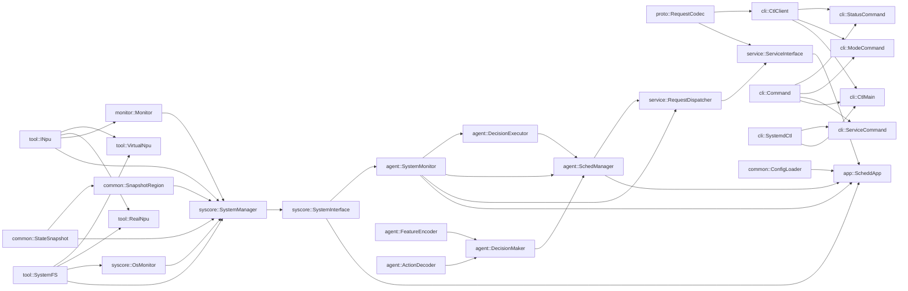

# 软件详细设计文档

## 1. 文档概述

### 1.1 编写目的

本文档基于《软件需求规格说明书》《软件体系结构设计文档》，对"面向 CPU+XPU 异构系统的智能调度算法及中间件原型"的设计元素进行精化和细化，把体系结构中的"黑盒子"子系统转变为"白盒子"的类与构件，达到程序员可直接据此编写 C++ 代码的程度。本文档同时纳入《用户界面设计文档》中 `schedctl` 客户端的设计结果。

### 1.2 读者对象

项目开发团队成员（上官源博、张豫君等）、指导教师、评审人员。

### 1.3 术语定义

| 术语 | 说明 |
|---|---|
| DQN | 深度 Q 网络，调度决策模型 |
| ONNX / ONNX Runtime | 模型交换格式 / 跨平台推理引擎 |
| UDS | Unix Domain Socket，本机进程间通信 |
| HAL | 硬件抽象层 |
| procfs / sysfs / devfreq | Linux 内核暴露状态与调频能力的文件接口 |
| 状态快照 | 监控线程写入、决策线程读取的共享内存结构 |
| 契约 | Python 训练侧与 C++ 运行侧之间的输入/输出维度与归一化约定 |

### 1.4 参考资料

- 《软件需求规格说明书.md》
- 《软件体系结构设计文档.md》
- 《用户界面设计文档.md》
- 项目申请书《面向大模型推理任务的边缘异构平台智能调度算法研究与实现》
- ONNX Runtime C++ API 文档；Linux kernel procfs / devfreq 文档

## 2. 系统概述

### 2.1 系统目标

构建可集成于 openEuler 的轻量化调度中间件守护进程 `schedd`，通过 DQN 推理为 LLM 推理任务动态分配 CPU/NPU 资源、批处理大小与频率档位，并由管理人员通过 `schedctl` 完成运维。

### 2.2 主要功能

请求推理调度、采集系统状态、调整处理器频率、查询系统状态、启停服务、切换调度模式（六项）。

### 2.3 目标用户

推理引擎（程序）、管理人员（运维）、操作系统（外部系统）。

### 2.4 运行环境

openEuler 24.03+（aarch64，RK3588）；开发期 WSL + openEuler（x86_64）仿真；C++17 + CMake；ONNX Runtime；systemd 托管。

## 3. 设计目标和原则

### 3.1 设计目标

- 每个需求用例都有明确的类协作实现方案，且可追踪到需求条目。
- 关键路径（请求 → 决策 → 执行）实现细化到方法级（签名、前/后置条件、算法）。
- 屏蔽平台差异：x86 仿真与 aarch64 实机共用同一套设计类，仅替换设备实现。
- 与既有代码资产对齐：`sched::SystemFS`、`sched::INpu`、`monitor::Monitor` 等已落地类作为设计基准。

### 3.2 设计原则

| 原则 | 落实方式 |
|---|---|
| 高内聚低耦合 | 每类单一职责；跨子系统只经接口类（`ServiceInterface`/`SystemInterface`）交互 |
| 信息隐藏 | 属性默认 private，仅接口方法 public；设备差异收敛在 `INpu` 之下 |
| 依赖倒置 | 上层依赖抽象 `INpu` 而非 `RealNpu`/`VirtualNpu` |
| 契约优先 | Python/C++ 之间的输入维度与归一化先冻结为 `model_contract.json` |
| 可测试性 | 监控与 HAL 可脱离守护进程被单元测试；设备经工厂注入 mock |

## 4. 用例设计

### 4.1 分析类到设计类的转化

分析类按体系结构设计元素落位，转化方式遵循 sdd 的三种方式：

| 分析类 | 类型 | 设计类 | 转化方式 |
|---|---|---|---|
| `serviceInterface` | boundary | `service::ServiceInterface` | 方式一（职责单方法实现） |
| `askInterface` | boundary | `service::ServiceInterface` + `service::RequestDispatcher` | 方式三（协作完成：监听与路由分离） |
| `schedManager` | control | `agent::SchedManager` | 方式一 |
| `decisionMaker` | control | `agent::DecisionMaker` + `FeatureEncoder` + `ActionDecoder` | 方式三（编码/推理/解码协作） |
| `decisionExecutor` | control | `agent::DecisionExecutor` | 方式一 |
| `systemMonitor` | control | `agent::SystemMonitor` | 方式一（对 System 的门面） |
| `OSMonitor` | boundary | `syscore::OsMonitor` + `monitor::Monitor` + `sched::SystemFS` | 方式三（读取/计算/文件访问协作） |
| `ScheduleInterface` | entity | `syscore::SystemInterface` | 方式一 |
| `SetInterface` | entity | `syscore::SystemManager::applyAction` | 方式二（一组方法实现） |
| `FreqSetter` | boundary | `syscore::SystemManager` + `sched::INpu::SetFrequency` | 方式二 |

体系结构与实现层补充出下列设计元素（无对应分析类，属实现层细化，共 31 项；与上表存在交叉，非分区）：

| 来源 | 设计元素 | 细化理由 |
|---|---|---|
| HAL 抽象 | `sched::INpu`、`sched::VirtualNpu`、`sched::RealNpu`、`sched::NpuState`、`sched::NpuGovernor` | 屏蔽真实/虚拟设备差异，工厂切换 |
| 基础设施 | `sched::SystemFS` | 跨平台文件读写，收敛 `procfs`/`sysfs`/`devfreq` 差异 |
| 监控计算 | `monitor::Monitor` | CPU 利用率换算、NPU 三核取最大（纯计算，无 I/O） |
| 数据契约 | `common::SchedMode`、`common::MessageType`、`common::TaskFeature`、`common::SystemFeature`、`common::DeviceAction`、`common::Decision`、`common::ResultInfo`、`common::ActionInfo` | 跨子系统值传递契约 |
| 并发原语 | `common::StateSnapshot`、`common::StateSnapshotValue`、`snapshotBeginWrite/EndWrite/TryRead/Store` | seqlock 无锁快照 |
| 快照宿主 | `common::SnapshotRegion` | 承载快照内存（Linux `shm_open`+`mmap`，Windows 退化为进程内对象） |
| 配置 | `common::ConfigLoader` | `schedd.conf` 解析 |
| 编码/解码 | `agent::FeatureEncoder`、`agent::ActionDecoder` | 特征归一化与动作映射，对应契约文件 |
| 报文分帧 | `proto::RequestCodec` | 长度前缀分帧，独立协议构件；`ServiceInterface` 与 `CtlClient` 共用同一份格式 |
| 进程编排 | `app::ScheddApp` | 装配子系统、启动监控/服务线程 |
| CLI | `cli::Command`、`cli::StatusCommand`、`cli::ModeCommand`、`cli::ServiceCommand`、`cli::CtlClient`、`cli::SystemdCtl`、`cli::OutputFormatter`、`cli::CtlMain` | 界面类在设计阶段细化为可编码的命令对象（见《用户界面设计文档》9.1） |

映射说明：分析类 `askInterface` 与 `serviceInterface` 均落位到 `service` 子系统；`OSMonitor` 的"读取/计算/文件访问"三项职责分别由 `syscore::OsMonitor`（唯一 I/O 层）、`monitor::Monitor`（纯计算）、`sched::SystemFS` 承担（方式三）。帧格式契约独立为 `proto` 构件，供服务端与客户端共用。

### 4.2 UC1 请求推理调度（askSched）

**实现方案**：推理引擎经 UDS 提交任务特征，Service 子系统解析后交给 Agent 的 `SchedManager`；`SchedManager` 依次索取系统状态（UC2）、执行 DQN 推理、下发动作（UC3），最终回传 `ActionInfo`。

| 步 | 设计类协作 | 说明 |
|---|---|---|
| 1 | `ServiceInterface::onRequest` | `epoll` 收到可读事件，读入完整报文 |
| 2 | `RequestCodec::decode` | 反序列化为 `TaskFeature` |
| 3 | `RequestDispatcher::route` | 按报文类型路由到 `SchedManager::handleTask` |
| 4 | `SchedManager::handleTask` | 调 `SystemMonitor::getFeature()`（展开为 UC2） |
| 5 | `DecisionMaker::infer` | `FeatureEncoder` 编码 → ONNX `Run` → `ActionDecoder` 解码 |
| 6 | `DecisionExecutor::exec` | 经 `SystemMonitor::applyAction()` 下发（展开为 UC3） |
| 7 | `RequestCodec::encode` | `ActionInfo` 序列化后经 UDS 回写 |

后置条件：推理引擎收到与请求一一对应的 `ActionInfo`；Agent 内部状态（模式）不变。

用例设计顺序图：


### 4.3 UC2 采集系统状态（SystemFeature）

**实现方案**：`SchedManager` 通过门面 `SystemMonitor` 获取状态；`SystemMonitor` 经 `SystemInterface` 委派给 `SystemManager`；`SystemManager` 调 `OsMonitor`/`monitor::Monitor`/`sched::INpu` 读取原始参数并换算为状态量。

| 步 | 设计类协作 | 说明 |
|---|---|---|
| 1 | `SchedManager` → `SystemMonitor::getFeature()` | 请求系统特征 |
| 2 | `SystemMonitor` → `SystemInterface::getInfo()` | 门面转发（子系统间唯一通道） |
| 3 | `SystemInterface` → `SystemManager::collect()` | 子系统内编排 |
| 4 | `SystemManager` → `OsMonitor::readCpuStat()` + `monitor::Monitor::cpuUsage()` | 读一次 `/proc/stat` 累计值；与上一次基线求差得利用率（`OsMonitor` 只做原始读取，求差在 `Monitor`） |
| 5 | `SystemManager` → `sched::INpu::GetLoad()` | 取 NPU 三核负载/频率/governor |
| 6 | `SystemManager` → `StateSnapshot` 写入共享内存 | 供决策线程零拷贝读取 |
| 7 | 逐级返回 `SystemFeature` | 上游使用 |

异常流：设备文件不可读 → 返回上一快照并标记 `stale=true`，不阻塞调度。

用例设计顺序图：


### 4.4 UC3 调整处理器频率（changeFreq）

**实现方案**：`DecisionExecutor` 将 `Decision` 拆为 CPU 与 NPU 两组动作，经 `SystemMonitor` → `SystemInterface` → `SystemManager`，最终由 `sched::INpu::SetFrequency` / CPU devfreq 写入落地。

| 步 | 设计类协作 | 说明 |
|---|---|---|
| 1 | `DecisionExecutor::exec(dec)` | 拆解决策为 CPU/NPU 动作 |
| 2 | `SystemMonitor::applyAction(cpu_act)` | 门面转发 |
| 3 | `SystemInterface::applyAction` | 子系统入口 |
| 4 | `SystemManager::applyAction` | 校验频率落在可用档位（devfreq `available_frequencies`） |
| 5 | `sched::INpu::SetFrequency` / `SystemFS::write` | 写入 NPU / CPU 频率 |
| 6 | 回读校验 | 读取生效频率，组装 `ResultInfo` |
| 7 | 返回 `ActionInfo` | 含逐设备结果 |

异常流：频率越界 → 夹取到最近合法档位并置 `adjusted=true`；写入失败 → `ResultInfo.ok=false`，由 `SchedManager` 触发降级。

用例设计顺序图：


### 4.5 UC4 / UC5 / UC6 管理类用例

| 用例 | 实现方案 |
|---|---|
| UC4 查询系统状态 | `schedctl status` → `StatusCommand` → `CtlClient` 经 UDS 发 `GET_STATE` → `ServiceInterface` → `SystemMonitor::getFeature()` → 原路返回并格式化 |
| UC5 启停服务 | `schedctl service <动作>` → `ServiceCommand` → `SystemdCtl` 调 `systemctl <动作> schedd`；守护进程生命周期由 systemd 管理，不进入 `schedd` 内部 |
| UC6 切换调度模式 | `schedctl mode <模式>` → `ModeCommand` → `CtlClient` 发 `SET_MODE` → `ServiceInterface` → `SchedManager::setMode()`；模式非法或降级不可用时返回错误 |

说明：UC4~UC6 的界面侧设计见《用户界面设计文档》，此处只给出与设计类的对接点。

### 4.6 设计类图（用例设计视图）

用例设计产生的设计类及其协作关系如下（整体类图见第 6 章）：


## 5. 子系统 / 构件设计

> 经与用户确认，本阶段**执行**。本项目预计规模中等（约 20~30 个类、3 个构件），子系统边界需要明确以支撑并行开发与独立测试。

### 5.1 子系统划分与职责

| 子系统 | 对应层次 | 职责 | 对外接口 |
|---|---|---|---|
| Service | 服务接口层 | 与推理引擎及 `schedctl` 双向交互 | `ServiceInterface`（UDS 协议） |
| Agent | 调度决策层 | 推理调度过程控制、模式管理 | `SchedManager`（进程内调用） |
| System | 状态监管层 + 硬件服务层 | 系统状态采集与设备参数访问 | `SystemInterface`（进程内调用） |
| CLI（独立构件） | — | 管理人员命令行客户端 | 复用 Service 的 UDS 协议 |

### 5.2 Service 子系统

**职责**：唯一对外通信入口，负责协议解析、请求路由、应答回写、连接生命周期。

**内部类**

| 类 | 职责 |
|---|---|
| `service::ServiceInterface` | 创建/绑定/监听 UDS，`epoll` 事件循环，accept/读写 |
| `service::RequestDispatcher` | 按报文类型路由到处理器（调度/查询/模式） |

**协作构件**：报文编解码原为 `service::RequestCodec`，为避免服务端与客户端各写一份帧格式，已**下沉为独立构件 `proto::RequestCodec`**（见 §5.5 与 §6.3.6）。`ServiceInterface` 与 `cli::CtlClient` 链接同一份实现。

**对外接口**：UDS 套接字路径 `/run/schedd.sock`；报文类型 `ASK_SCHED` / `GET_STATE` / `SET_MODE`。

**交互**：`RequestDispatcher` 将 `ASK_SCHED` 交给 `agent::SchedManager`，`GET_STATE` 交给 `agent::SystemMonitor`，`SET_MODE` 交给 `SchedManager::setMode`。

### 5.3 Agent 子系统

**职责**：实现调度决策流程与运行模式，是"调度大脑"，不含设备细节。

**内部类**

| 类 | 职责 |
|---|---|
| `agent::SchedManager` | 流程总控；持有门面与推理器；管理模式状态机 |
| `agent::SystemMonitor` | 对 System 子系统的门面，Agent 内统一访问入口 |
| `agent::DecisionMaker` | ONNX Runtime 封装，加载模型并执行推理 |
| `agent::FeatureEncoder` | 任务特征 + 系统特征 → 模型输入向量（归一化） |
| `agent::ActionDecoder` | 模型 Q 值 → 离散动作 → `Decision` |
| `agent::DecisionExecutor` | 决策落地，拆解为设备动作并校验结果 |

**对外接口**：`SchedManager::handleTask`、`SchedManager::setMode`、`SystemMonitor::getFeature`。

### 5.4 System 子系统

**职责**：把设备参数转换为决策可用状态量，并把调整命令落地到设备。

**内部类**

| 类 | 职责 |
|---|---|
| `syscore::SystemInterface` | 子系统对外唯一入口（pimpl 持有 `SystemManager`） |
| `syscore::SystemManager` | 参数↔状态换算、档位校验、状态快照维护 |
| `syscore::OsMonitor` | 读取 procfs/sysfs 原始参数（**唯一原始读取层**，含 CPU 与 NPU 两条 devfreq 路径） |
| `monitor::Monitor` | CPU 利用率换算与 NPU 负载取最大（纯计算，无 I/O、无阻塞） |
| `sched::SystemFS` | 跨平台文件读写封装（既有代码资产） |
| `sched::INpu`（抽象） | NPU 能力抽象（既有代码资产） |
| `sched::RealNpu` / `sched::VirtualNpu` | 真实 / 虚拟 NPU 实现（既有代码资产） |
| `sched::NpuState` / `sched::NpuGovernor` | NPU 状态与调频策略值类型 |
| `common::StateSnapshot` / `common::StateSnapshotValue` | 共享内存状态快照结构 / 读取结果 |
| `common::SnapshotRegion` | 快照内存宿主（Linux 共享内存 / Windows 进程内退化） |
| `common::ConfigLoader` | `schedd.conf` 解析（由 `ScheddApp` 使用） |
| `common::*` 数据结构 | `TaskFeature` 等 8 个跨子系统值传递契约 |

**对外接口**：`getInfo()`、`applyAction()`、`snapshot()`。

**CPU 通道设计**：CPU 调频**不套用 `INpu` 抽象**。`INpu` 的 `GetLoad`（返回 `NpuState` 三核负载）、`SubmitTask`（推理引擎）、`SetGovernor` 对 CPU 是语义空壳，且 `RealNpu::kDevfreqPath` 硬编码 NPU 节点，`INpu::Create()` 只会返回 NPU 实现。CPU 侧实际只需"读档位 + 写 `set_freq`"，故直接由 `OsMonitor`（读）+ `SystemFS`（写）承担，`SystemManager` 仅持有路径字符串 `m_cpuFreqPath`。详见 §6.4.3。

> **命名空间说明**：System 子系统的命名空间由 `system` 调整为 **`syscore`**。
> 原因：`<stdlib.h>` 在全局命名空间声明了 `int system(const char*)`，而 `<string>`、`<memory>`
> 等标准库头会间接引入 `<cstdlib>`，`namespace system` 于是与函数 `system` 重名冲突、无法编译
> （glibc 与 MinGW 均如此，非平台差异）。本次调整仅改名：目录名仍为 `system/`，类名不变
> （`syscore::SystemInterface`、`syscore::SystemManager`、`syscore::OsMonitor`）。
> 其余子系统命名空间 `service::`、`agent::`、`common::`、`sched::`、`monitor::` 均无冲突。

### 5.5 构件与构建（CMake）

顶层 `CMakeLists.txt`：C++17（`CXX_EXTENSIONS OFF`），默认 `Debug`；选项 `SCHED_ENABLE_ONNX`（默认 ON）、`SCHED_BUILD_TESTS`（默认 ON）；全局告警接口库 `sched_warnings` 提供 `-Wall -Wextra -Wpedantic`；`find_package(Threads REQUIRED)`；可执行产物统一输出到 `build/bin`。

| 构件（target） | 类型 | 内容 | 依赖 |
|---|---|---|---|
| `sched_warnings` | INTERFACE 库 | 全局编译告警选项 | 无 |
| `sched_common` | 静态库 | `Types.cpp`、`StateSnapshot.cpp`、`SnapshotRegion.cpp`、`ConfigLoader.cpp` | `Threads::Threads`、`sched_warnings`、Linux 下 `rt` |
| `sched_proto` | 静态库 | `proto::RequestCodec` | `sched_common` |
| `sched_tool` | 静态库 | `SystemFS`、`INpu`、`RealNpu`、`VirtualNpu` | `sched_common` |
| `sched_monitor` | 静态库 | `monitor::Monitor` | `sched_tool` |
| `sched_system` | 静态库 | System 子系统（3 个类） | `sched_tool`、`sched_monitor`、**`sched_common`（显式）** |
| `sched_agent` | 静态库 | Agent 子系统（6 个类） | `sched_system`、（可选）`ONNXRuntime::onnxruntime` |
| `sched_service` | 静态库 | Service 子系统（2 个类） | `sched_agent`、**`sched_proto`** |
| `schedd` | 可执行 | `main.cpp`、`ScheddApp.cpp` | `sched_service` |
| `schedctl` | 可执行 | `main.cpp` + 8 个 CLI 类 | **`sched_common`、`sched_proto`** |
| `monitor_test` / `system_test` / `agent_test` / `service_test` | 可执行 | 各子系统单元/冒烟测试，经 `add_test` 注册到 CTest | 对应库 |

构建顺序（`add_subdirectory`）：`common → proto → tool → monitor → system → agent → service → app → cli`。`proto` 紧随 `common` 之后，因为 `service` 与 `cli` 均需在其之前定义。

依赖传递说明：`sched_common` 经 `sched_tool → sched_monitor/sched_system` 逐级 `PUBLIC` 传递。`system/CMakeLists.txt` 已**显式**书写 `sched_common`（`SystemManager` 直接使用 `SnapshotRegion`/`StateSnapshot`），不再依赖传递可见性。

ONNX Runtime 为**可选依赖**：`SCHED_ENABLE_ONNX=ON` 且 `find_package(ONNXRuntime)` 命中时定义 `SCHED_HAS_ONNX=1` 并链接真实推理路径；未命中时 `DecisionMaker` 退化为 stub（见 §6.3.5 的 pimpl 设计），保证无 ONNX 环境下全工程可编译、可跑通 UDS 链路。

**顺序约束**：`app` 与 `cli` 均在 `add_subdirectory` 末尾，因为 `schedd` 依赖 `sched_service`、`schedctl` 依赖 `sched_common` 与 `sched_proto`，二者必须在下游子目录之前完成定义。`set_target_properties(schedd schedctl ...)` 在顶层末尾统一设置输出目录，要求两个目标均已存在。

**协议唯一实现**：帧格式（8B 帧头：len(4B) + type(4B)）的编解码实现在 `sched_proto` 中**只存在一份**，`sched_service` 与 `schedctl` 共同链接。`proto` 构件仅依赖 `sched_common`，不牵连 `agent`/`system`/ONNX Runtime，因此命令行客户端不会因复用协议实现而被拖入推理依赖链。早期版本"一处契约、两处实现"的技术债已消除。

## 6. 类设计

### 6.1 设计类图


> 上图为**面向读者的概念类图**（按子系统分组、省略部分边）。**工程用图**——即"类到类的全部依赖边、拓扑层级与关键路径"——见 §6.6，该图由源码 `#include` 与成员声明反推得出，用于排定实现顺序。

### 6.2 设计元素清单与可见性

本节列出**全部**设计元素，共 40 个顶层命名元素（28 个类 + 9 个结构体 + 3 个枚举）另加 1 个嵌套结构体与 5 个自由函数，无遗漏。可见性遵循信息隐藏原则：属性一律 `private`，仅接口方法 `public`。

| # | 设计元素 | 模块 / 构件 | 类别 | 类可见性 | 说明 |
|---|---|---|---|---|---|
| 1 | `common::SchedMode` | common | enum class | public | 调度模式 auto/static/off |
| 2 | `common::MessageType` | common | enum class | public | UDS 报文类型 |
| 3 | `common::TaskFeature` | common | struct | public | 推理引擎提交的任务特征 |
| 4 | `common::SystemFeature` | common | struct | public | 决策输入的系统状态量 |
| 5 | `common::DeviceAction` | common | struct | public | 单设备目标动作 |
| 6 | `common::Decision` | common | struct | public | 决策结果（动作编号+Q值+动作组） |
| 7 | `common::ResultInfo` | common | struct | public | 逐设备动作落地结果 |
| 8 | `common::ActionInfo` | common | struct | public | 回传推理引擎的应答 |
| 9 | `common::StateSnapshot` | common | struct | public | 共享内存快照本体（seqlock 写侧） |
| 10 | `common::StateSnapshotValue` | common | struct | public | 快照读取结果（拷贝友好） |
| 11 | `common::SnapshotRegion` | common | class | public | 快照内存宿主（shm / 进程内），快照的唯一分配者 |
| 12 | `common::ConfigLoader` | common | class | public | `schedd.conf` 解析 |
| 13 | `sched::NpuGovernor` | tool | enum class | public | NPU 调频策略 |
| 14 | `sched::NpuState` | tool | struct | public | NPU 一次测量的完整状态 |
| 15 | `sched::SystemFS` | tool | class（纯静态） | public | 跨平台文件读写封装 |
| 16 | `sched::INpu` | tool | abstract class | public | NPU 能力抽象（HAL） |
| 17 | `sched::VirtualNpu` | tool | final class | public | 虚拟 NPU（x86 仿真） |
| 18 | `sched::RealNpu` | tool | final class | public | 真实 RK3588 NPU |
| 19 | `monitor::Monitor` | monitor | class | public | CPU 利用率换算 / NPU 负载取最大（纯计算） |
| 20 | `syscore::OsMonitor` | system | class | internal | procfs/sysfs 原始参数读取（唯一 I/O 层） |
| 21 | `syscore::SystemManager` | system | class | internal | 参数↔状态换算、档位校验、快照维护 |
| 22 | `syscore::SystemInterface` | system | class | public | System 子系统对外唯一入口 |
| 23 | `agent::SystemMonitor` | agent | class | public | 对 System 子系统的门面 |
| 24 | `agent::FeatureEncoder` | agent | class | internal | 特征归一化编码 |
| 25 | `agent::ActionDecoder` | agent | class | internal | Q 值 → 动作解码 |
| 26 | `agent::DecisionMaker` | agent | class | internal | ONNX Runtime 封装与推理 |
| 26a | `agent::DecisionMaker::OrtHandles` | agent | nested struct | private | ORT 句柄（pimpl，定义于 `.cpp`） |
| 27 | `agent::DecisionExecutor` | agent | class | internal | 决策拆解下发与结果汇总 |
| 28 | `agent::SchedManager` | agent | class | public | 流程总控 + 模式状态机 |
| 29 | `proto::RequestCodec` | **proto** | class | public | 报文编解码（分帧）；`schedd` 与 `schedctl` 共用同一份实现 |
| 30 | `service::RequestDispatcher` | service | class | internal | 按报文类型路由 |
| 31 | `service::ServiceInterface` | service | class | public | UDS 监听与 epoll 事件循环 |
| 32 | `app::ScheddApp` | app(schedd) | class（单例） | public | 守护进程主对象 |
| 33 | `cli::Command` | cli(schedctl) | abstract class | public | 命令抽象 |
| 34 | `cli::StatusCommand` | cli(schedctl) | final class | internal | `status` 子命令 |
| 35 | `cli::ModeCommand` | cli(schedctl) | final class | internal | `mode` 子命令 |
| 36 | `cli::ServiceCommand` | cli(schedctl) | final class | internal | `service` 子命令 |
| 37 | `cli::CtlClient` | cli(schedctl) | class | internal | UDS 客户端（复用 `proto::RequestCodec` 分帧） |
| 38 | `cli::SystemdCtl` | cli(schedctl) | class | internal | `systemctl` 封装 |
| 39 | `cli::OutputFormatter` | cli(schedctl) | class | internal | 表格 / JSON 输出 |
| 40 | `cli::CtlMain` | cli(schedctl) | class | internal | argv 解析与命令分发 |

自由函数（`common` 命名空间，`public`）：`toString(SchedMode)`、`snapshotBeginWrite(StateSnapshot&)`、`snapshotEndWrite(StateSnapshot&)`、`snapshotTryRead(const StateSnapshot&, StateSnapshotValue&)`、`snapshotStore(StateSnapshot&, const SystemFeature&, int)`。

可见性说明：`cli` 为独立可执行构件，其"internal"表示"仅 `schedctl` 进程内可见，不经头文件对外暴露给 `schedd`"。

### 6.3 设计元素详表

本节给出**全部 40 个设计元素**的属性与方法。格式约定：属性表列出「名称 / 类型 / 可见性 / 初值 / 说明」；方法表列出「方法 / 签名 / 作用范围 / 前置条件 / 后置条件 / 算法」。`—` 表示不适用或不约束。构造函数与析构函数在方法表中一并给出（标注为"创建/销毁方法"）。

#### 6.3.1 common 模块（公共契约层，共 12 个元素 + 5 个自由函数）

**`common::SchedMode`**（`enum class`，可见性 public）

| 枚举项 | 值 | 语义 | 使用方 |
|---|---|---|---|
| `Auto` | 0 | DQN 推理调度（正常态） | `SchedManager`、`OutputFormatter` |
| `Static` | 1 | 固定规则降级调度（模型不可用时保底） | `SchedManager` |
| `Off` | 2 | 不推理，仅返回状态摘要 | `SchedManager`、`ServiceInterface` |

约束：`handleTask` 仅在 `Auto` 下触发推理；`Static`/`Off` 为降级与维护态。枚举值参与共享内存 `StateSnapshot::mode`（以 `int` 存储），故**取值一经确定不得改动**。

**`common::MessageType`**（`enum class : int`，可见性 public）

| 枚举项 | 值 | 语义 | 载荷 | 应答 |
|---|---|---|---|---|
| `Unknown` | 0 | 非法/未识别 | — | 错误应答 |
| `AskSched` | 1 | 请求推理调度（UC1） | `TaskFeature` JSON | `ActionInfo` JSON |
| `GetState` | 2 | 查询系统状态（UC4） | 空 | `SystemFeature` JSON |
| `SetMode` | 3 | 切换调度模式（UC6） | `{"mode":"auto"}` | `{"ok":true}` |

约束：显式赋值为定值，保证与《用户界面设计文档》的协议表逐值对应；新增类型须同时更新 `RequestDispatcher::route` 与 `RequestCodec`。

**`common::TaskFeature`**（struct，可见性 public）

| 属性 | 类型 | 可见性 | 初值 | 说明 |
|---|---|---|---|---|
| `taskId` | `uint64_t` | public | `0` | 任务唯一标识，用于应答配对 |
| `batchSize` | `int` | public | `1` | 批大小 |
| `seqLen` | `int` | public | `0` | 序列长度 |
| `priority` | `int` | public | `0` | 优先级，数值越大越急 |
| `arrivalTsMs` | `double` | public | `0.0` | 到达时刻（毫秒，`steady_clock` 基准） |

无方法（纯数据契约，POD）。用途：UC1 入参，由 `RequestCodec::decode` 从 JSON 构造，经 `SchedManager::handleTask` → `FeatureEncoder::encode`。

**`common::SystemFeature`**（struct，可见性 public）

| 属性 | 类型 | 可见性 | 初值 | 说明 |
|---|---|---|---|---|
| `ucpu` | `float` | public | `0.0f` | CPU 利用率，量程 `[0,1]` |
| `unpu` | `std::array<float,3>` | public | `{}` | NPU 三核负载，各量程 `[0,1]` |
| `cpuFreqKHz` | `int` | public | `0` | CPU 当前频率（kHz） |
| `npuFreqKHz` | `int` | public | `0` | NPU 当前频率（kHz） |
| `stale` | `bool` | public | `false` | 采集失败标志；为 `true` 时下游沿用上一份快照 |

无方法。`stale=true` 的语义约束：此时**不调用** `snapshotStore`，让共享内存中的旧快照继续生效；上层取到的字段值仍为上一次的有效值（决策层不得因 `stale` 抛错，仅可降低置信度）。

**`common::DeviceAction`**（struct，可见性 public）

| 属性 | 类型 | 可见性 | 初值 | 说明 |
|---|---|---|---|---|
| `device` | `std::string` | public | `""` | 设备标识，取值 `"cpu"` / `"npu"` |
| `freqKHz` | `int` | public | `0` | 目标频率（kHz）；`0` 表示不改频 |
| `batchSize` | `int` | public | `0` | 目标批大小；`0` 表示不改 |

无方法。由 `ActionDecoder::decode` 依据 `model_contract.json` 的 `actions` 映射生成；`device` 的取值集合为 `SystemManager::applyAction` 的分派依据，**新增取值须同步修改该分派**。

**`common::Decision`**（struct，可见性 public）

| 属性 | 类型 | 可见性 | 初值 | 说明 |
|---|---|---|---|---|
| `actionIndex` | `int` | public | `-1` | 选中的动作编号（`argmax` 结果），`-1` 表示无效 |
| `qValue` | `double` | public | `0.0` | 选中动作的 Q 值（用于日志与置信度判断） |
| `actions` | `std::vector<DeviceAction>` | public | `{}` | 展开后的设备动作组（1~2 项） |

无方法。约束：`actions` 至少含一项，否则 `DecisionExecutor::exec` 直接返回 `ok=false`。

**`common::ResultInfo`**（struct，可见性 public）

| 属性 | 类型 | 可见性 | 初值 | 说明 |
|---|---|---|---|---|
| `device` | `std::string` | public | `""` | 回填被处理设备名，与 `DeviceAction::device` 一致 |
| `ok` | `bool` | public | `false` | 本次落地是否成功 |
| `adjusted` | `bool` | public | `false` | 频率越界被夹取到最近合法档位 |
| `appliedFreqKHz` | `int` | public | `0` | 回读确认的实际生效频率（kHz） |
| `message` | `std::string` | public | `""` | 失败原因或提示（供 CLI 展示） |

无方法。四态语义：`ok=true,adjusted=false`（精确命中）；`ok=true,adjusted=true`（夹取成功）；`ok=false`（写入失败）；`ok=false,message` 说明原因。**`ok` 必须被上层消费**，否则 DQN 会把失败动作当作已生效，在错误状态上继续学习。

**`common::ActionInfo`**（struct，可见性 public）

| 属性 | 类型 | 可见性 | 初值 | 说明 |
|---|---|---|---|---|
| `taskId` | `uint64_t` | public | `0` | 回填请求的 `TaskFeature::taskId`，用于配对 |
| `ok` | `bool` | public | `false` | 整条请求是否成功 |
| `actionIndex` | `int` | public | `-1` | 选中的动作编号（降级/失败时为 `-1`） |
| `results` | `std::vector<ResultInfo>` | public | `{}` | 逐设备结果，与 `Decision::actions` 一一对应 |
| `message` | `std::string` | public | `""` | 总体提示（如 "degraded: model unavailable"） |

无方法。后置约束：`results.size()` 等于实际下发的动作数；`taskId` 必须与请求一致，保证推理引擎可配对（UC1 后置条件）。

**`common::StateSnapshot`**（struct，可见性 public；共享内存布局，不可拷贝——含 `std::atomic`）

| 属性 | 类型 | 可见性 | 初值 | 说明 |
|---|---|---|---|---|
| `seq` | `std::atomic<uint64_t>` | public | `0` | 版本号：写前 +1（奇数=写入中），写后 +1（偶数=稳定） |
| `ucpu` | `float` | public | `0.0f` | CPU 利用率 |
| `unpu` | `float[3]` | public | `{0,0,0}` | NPU 三核负载 |
| `cpuFreqKHz` | `int` | public | `0` | CPU 当前频率 |
| `npuFreqKHz` | `int` | public | `0` | NPU 当前频率 |
| `mode` | `int` | public | `0` | `static_cast<int>(SchedMode)` |
| `tsNs` | `int64_t` | public | `0` | 采样时间戳（纳秒，`steady_clock` 基准） |

| 方法 | 签名 | 作用范围 | 前置 | 后置 | 算法 |
|---|---|---|---|---|---|
| 创建方法 | 隐式默认构造 | public | — | `seq=0`（偶），字段全 0 | 聚合初始化，不分配资源 |
| 拷贝 | `= delete`（隐式不可拷贝） | — | — | — | 含 `atomic` 成员，禁止拷贝 |
| 布局 | 无虚函数、无自定义析构 | — | — | — | 保持紧凑布局，供 `mmap` 共享 |

**`common::StateSnapshotValue`**（struct，可见性 public；拷贝友好）

| 属性 | 类型 | 可见性 | 初值 | 说明 |
|---|---|---|---|---|
| `ucpu` | `float` | public | `0.0f` | 同 `StateSnapshot::ucpu` |
| `unpu` | `float[3]` | public | `{0,0,0}` | 同 `StateSnapshot::unpu` |
| `cpuFreqKHz` | `int` | public | `0` | 同上 |
| `npuFreqKHz` | `int` | public | `0` | 同上 |
| `mode` | `int` | public | `0` | 同上 |
| `tsNs` | `int64_t` | public | `0` | 同上 |

无 `seq`（读取一致性由 `snapshotTryRead` 内部判定，不对外暴露）。无方法。用途：把"不可拷贝 + 可能撕裂"的共享内存数据，转换成可安全携带的值对象。

遗留缺口：**`StateSnapshotValue` → `SystemFeature` 的反向转换函数尚不存在**。写侧有 `snapshotStore` 这个便利封装，读侧拿到 `StateSnapshotValue` 后没有桥接回决策层所需的 `SystemFeature`。建议补 `common::toSystemFeature(const StateSnapshotValue&, SystemFeature&)`（与 `snapshotStore` 对称），否则快照读路径无法在 `agent` 层落地。

**`common::SnapshotRegion`**（class，可见性 public；快照内存宿主）

职责边界：**只管"内存从哪来"**，不参与 seqlock 协议（协议归 `StateSnapshot` 与 4 个自由函数）。它是全系统**唯一**的 `StateSnapshot` 分配者，回答"`SystemManager::m_snap` 这个指针到底由谁分配、指向哪"。

| 属性 | 类型 | 可见性 | 初值 | 说明 |
|---|---|---|---|---|
| `m_snap` | `StateSnapshot*` | private | `nullptr` | 映射后的快照地址（`get()` 的返回源） |
| `m_map` | `void*` | private | `nullptr` | `mmap` 基址（仅 Linux 共享路径使用） |
| `m_size` | `std::size_t` | private | `0` | 映射长度（`ftruncate` 用） |
| `m_fd` | `int` | private | `-1` | `shm_open` 返回的描述符（仅 Linux） |
| `m_shared` | `bool` | private | `false` | 当前是否真的落在共享内存上 |

| 方法 | 签名 | 作用范围 | 前置 | 后置 | 算法 |
|---|---|---|---|---|---|
| 创建方法 | `SnapshotRegion() = default` | public | — | 空对象，`get()` 返回 `nullptr` | 不分配任何资源 |
| 销毁方法 | `~SnapshotRegion()` | public | — | 等价于 `close()` | 定义在 `.cpp`（需完整类型做映射释放） |
| 拷贝 | `= delete` | — | — | — | 持有 fd / 映射，禁止拷贝 |
| `open` | `bool open(const std::string& name)` | public | 未处于已打开状态 | **两种情况下 `get()` 均非空**；返回 `true`=确实落在共享内存，`false`=已退化为进程内对象 | `name` 为空或平台无 POSIX 共享内存（MinGW）→ 进程内 `new StateSnapshot`。否则 `shm_open("/dev/shm/<name>", O_CREAT|O_RDWR)` → `ftruncate(sizeof(StateSnapshot))` → `mmap` → 把返回地址解释为 `StateSnapshot*`；任一步失败则**同样退化为进程内对象**（不让快照功能因环境缺失而整体失效） |
| `close` | `void close()` | public | — | 资源释放，可重复调用（幂等） | 共享路径：`munmap` → `::close(m_fd)`；进程内路径：`delete m_snap`。标记回空状态 |
| `get` | `StateSnapshot* get() const` | public | — | 返回快照地址（未打开时为 `nullptr`） | 内联返回 `m_snap` |
| `shared` | `bool shared() const` | public | — | — | 内联返回 `m_shared`，供日志区分"仿真未启用共享内存" |

设计说明：`open` 的返回值**不表示失败**。`true/false` 只用于诊断日志——两种情况下快照都可用，调用方不需要写失败分支。这样 Windows（x86 仿真）与 openEuler（生产）用的是同一份代码、同一个调用姿势。退化不影响 seqlock 正确性：`schedd` 是单进程多线程，进程内对象同样只有监控线程一个写者。

**`common::ConfigLoader`**（class，可见性 public）

| 属性 | 类型 | 可见性 | 初值 | 说明 |
|---|---|---|---|---|
| `m_items` | `std::map<std::string, std::map<std::string, std::string>>` | private | 空 | `节 → 键 → 值` 二级表 |

| 方法 | 签名 | 作用范围 | 前置 | 后置 | 算法 |
|---|---|---|---|---|---|
| 创建方法 | `ConfigLoader() = default` | public | — | 空表 | — |
| 销毁方法 | `~ConfigLoader() = default` | public | — | — | — |
| `load` | `bool load(const std::string& path)` | public | `path` 为文件路径 | 成功则 `m_items` 被填充，失败保持原内容不变 | 清表→逐行读取→跳过空行与 `#` 注释→`[section]` 更换当前节→`key=value` 去首尾空白后存入→文件不可读返回 `false` |
| `getString` | `std::string getString(const std::string& section, const std::string& key, const std::string& defaultValue) const` | public | — | 返回值或 `defaultValue` | 二级查表，未命中返回默认值 |
| `getInt` | `int getInt(const std::string& section, const std::string& key, int defaultValue) const` | public | — | 返回值（整数）或 `defaultValue` | 查表后 `strtol`/`std::stoi`；**空值或非法字面量一律退回默认值**（`schedd.conf` 的频率上限项允许留空表示"启动时从硬件读取"） |
| `has` | `bool has(const std::string& section, const std::string& key) const` | public | — | 存在性 | 二级查表 |
| `clear` | `void clear()` | public | — | 表清空 | `m_items.clear()` |

约束：`getString`/`getInt`/`has` 均为 `const`，可在只读上下文（如 `const ScheddApp&`）调用；`load` 失败**不抛异常**，由调用方使用默认值继续，满足"配置缺失不阻塞启动"的可靠性要求。

**自由函数（`common` 命名空间）**

| 函数 | 签名 | 前置 | 后置 | 算法 |
|---|---|---|---|---|
| `toString` | `const char* toString(SchedMode)` | — | 返回静态字符串，不返回 `nullptr` | `switch` 三分支返回 `"auto"`/`"static"`/`"off"`，兜底 `"unknown"` |
| `snapshotBeginWrite` | `void snapshotBeginWrite(StateSnapshot&)` | 由唯一写者（监控线程）调用 | `seq` 由偶变奇 | `seq.fetch_add(1, relaxed)` 后 `atomic_thread_fence(release)`——栅栏为 StoreStore 屏障，阻止 `seq` 自增与后续字段写入重排 |
| `snapshotEndWrite` | `void snapshotEndWrite(StateSnapshot&)` | 已调用 `BeginWrite` 且字段写毕 | `seq` 由奇变偶 | `seq.fetch_add(1, release)`：保证此前所有字段写入先于本次归偶可见 |
| `snapshotTryRead` | `bool snapshotTryRead(const StateSnapshot&, StateSnapshotValue&)` | `out` 可为任意值 | 成功时 `out` 被完整覆盖；失败时 `out` **保持调用方原值** | 最多 4 轮：① `s1=seq.load(acquire)`；② `s1` 为奇数则重试（写者尚未收尾，否则 `s1==s2` 同为奇数会误判成功）；③ 复制 6 个字段到临时对象；④ `atomic_thread_fence(acquire)` 划出"读数据/读 seq"硬边界；⑤ `s2=seq.load(relaxed)`；⑥ `s1==s2` 则 `out=tmp` 返回 `true`。重试耗尽返回 `false`，调用方沿用旧值 |
| `snapshotStore` | `void snapshotStore(StateSnapshot&, const SystemFeature&, int mode)` | 同上，单写者 | 快照与 `feature` 一致且 `seq` 归偶 | `BeginWrite` → 逐字段搬运（`unpu` 为 `std::array`→C 数组，需循环）→ `mode` 直存 → `tsNs = duration_cast<nanoseconds>(steady_clock::now().time_since_epoch()).count()` → `EndWrite`。**`SystemFeature` 不含时间戳，故时间戳必须在此生成**；使用 `steady_clock` 而非 `system_clock`，避免 NTP 校时跳变影响"新鲜度"判断 |

#### 6.3.2 tool 模块（基础设施 / HAL，共 6 个元素）

**`sched::NpuGovernor`**（`enum class`，可见性 public）

| 枚举项 | 语义 | 映射来源 |
|---|---|---|
| `Performance` | 性能优先（锁最高频） | sysfs `governor` 内容 `"performance"` |
| `Powersave` | 省电优先 | `"powersave"` |
| `Unknown` | 未识别/读取失败 | 其他任何取值 |

约束：**读用枚举、写用字符串**是刻意的不对称设计——决策层需要"判断"（枚举比较安全），而写入需原样透传给 sysfs（用枚举会引入 enum↔字符串映射表，内核版本一变就失配）。

**`sched::NpuState`**（struct，可见性 public）

| 属性 | 类型 | 可见性 | 初值 | 说明 |
|---|---|---|---|---|
| `load` | `std::array<double,3>` | public | `{0,0,0}` | 三核负载，各量程 `[0,1]` |
| `freqKHz` | `int` | public | `0` | 当前频率（kHz） |
| `governor` | `NpuGovernor` | public | `Unknown` | 当前调频策略 |
| `taskCount` | `int` | public | `0` | 已提交任务计数（虚拟设备用） |
| `valid` | `bool` | public | `false` | 读取失败时为 `false` |

无方法。约束：`GetLoad` 实现**必须在入口先置 `valid=false`**，防止调用方复用同一对象时残留上一轮的 `valid=true`。

**`sched::SystemFS`**（class，可见性 public；纯静态工具类，无实例状态）

| 方法 | 签名 | 作用范围 | 前置 | 后置 | 算法 |
|---|---|---|---|---|---|
| 创建/销毁 | 隐式默认（无成员） | — | — | — | 全静态，不实例化 |
| `read` | `static std::optional<std::string> read(const std::string& path)` | public | `path` 可读 | 成功返回内容，失败返回 `nullopt` | 内部先 `u8path(path)` 转宽字符路径（Windows 下 `fs::path::value_type` 为 `wchar_t`，避免 CRT 窄接口按进程 ACP 解释 UTF-8 导致中文路径打不开）→ `ifstream(path.c_str(), in\|binary)` → 逐行 `getline` 并剥除行尾 `\r`/`\n` → 去除末尾换行。**剥尾换行是必需的**：sysfs 值通常无换行，而字符串比较（如 `governor == "performance"`）无法容忍尾随 `\n` |
| `write` | `static bool write(const std::string& path, const std::string& value)` | public | `path` 可写 | 内容被覆盖，返回是否成功 | 同上转宽路径 → `ofstream(path, out\|trunc\|binary)` → 检查 `!fout` 立即返回 `false` → `write(data,size)` → `close()` → **`return static_cast<bool>(fout)`**：sysfs 写非法值的错误常在 flush/close 阶段才暴露，不可无条件返回 `true` |
| `exists` | `static bool exists(const std::string& path)` | public | — | 存在返回 `true` | 带 `std::error_code` 的重载调用 `fs::exists`（不抛异常，符合"异常安全"约定） |
| `tempDir` | `static std::string tempDir()` | public | — | 返回平台临时目录，**无末尾分隔符** | `fs::temp_directory_path(ec)`，失败返回 `"."`；再剥掉末尾的 `/` 或 `\`（Windows 的 `%TEMP%` 带尾反斜杠，否则会拼出 `...Temp//virtual_npu`） |

跨平台约定：`binary` 模式在 Windows 下阻止 CRLF 转换，在 Linux 下是空操作；`write(ptr,len)` 单次写入符合 sysfs"一次写一个值"的期望；**不可使用 `seekp`/`app` 模式**（sysfs 不支持定位，追加语义错误）。

**`sched::INpu`**（abstract class，可见性 public；HAL 抽象，见设计模式"适配器/工厂方法"）

| 方法 | 签名 | 作用范围 | 前置 | 后置 | 算法 |
|---|---|---|---|---|---|
| 销毁方法 | `virtual ~INpu() = default` | public | — | 子类正确析构 | 虚析构，允许经基类指针删除 |
| `GetLoad` | `virtual bool GetLoad(NpuState& out) = 0` | public | `out` 可写 | 成功返回 `true` 并填满 `out`，失败返回 `false` 且 `out.valid=false` | 由实现类定义（见 16/17） |
| `SubmitTask` | `virtual bool SubmitTask(const std::string& task) = 0` | public | `task` 为不透明载荷 | 提交成功返回 `true` | 参数用"不透明字节串"是刻意的抽象中立：HAL 对"RKLLM / 其他推理引擎"保持不感知，换后端时接口不变。载荷可大，故按 `const&` 传递 |
| `SetGovernor` | `virtual bool SetGovernor(const std::string& governor) = 0` | public | `governor` 为策略名 | 写入成功返回 `true` | 收字符串以原样透传 sysfs；非法值由内核返回 `-EINVAL`，可能到 close 才暴露 |
| `SetFrequency` | `virtual bool SetFrequency(int freqKHz) = 0` | public | `freqKHz > 0` | 目标频率写入成功返回 `true` | 单位为 **kHz**（RK3588 调频接口原生单位），参数名内嵌单位以防跨模块量纲错配 |
| `GetBasePath` | `virtual std::string GetBasePath() const = 0` | public | — | 返回设备根路径 | `const` 成员函数，便于诊断/日志在只读上下文调用 |
| `Create`（工厂） | `static std::unique_ptr<INpu> Create()` | public | — | 返回非空实现 | 读环境变量 `SCHED_NPU_MODE`；值为 `"real"` → `make_unique<RealNpu>()`，否则 `make_unique<VirtualNpu>()`。**返回 `unique_ptr`（转移独占所有权）** |

注：`override` 是编译期契约检查——签名差一个字符即报错；缺 `override` 会静默定义出新函数而纯虚函数仍未实现。

**`sched::VirtualNpu`**（final class，实现 `INpu`，可见性 public；x86 仿真用）

| 属性 | 类型 | 可见性 | 初值 | 说明 |
|---|---|---|---|---|
| `m_base` | `std::string` | private | 构造时赋值为 `tempDir() + "/virtual_npu"` | 假 sysfs 根目录 |

模拟的文件结构（一个文件一个值，与真实 sysfs 同构）：

| 文件 | 默认内容 | 对应真实路径 |
|---|---|---|
| `load` | `0 0 0` | `/sys/kernel/debug/rknpu/load` |
| `governor` | `powersave` | `<devfreq>/governor` |
| `cur_freq` | `1000000` | `<devfreq>/cur_freq` |
| `available_frequencies` | `1000000 800000 600000` | `<devfreq>/available_frequencies` |
| `task_count` | `0` | （虚拟设备专有，用于验证提交计数） |

| 方法 | 签名 | 作用范围 | 前置 | 后置 | 算法 |
|---|---|---|---|---|---|
| 创建方法 | `VirtualNpu()` | public | — | 目录存在且 5 个默认文件齐备 | `m_base = SystemFS::tempDir() + "/virtual_npu"`；`fs::create_directories(u8path(m_base), ec)`（对已存在目录返回 false 但不报错，故可无条件调用）；遍历默认值表，**仅当文件不存在时**用 `SystemFS::exists`/`write` 补齐（已存在则不覆盖，避免重启丢状态） |
| 销毁方法 | `~VirtualNpu() override` | public | — | — | 默认；**不删除模拟目录**，便于事后 `cat` 检查 |
| `GetLoad` | `bool GetLoad(NpuState& out) override` | public | `m_base/load` 存在 | 三核负载解析成功返回 `true` | 入口 `out.valid=false` → 读 `m_base/load`，缺失即 `return false`（主文件缺失=设备读失败，必须上报上层）→ `istringstream` 逐个解析三个 double，任一失败返回 `false` → `cur_freq`/`task_count` 用 `atoi`（辅助项失败退回默认值，不 overall 失败）→ `governor` 读回后映射枚举（`"performance"`/`"powersave"`，其余 `Unknown`）→ `out.valid=true`，返回 `true` |
| `SubmitTask` | `bool SubmitTask(const std::string& task) override` | public | `m_base/task_count` 可读写 | 计数 +1 并写回 | 读 `task_count`；**`if (!text) return false;`（缺此判空会解引用空 `optional`，属 UB）** → `atoi` 取旧值 +1 → `SystemFS::write(m_base + "/task_count", std::to_string(cnt))`。`task` 内容不参与模拟，仅计次，用 `(void)task;` 显式标注 |
| `SetGovernor` | `bool SetGovernor(const std::string& governor) override` | public | — | 写入 `<m_base>/governor` | 直接 `SystemFS::write(m_base + "/governor", governor)`，与真实设备"透传"语义一致 |
| `SetFrequency` | `bool SetFrequency(int freqKHz) override` | public | — | 写入 `<m_base>/cur_freq` | `if (freqKHz <= 0) return false;` → `write(m_base + "/cur_freq", std::to_string(freqKHz))` |
| `GetBasePath` | `std::string GetBasePath() const override` | public | — | 返回 `m_base` | 直接返回成员 |

实现陷阱（已在实现中修正，记录备查）：① 整数直接与 `""` 相加是**指针算术**而非字符串转换，会读出邻近 `.rodata` 字节（如把编译器模板类型名写成文件内容），必须用 `std::to_string`；② `governor` 文件名漏写尾字母会写出 `gover`，函数返回 `true` 却完全无效，且与 `RealNpu` 契约分裂。

**`sched::RealNpu`**（final class，实现 `INpu`，可见性 public；RK3588 上板用）

| 属性 | 类型 | 可见性 | 初值 | 说明 |
|---|---|---|---|---|
| `kDebugLoadPath` | `static constexpr const char*` | public | `"/sys/kernel/debug/rknpu/load"` | 三核负载来源 |
| `kDevfreqPath` | `static constexpr const char*` | public | `"/sys/class/devfreq/fdab0000.npu"` | devfreq 根路径（governor / cur_freq / available_frequencies） |

| 方法 | 签名 | 作用范围 | 前置 | 后置 | 算法 |
|---|---|---|---|---|---|
| 创建/销毁 | `RealNpu()` / `~RealNpu() override` | public | — | — | 无状态，默认实现 |
| `GetLoad` | `bool GetLoad(NpuState& out) override` | public | debugfs 已挂载 | 同 `INpu` 契约 | 读 `kDebugLoadPath`，按 `"Core0: 39%,"` 形式解析三核百分比并除以 100；读 `<kDevfreqPath>/cur_freq` 得频率；`governor` 映射枚举 |
| `SubmitTask` | `bool SubmitTask(const std::string& task) override` | public | — | RRFLLM 提交 | RKLLM runtime 预留接口（当前返回未实现，上板阶段接入） |
| `SetGovernor` | `bool SetGovernor(const std::string& governor) override` | public | — | 写入 `<kDevfreqPath>/governor` | `SystemFS::write` 透传 |
| `SetFrequency` | `bool SetFrequency(int freqKHz) override` | public | — | 频率生效 | **先读 `available_frequencies` 校验目标值在允许档位内**，并把 governor 切成 `userspace`（否则写 `set_freq` 不生效），再写 `<kDevfreqPath>/userspace/set_freq` |
| `GetBasePath` | `std::string GetBasePath() const override` | public | — | 返回 `kDevfreqPath` | 常用于诊断日志 |

**CPU 通道不套用本接口（已决）**：`INpu` 的五个方法中，`GetLoad`（返回 `NpuState` 三核负载）、`SubmitTask`（推理引擎）、`SetGovernor` 对 CPU 均为语义空壳，且 `kDevfreqPath`/`kDebugLoadPath` 硬编码 NPU 节点，`Create()` 只可能返回 NPU 实现。因此 **CPU 调频退出 `INpu` 抽象**，改由 `syscore::OsMonitor`（读档位）+ `sched::SystemFS`（写 `userspace/set_freq`）承担，`SystemManager` 仅持有路径字符串 `m_cpuFreqPath`。本接口因此保持 1:1 的唯一实现者语义（`VirtualNpu` / `RealNpu`），`INpu.h` 未作任何签名改动。决策记录见 §6.4.3-①。

#### 6.3.3 monitor 模块（监控计算，共 1 个元素）

**`monitor::Monitor`**（class，可见性 public；既有代码资产，本轮改造为**纯计算器**）

**定位**：不读文件、不 `sleep`、不持有采样状态。procfs/sysfs 的原始读取统一由 `syscore::OsMonitor` 负责；两次采样的上一次累计值（`prevTotal`/`prevIdle`）由调用方 `SystemManager` 保存。这样拆的三个理由：① `Monitor` 可无副作用地单测，不必造假的 `/proc`；② 消除旧版 `get_ucpu()` 内部 500 ms 阻塞采样与监控线程采样周期形成的**双重节流**；③ 解除 `Monitor` 对 `INpu` 的所有权依赖，`SystemManager` 中指向同一 NPU 的引用从三份降到一份。

| 属性 | 类型 | 可见性 | 初值 | 说明 |
|---|---|---|---|---|
| — | 无实例属性 | — | — | 无状态，值成员内嵌于 `SystemManager` |

| 方法 | 签名 | 作用范围 | 前置 | 后置 | 算法 |
|---|---|---|---|---|---|
| 创建方法 | `Monitor() = default` | public | — | 无资源 | 无状态 |
| 销毁方法 | `~Monitor() = default` | public | — | — | — |
| `cpuUsage` | `double cpuUsage(unsigned long long prevTotal, unsigned long long prevIdle, unsigned long long curTotal, unsigned long long curIdle) const` | public | 累计值单位为 jiffies；`idle` 应已含 `iowait` | 返回 `[0,1]`，**不抛异常** | `Δtotal = curTotal - prevTotal`；`Δidle = curIdle - prevIdle`；`Δtotal == 0` 或累计值倒退（CPU 热插拔）→ 返回 `0.0`；否则 `1.0 - Δidle/Δtotal`，结果夹取到 `[0,1]` |
| `npuUsage` | `double npuUsage(const sched::NpuState& state) const` | public | — | 返回三核负载最大值，`[0,1]`；`state.valid == false` 时返回 `0.0` | 取 `max(state.load[0..2])`。**取最大值而非平均值**：更能反映"NPU 是否忙"这一决策依据 |

**与既有实现的差异（本轮变更）**：原版为 `explicit Monitor(sched::INpu* npu)` 构造 + `get_ucpu()` / `get_unpu()` / `get_npu_state()` / `sample_interval_ms()` / `set_sample_interval_ms()` 五个方法，内部持有 `m_npu`、`m_intervalMs=500`、`m_prevTotal`、`m_prevIdle`。改造后：构造不再注入 NPU（`monitor` 模块对 `INpu` 的依赖仅为 `sched::NpuState` 这一值类型），阻塞采样与采样状态全部外移，`sample_interval_ms` 的配置由 `ConfigLoader` 直接传给 `ScheddApp` 的监控循环。

#### 6.3.4 syscore 模块（System 子系统，共 3 个元素）

**`syscore::OsMonitor`**（class，可见性 internal；唯一原始读取层）

无属性（无状态）。

| 方法 | 签名 | 作用范围 | 前置 | 后置 | 算法 |
|---|---|---|---|---|---|
| 创建/销毁 | `OsMonitor() = default` / `~OsMonitor() = default` | public | — | — | 无状态 |
| `readCpuStat` | `bool readCpuStat(unsigned long long& total, unsigned long long& idle)` | public | `/proc/stat` 存在 | 成功填值返回 `true` | 读 `/proc/stat` 首行 → 跳过 `"cpu"` 标签 → 累加 `user+nice+system+idle+iowait+irq+softirq+steal` 得 `total`，取第 4 项为 `idle` → 解析失败返回 `false`。**本方法只做一次快照，不做求差**（求差由 `monitor::Monitor` 或 `SystemManager` 承担） |
| `readAvailableFreqs` | `std::optional<std::vector<int>> readAvailableFreqs(const std::string& devfreqPath)` | public | `devfreqPath` 非空 | 成功返回档位数组 | 读 `<devfreqPath>/available_frequencies` → 按空白切分 → 逐项转 `int`（kHz）→ 任一项非法则整项丢弃 |
| `readCurrentFreq` | `std::optional<int> readCurrentFreq(const std::string& devfreqPath)` | public | `devfreqPath` 非空 | 成功返回当前频率（kHz） | 读 `<devfreqPath>/cur_freq` → 转 `int` |

`devfreqPath` 参数化是刻意设计：同一份代码既可用于 NPU（`fdab0000.npu`）也可用于 CPU（`policy0`/`cpufreq`），避免为 CPU 另建一个类或把路径写死。

**`syscore::SystemManager`**（class，可见性 internal；子系统内编排者）

| 属性 | 类型 | 可见性 | 初值 | 说明 |
|---|---|---|---|---|
| `m_npu` | `std::shared_ptr<sched::INpu>` | private | ctor 中 `INpu::Create()` | NPU 通道（**唯一**的 `INpu` 持有者） |
| `m_cpuFreqPath` | `std::string` | private | ctor 中赋值 | CPU 调频节点目录（RK3588 上为 cpufreq `policy0`）。**CPU 刻意不套用 `INpu`**，见 §5.4 与 §6.4.3 |
| `m_os` | `std::unique_ptr<OsMonitor>` | private | ctor 中 `make_unique` | 唯一的 procfs / sysfs 读取层（组合 1:1） |
| `m_monitor` | `monitor::Monitor` | private | 默认构造 | 纯计算、无状态，**值成员直接内嵌**（不再需要 `unique_ptr` 间接层） |
| `m_prevTotal` | `unsigned long long` | private | `0` | 上一次 `/proc/stat` 累计总 jiffies（原属 `Monitor`，本轮上移） |
| `m_prevIdle` | `unsigned long long` | private | `0` | 上一次累计空闲 jiffies |
| `m_hasPrevSample` | `bool` | private | `false` | 首次采样无差分，利用率记 0 |
| `m_region` | `common::SnapshotRegion` | private | 默认构造，ctor 中 `open("schedd_state")` | 快照内存宿主（组合 1:1）——**快照的唯一分配者** |
| `m_snap` | `common::StateSnapshot*` | private | ctor 中 `m_region.get()` | 等价于 `m_region.get()`；缓存一份避免重复取值，**不拥有** |
| `m_fs` | `sched::SystemFS` | private | 默认 | 栈上内嵌（无状态工具，组合 1:1） |
| `m_availCpuFreqs` | `std::vector<int>` | private | 空 | CPU 可用档位（ctor 中读取） |
| `m_availNpuFreqs` | `std::vector<int>` | private | 空 | NPU 可用档位（ctor 中读取） |

| 方法 | 签名 | 作用范围 | 前置 | 后置 | 算法 |
|---|---|---|---|---|---|
| 创建方法 | `SystemManager()` | public | — | 通道已建、档位已读、`m_snap` 非空（最坏退化为进程内对象） | ① `m_os = make_unique<OsMonitor>()`；② `m_npu = sched::INpu::Create()`；③ 读两条 devfreq 档位：`m_availNpuFreqs = m_os->readAvailableFreqs(m_npu->GetBasePath())`、`m_availCpuFreqs = m_os->readAvailableFreqs(m_cpuFreqPath)`，**读失败留空表**（`applyAction` 据此报 device unavailable）；④ `m_region.open("schedd_state")` → `m_snap = m_region.get()`。**`m_monitor` 无需在列表里构造**——它现在无参且无状态 |
| 销毁方法 | `~SystemManager()` | public | — | — | `= default`，**必须定义在 `.cpp`**：`unique_ptr<OsMonitor>` 的析构需要完整类型，而头文件中 `OsMonitor` 仅有前向声明 |
| `collect` | `bool collect(common::SystemFeature& out)` | public | 设备可读 | 成功返回 `true` 且已写共享内存快照；失败返回 `false` 且调用方置 `stale=true` | ① `m_os->readCpuStat(total, idle)`；首次采样（`!m_hasPrevSample`）只存基线，`ucpu` 记 0；此后 `ucpu = m_monitor.cpuUsage(m_prevTotal, m_prevIdle, total, idle)`，并更新基线；② `m_npu->GetLoad(state)` → `unpu[k] = …`、`npuFreqKHz = state.freqKHz`；③ `m_os->readCurrentFreq(m_cpuFreqPath)` 取 CPU 频率；④ `snapshotStore(*m_snap, feat, int(mode))` 写共享内存；⑤ **任何一步失败即返回 `false` 且不写快照**，让旧快照继续生效 |
| `applyAction` | `common::ResultInfo applyAction(const common::DeviceAction& action)` | public | 档位已加载 | 返回已填充的 `ResultInfo`（**不抛异常**） | 按 `action.device` 选择档位表 → `clampToNearest(freqs, action.freqKHz, adjusted)` → **分派**：`"npu"` 走 `m_npu->SetFrequency(f)`；`"cpu"` 走 `m_fs.write(m_cpuFreqPath + "/userspace/set_freq", std::to_string(f))`（写前需把 governor 置 `userspace`，否则写入不生效）→ **回读 `cur_freq` 校验**（读回值填入 `appliedFreqKHz`，回读不等于目标则 `ok=false`）→ 组装 `ResultInfo{device, ok, adjusted, appliedFreqKHz, message}` |
| `clampToNearest` | `int clampToNearest(const std::vector<int>& freqs, int want, bool& adjusted) const` | private | `freqs` 非空 | 返回 `freqs` 中与 `want` 距离最近的档位；不等时 `adjusted=true` | 遍历取 `|f-want|` 最小者；`freqs` 为空时返回 `want` 且 `adjusted=false`（无档位信息，不臆测）。`const` 成员函数，纯计算 |
| `snapshot` | `common::StateSnapshot* snapshot()` | public | — | 返回 `m_snap` | 内联返回；供 `SystemInterface::snapshot()` 转发 |
| `availableCpuFreqs` | `const std::vector<int>& availableCpuFreqs() const` | public | — | — | 返回 `const&`，便于诊断与单元测试断言夹取行为 |
| `availableNpuFreqs` | `const std::vector<int>& availableNpuFreqs() const` | public | — | — | 同上 |

**成员声明顺序约束**：`m_npu` 与 `m_cpuFreqPath` 必须**先于** `m_os`，因为构造函数体要用 `m_npu->GetBasePath()` 读档位。当前头文件已按 `m_npu → m_cpuFreqPath → m_os → m_monitor → …` 排列，初始化列表按声明顺序执行，无 `-Wreorder` 风险。（旧版"`m_monitor` 需 `m_npu.get()` 故必须移出初始化列表"的约束，已随 `Monitor` 改为无状态纯计算而**消失**。）

**快照宿主已闭合**：`m_region`（`common::SnapshotRegion`）是全项目**唯一**的 `StateSnapshot` 分配者，Linux 落 `/dev/shm/schedd_state`、Windows 仿真自动退化为进程内对象，两条路径下 `m_snap` 均非空。原先"`m_snap` 无分配者"的缺口（原 §6.4.3-3）已消除。

**`syscore::SystemInterface`**（class，可见性 public；子系统对外唯一入口，pimpl 手法）

| 属性 | 类型 | 可见性 | 初值 | 说明 |
|---|---|---|---|---|
| `m_manager` | `std::unique_ptr<SystemManager>` | private | 构造时创建 | pimpl：实现细节不外泄，头文件不暴露 `SystemManager` |

| 方法 | 签名 | 作用范围 | 前置 | 后置 | 算法 |
|---|---|---|---|---|---|
| 创建方法 | `SystemInterface()` | public | — | `m_manager` 就绪 | `m_manager = make_unique<SystemManager>()` |
| 销毁方法 | `~SystemInterface()` | public | — | — | 定义在 `.cpp`（`unique_ptr` 析构需完整类型） |
| 拷贝 | `= delete` | — | — | — | 不可拷贝（独占 pimpl 资源） |
| `getInfo` | `bool getInfo(common::SystemFeature& out)` | public | — | 透传采集结果 | 委派 `m_manager->collect(out)`，返回其返回值 |
| `applyAction` | `common::ResultInfo applyAction(const common::DeviceAction& action)` | public | — | 透传动作结果 | 委派 `m_manager->applyAction(action)` |
| `snapshot` | `common::StateSnapshot* snapshot()` | public | — | 返回共享内存指针 | 委派 `m_manager->snapshot()`；供 `ScheddApp` 的监控线程直接写快照 |

#### 6.3.5 agent 模块（Agent 子系统，共 6 个元素 + 1 个嵌套结构体）

**`agent::SystemMonitor`**（class，可见性 public；门面模式，Agent 内访问 System 的唯一入口）

| 属性 | 类型 | 可见性 | 初值 | 说明 |
|---|---|---|---|---|
| `m_sys` | `std::shared_ptr<syscore::SystemInterface>` | private | 构造注入 | 共享所有权（`ScheddApp` 与 `SchedManager` 均持有） |

| 方法 | 签名 | 作用范围 | 前置 | 后置 | 算法 |
|---|---|---|---|---|---|
| 创建方法 | `explicit SystemMonitor(std::shared_ptr<syscore::SystemInterface> sys)` | public | `sys` 非空 | `m_sys` 已注入 | 依赖注入 |
| 销毁方法 | `~SystemMonitor()` | public | — | — | 定义在 `.cpp`（`SystemInterface` 在此仅有前向声明，析构需完整类型） |
| `getFeature` | `bool getFeature(common::SystemFeature& out)` | public | `m_sys` 非空 | 透传采集结果与成功标志 | 委派 `m_sys->getInfo(out)` |
| `applyAction` | `common::ResultInfo applyAction(const common::DeviceAction& action)` | public | `m_sys` 非空 | 透传动作结果 | 委派 `m_sys->applyAction(action)` |

**设计说明**：本类当前是"零逻辑透传"。保留它的理由是**降低跨子系统耦合**（`SchedManager`/`RequestDispatcher` 只认识 `SystemMonitor`，不认识 `syscore` 命名空间）；代价是多一层跳转。若后续需要在此层加入缓存、降级或指标统计，落点已就位。

**`agent::FeatureEncoder`**（class，可见性 internal）

| 属性 | 类型 | 可见性 | 初值 | 说明 |
|---|---|---|---|---|
| `m_inputDim` | `int` | private | `0` | 输入向量维度（来自契约，默认 8） |

| 方法 | 签名 | 作用范围 | 前置 | 后置 | 算法 |
|---|---|---|---|---|---|
| 创建/销毁 | `FeatureEncoder() = default` / `~FeatureEncoder() = default` | public | — | — | — |
| `loadContract` | `bool loadContract(const std::string& path)` | public | `path` 可读 | 成功则 `m_inputDim` 被设定 | 解析 `model_contract.json` 的 `input_dim` 与 `state_bounds`；文件缺失或维度非法返回 `false`（上层据此进入降级模式） |
| `inputDim` | `int inputDim() const` | public | — | — | 返回 `m_inputDim`；供 `DecisionMaker::load` 校验模型输入维度 |
| `encode` | `std::vector<float> encode(const common::TaskFeature& task, const common::SystemFeature& sys) const` | public | `m_inputDim > 0` | 返回定长 `m_inputDim` 维向量，各分量已归一化到 `[0,1]` | 按 `state_bounds` 逐项线性归一化：`ucpu`、`unpu[0..2]`、`cpu_freq_ratio`、`npu_freq_ratio`、`batch_size_norm`、`seq_len_norm`；频率比值由 `cpuFreqKHz`/`npuFreqKHz` 除以档位极值得到。**归一化上/下界必须与 Python 训练侧逐项一致**（契约冻结项）。`const` 成员函数，纯计算，可重入 |

**`agent::ActionDecoder`**（class，可见性 internal）

| 属性 | 类型 | 可见性 | 初值 | 说明 |
|---|---|---|---|---|
| `m_actionCount` | `int` | private | `0` | 动作总数 A（来自契约，默认 5） |

| 方法 | 签名 | 作用范围 | 前置 | 后置 | 算法 |
|---|---|---|---|---|---|
| 创建/销毁 | `ActionDecoder() = default` / `~ActionDecoder() = default` | public | — | — | — |
| `loadContract` | `bool loadContract(const std::string& path)` | public | `path` 可读 | `m_actionCount` 被设定 | 解析 `output_dim` 与 `actions` 映射表；映射非法返回 `false` |
| `actionCount` | `int actionCount() const` | public | — | — | 返回 `m_actionCount` |
| `decode` | `common::Decision decode(const std::vector<float>& qValues) const` | public | `!qValues.empty()` | 返回已填 `actionIndex`/`qValue`/`actions` 的 `Decision` | `argmax(qValues)` 得 `actionIndex` 与 `qValue`；按契约 `actions[actionIndex]` 展开为 1~2 个 `DeviceAction`（含 `cpu_share`→CPU 档位、`batch_size`、`npu_freq_level`→NPU 频率）。Q 值向量长度与 `m_actionCount` 不符时返回 `actionIndex=-1` 的空决策。`const` 纯函数 |

**`agent::DecisionMaker`**（class，可见性 internal；ONNX Runtime 封装）

| 属性 | 类型 | 可见性 | 初值 | 说明 |
|---|---|---|---|---|
| `m_encoder` | `std::unique_ptr<FeatureEncoder>` | private | 构造时创建 | 组合 1:1 |
| `m_decoder` | `std::unique_ptr<ActionDecoder>` | private | 构造时创建 | 组合 1:1 |
| `m_ort` | `std::unique_ptr<OrtHandles>` | private | 构造时创建 | **pimpl**：不暴露 `onnxruntime` 头文件 |
| `m_timeout` | `std::chrono::microseconds` | private | `5000`（5 ms） | 推理超时 |
| `m_ready` | `bool` | private | `false` | 模型是否可用 |

**嵌套元素 `agent::DecisionMaker::OrtHandles`**（struct，可见性 private，定义在 `.cpp`）

| 属性 | 类型 | 说明 |
|---|---|---|
| `env` | `Ort::Env` | ONNX Runtime 环境（进程级单例，建议全局唯一） |
| `session` | `Ort::Session` | 已加载的模型会话 |
| `memInfo` | `Ort::MemoryInfo` | 输入/输出张量的内存信息 |

pimpl 的收益：`onnxruntime` 未安装时（`SCHED_ENABLE_ONNX=OFF` 或 `find_package` 未命中）`sched_agent` 仍可编译，`DecisionMaker` 退化为 stub，保证 x86 无依赖环境可跑通全链路。

| 方法 | 签名 | 作用范围 | 前置 | 后置 | 算法 |
|---|---|---|---|---|---|
| 创建方法 | `DecisionMaker()` | public | — | 编码器/解码器已就绪，`m_ready=false` | 创建 `m_encoder`/`m_decoder`；`m_ort` 视 ONNX 是否启用决定是否建会话 |
| 销毁方法 | `~DecisionMaker()` | public | — | 释放 ORT 会话 | 定义在 `.cpp`（`OrtHandles` 需完整类型） |
| 拷贝 | `= delete` | — | — | — | 独占 ORT 会话 |
| `load` | `bool load(const std::string& modelPath, const std::string& contractPath)` | public | 两路径可读 | 成功置 `m_ready=true` | ① 加载契约（并行调用 `m_encoder->loadContract` 与 `m_decoder->loadContract`）；② 创建 `Ort::Env` 与 `Ort::Session`；③ **按契约校验模型输入维度**（`session` 的实际输入维度须等于 `m_encoder->inputDim()`）与输出维度；④ 任一失败置 `m_ready=false` 并返回 `false`，由 `SchedManager` 进入 `static` 降级 |
| `infer` | `std::optional<common::Decision> infer(const common::TaskFeature& task, const common::SystemFeature& sys)` | public | `m_ready == true` | 成功返回 `Decision`；超时/异常返回 `nullopt` | ① `m_encoder->encode(task, sys)` 得输入向量；② 组装 `Ort::Value` 输入张量；③ `session.Run` 执行推理，受 `m_timeout` 约束；④ 取输出 Q 值向量；⑤ `m_decoder->decode(qValues)` 返回。**返回 `optional` 而非异常**：推理超时是运行期常态，不应打断守护进程 |
| `ready` | `bool ready() const` | public | — | — | 返回 `m_ready`；`SchedManager::setMode` 据此判断能否切回 `auto` |
| `setTimeout` | `void setTimeout(std::chrono::microseconds t)` | public | `t > 0` | `m_timeout` 更新 | 由 `ScheddApp::init` 用 `schedd.conf` 的 `infer_timeout_us` 注入 |
| `timeout` | `std::chrono::microseconds timeout() const` | public | — | — | 返回 `m_timeout` |

**`agent::DecisionExecutor`**（class，可见性 internal）

| 属性 | 类型 | 可见性 | 初值 | 说明 |
|---|---|---|---|---|
| `m_monitor` | `std::shared_ptr<SystemMonitor>` | private | 构造注入 | 聚合（与 `SchedManager` 共享） |

| 方法 | 签名 | 作用范围 | 前置 | 后置 | 算法 |
|---|---|---|---|---|---|
| 创建方法 | `explicit DecisionExecutor(std::shared_ptr<SystemMonitor> monitor)` | public | `monitor` 非空 | 已注入 | — |
| 销毁方法 | `~DecisionExecutor()` | public | — | — | 定义在 `.cpp` |
| `exec` | `common::ActionInfo exec(const common::TaskFeature& task, const common::Decision& decision)` | public | `decision.actions` 非空 | 返回逐设备结果已填的 `ActionInfo` | ① 填 `taskId = task.taskId`、`actionIndex = decision.actionIndex`；② 遍历 `decision.actions`，逐个 `m_monitor->applyAction(...)`；③ 收集 `ResultInfo` 到 `results`（顺序与 `actions` 一致）；④ **`ok` 取所有结果的逻辑与**——任一台设备失败即整条请求失败，使上层可触发降级 |

**`agent::SchedManager`**（class，可见性 public；流程总控 + 模式状态机）

| 属性 | 类型 | 可见性 | 初值 | 说明 |
|---|---|---|---|---|
| `m_monitor` | `std::shared_ptr<SystemMonitor>` | private | 构造装配 | 门面，不可空（组合 1:1） |
| `m_maker` | `std::shared_ptr<DecisionMaker>` | private | 构造装配 | 推理器（组合 1:1） |
| `m_executor` | `std::shared_ptr<DecisionExecutor>` | private | 构造装配 | 动作执行器（组合 1:1） |
| `m_mode` | `common::SchedMode` | private | `SchedMode::Auto` | 当前模式 |
| `m_modeMutex` | `std::shared_mutex` | private | — | 模式读写保护；`mutable` 以支持 `const` 的 `mode()` |

| 方法 | 签名 | 作用范围 | 前置 | 后置 | 算法 |
|---|---|---|---|---|---|
| 创建方法 | `SchedManager()` | public | — | 三个协作对象就绪 | 装配 `SystemMonitor`（需注入 `syscore::SystemInterface`）、`DecisionMaker`、`DecisionExecutor`（后者复用同一个 `SystemMonitor` 实例） |
| 销毁方法 | `~SchedManager()` | public | — | — | 定义在 `.cpp`（成员为前向声明的类，析构需完整类型） |
| 拷贝 | `= delete` | — | — | — | 含互斥量，不可拷贝 |
| `handleTask` | `common::ActionInfo handleTask(const common::TaskFeature& task)` | public | — | 返回与请求一一对应的 `ActionInfo`（UC1 后置条件） | ① `m_modeMutex` 加**读锁**取 `m_mode`；② `Off` → 直接返回状态摘要（不推理、不调频，`message` 说明原因）；③ `Static` → 走固定规则策略（不调 `DecisionMaker`）；④ `Auto` → `m_monitor->getFeature(feat)` → `m_maker->infer(task, feat)`；⑤ 推理返回 `nullopt`（超时/模型缺失）→ **连续超时达阈值则降级为 `Static`** 并返回带 `message` 的失败应答；⑥ `m_executor->exec(task, dec)` → 返回 `ActionInfo`。读锁不覆盖推理过程，避免长事务阻塞 `setMode` |
| `setMode` | `bool setMode(common::SchedMode mode)` | public | `mode` 取值合法 | 成功则 `m_mode` 更新并返回 `true` | 加**写锁**；`-> Auto` 需 `m_maker->ready()` 为真，否则拒绝并返回 `false`（避免切到不可用模式）；`-> Off` 由 CLI 侧做二次确认后调用；更新 `m_mode` |
| `mode` | `common::SchedMode mode() const` | public | — | — | `m_modeMutex` 加读锁返回 `m_mode`；`const` 成员函数（依赖 `mutable` 互斥量） |

#### 6.3.6 proto 模块（协议层，共 1 个元素）

**定位**：帧格式是 `schedd`（服务端）与 `schedctl`（客户端）之间的**共同契约**，两侧必须链接同一份实现——各写一份，格式一改就会静默失配（编译不报错，运行表现为 JSON 解析失败或第二条请求起全部错位）。故独立为 `sched_proto` 薄构件，仅依赖 `sched_common`，不牵连 `agent`/`system`/ONNX Runtime，使命令行客户端可以安全复用它。

**分帧问题的本质**：UDS 用 `SOCK_STREAM`，内核只搬字节、不保留写入边界。三条消息可能被对端一次读成 1.5 条（半包）或 2 条（粘包），因此接收方必须自行在字节流上重新标出消息边界——即"分帧"。本项目采用**长度前缀**方案。

**`proto::RequestCodec`**（class，可见性 public；报文编解码，无状态）

| 属性 | 类型 | 可见性 | 初值 | 说明 |
|---|---|---|---|---|
| `kHeaderSize` | `static constexpr int` | public | `8` | 帧头长度：长度前缀 4B + 类型头 4B |
| — | 无实例属性 | — | — | 无状态，可共享使用 |

| 方法 | 签名 | 作用范围 | 前置 | 后置 | 算法 |
|---|---|---|---|---|---|
| 创建/销毁 | `RequestCodec() = default` / `~RequestCodec() = default` | public | — | — | — |
| `decode` | `bool decode(const std::string& frame, common::MessageType& type, std::string& payload)` | public | `frame.size() >= kHeaderSize` | 成功填 `type`/`payload` 返回 `true`；失败不动出参 | 读前 4B 长度前缀（网络序 → 主机序）→ 校验与 `frame.size()` 一致性（**不足或超长均判失败**，防止粘包/截断被误当合法帧）→ 读次 4B 类型头并转 `MessageType` → 剩余为 JSON 载荷 |
| `encode` | `std::string encode(common::MessageType type, const std::string& payload)` | public | — | 返回成帧字节串 | 拼 `len(4, 网络序) + type(4, 网络序) + payload`；`len` 为整个帧的长度（含帧头），使接收方可先读 8B 再读剩余 |
| `encodeActionInfo` | `std::string encodeActionInfo(const common::ActionInfo& info)` | public | — | 返回载荷 JSON（不含帧头） | `ActionInfo → JSON`：`taskId`/`ok`/`actionIndex`/`message` 直搬，`results` 为对象数组 |
| `encodeSystemFeature` | `std::string encodeSystemFeature(const common::SystemFeature& feature)` | public | — | 返回载荷 JSON | `SystemFeature → JSON`：`unpu` 数组化，`stale` 一并输出供 CLI 高亮 |

实现须知（两侧共用，故只需实现一次）：接收侧必须写一个 `readFully(fd, buf, n)` 循环——`read` 可能返回 `0`（对端关闭）、`-1`（`EINTR` 需重试）或任意小于 `n` 的字节数；只调一次 `read` 是**最常见的错误**。

#### 6.3.7 service 模块（Service 子系统，共 2 个元素）

**`service::RequestDispatcher`**（class，可见性 internal；路由）

| 属性 | 类型 | 可见性 | 初值 | 说明 |
|---|---|---|---|---|
| `m_manager` | `std::shared_ptr<agent::SchedManager>` | private | 构造注入 | 聚合（与 `ServiceInterface` 共享） |
| `m_monitor` | `std::shared_ptr<agent::SystemMonitor>` | private | 构造注入 | 聚合 |

| 方法 | 签名 | 作用范围 | 前置 | 后置 | 算法 |
|---|---|---|---|---|---|
| 创建方法 | `RequestDispatcher(std::shared_ptr<agent::SchedManager>, std::shared_ptr<agent::SystemMonitor>)` | public | 两者非空 | 已注入 | — |
| 销毁方法 | `~RequestDispatcher()` | public | — | — | 定义在 `.cpp` |
| `route` | `bool route(common::MessageType type, const std::string& payload, std::string& reply)` | public | — | `reply` 为应答载荷；未知类型返回 `false` | `switch(type)`：`AskSched` → `handleAskSched`；`GetState` → `handleGetState`；`SetMode` → `handleSetMode`；`Unknown`/默认 → 返回 `false`（由调用方回错误帧）。**这是全系统唯一按报文类型分派的位置**，新增类型须在此扩展 |
| `handleAskSched` | `bool handleAskSched(const std::string& payload, std::string& reply)` | private | `payload` 为 `TaskFeature` JSON | `reply` 为 `ActionInfo` JSON | 反序列化 `TaskFeature` → `m_manager->handleTask(task)` → `encodeActionInfo` |
| `handleGetState` | `bool handleGetState(const std::string& payload, std::string& reply)` | private | — | `reply` 为 `SystemFeature` JSON | `m_monitor->getFeature(feat)`（`payload` 不用）→ `encodeSystemFeature`；采集失败时以 `stale=true` 的 JSON 正常应答（查询类请求不因采集失败而报错） |
| `handleSetMode` | `bool handleSetMode(const std::string& payload, std::string& reply)` | private | `payload` 含 `mode` 字段 | `reply` 含切换结果 | 解析模式名（`"auto"`/`"static"`/`"off"`）→ 非法值直接返回 `false` → `m_manager->setMode(m)` → 成功回 `{"ok":true}`，失败回 `{"ok":false,"message":"..."}` 并返回 `false` |

**`service::ServiceInterface`**（class，可见性 public；UDS 监听与事件循环）

| 属性 | 类型 | 可见性 | 初值 | 说明 |
|---|---|---|---|---|
| `m_manager` | `std::shared_ptr<agent::SchedManager>` | private | 构造注入 | 聚合，转发给 `RequestDispatcher` |
| `m_monitor` | `std::shared_ptr<agent::SystemMonitor>` | private | 构造注入 | 聚合，转发给 `RequestDispatcher` |
| `m_dispatcher` | `std::unique_ptr<RequestDispatcher>` | private | 待装配 | 组合 1:1 |
| `m_codec` | `std::unique_ptr<proto::RequestCodec>` | private | 待装配 | 组合 1:1（跨构件类型：来自 `sched_proto`） |
| `m_listenFd` | `int` | private | `-1` | UDS 监听描述符 |
| `m_epollFd` | `int` | private | `-1` | epoll 实例 |
| `m_running` | `bool` | private | `false` | 事件循环运行标志 |

| 方法 | 签名 | 作用范围 | 前置 | 后置 | 算法 |
|---|---|---|---|---|---|
| 创建方法 | `ServiceInterface(std::shared_ptr<agent::SchedManager>, std::shared_ptr<agent::SystemMonitor>)` | public | 两者非空 | `m_dispatcher`/`m_codec` 已创建 | 装配 `m_dispatcher = make_unique<RequestDispatcher>(m_manager, m_monitor)` 与 `m_codec` |
| 销毁方法 | `~ServiceInterface()` | public | — | 关闭 `m_listenFd`/`m_epollFd` | 定义在 `.cpp`；关闭 fd 防泄漏 |
| 拷贝 | `= delete` | — | — | — | 持有 fd |
| `run` | `bool run(const std::string& socketPath)` | public | 路径所在目录可写 | 阻塞直到 `stop()`；返回是否正常退出 | ① `setupListener(socketPath)`；② `epoll_create1` 并把监听 fd 注册为 `EPOLLIN`；③ `m_running = true`；④ 循环 `epoll_wait` → 监听 fd 可读则 `accept` 并把新连接注册进 epoll；客户端 fd 可读则 `handleReadable(fd)`；⑤ `stop()` 置 `m_running=false` 后退出循环 |
| `stop` | `void stop()` | public | — | 事件循环在下一轮退出 | `m_running = false` 并写 `eventfd` 唤醒阻塞中的 `epoll_wait`（否则最长要等一个超时周期才退出）。**须信号安全**：仅做无锁标志写与一次系统调用，供 `SIGTERM`/`SIGINT` 处理器调用 |
| `setupListener` | `bool setupListener(const std::string& socketPath)` | private | 端口未被占用 | 成功返回 `true` 且 `m_listenFd` 有效 | `socket(AF_UNIX, SOCK_STREAM, 0)` → **若路径已存在先 `unlink`**（上次异常退出残留的 socket 文件会导致 `bind` 报 `EADDRINUSE`）→ `bind` → `listen` → 设 `SOCK_CLOEXEC` |
| `handleReadable` | `void handleReadable(int clientFd)` | private | `clientFd` 可读 | 应答已回写，连接按需关闭 | 先读满 8B 帧头 → 按长度前缀读满剩余载荷（**处理部分读/粘包**）→ `m_codec->decode` → `m_dispatcher->route` → `m_codec->encode` → 写回；对端关闭或解码失败则关连接并从 epoll 注销 |

#### 6.3.8 app 模块（守护进程，共 1 个元素）

**`app::ScheddApp`**（class，可见性 public；单例模式）

| 属性 | 类型 | 可见性 | 初值 | 说明 |
|---|---|---|---|---|
| `m_config` | `std::unique_ptr<common::ConfigLoader>` | private | 构造时创建 | 组合 1:1 |
| `m_system` | `std::shared_ptr<syscore::SystemInterface>` | private | `init` 时装配 | 组合但以 `shared_ptr` 交出共享权 |
| `m_monitor` | `std::shared_ptr<agent::SystemMonitor>` | private | `init` 时装配 | 与 `SchedManager`、`ServiceInterface` 共享 |
| `m_manager` | `std::shared_ptr<agent::SchedManager>` | private | `init` 时装配 | 与 `ServiceInterface` 共享 |
| `m_service` | `std::shared_ptr<service::ServiceInterface>` | private | `init` 时装配 | 组合 1:1 |

| 方法 | 签名 | 作用范围 | 前置 | 后置 | 算法 |
|---|---|---|---|---|---|
| `instance` | `static ScheddApp& instance()` | public | — | 返回进程内唯一实例 | 函数内 `static` 局部对象（C++11 起线程安全初始化），避免全局构造顺序问题 |
| 创建方法 | `ScheddApp()` | private | — | `m_config` 就绪 | **私有**：单例只允许经 `instance()` 创建；子对象延迟到 `init()` 装配 |
| 销毁方法 | `~ScheddApp()` | private | — | — | 定义在 `.cpp`（成员为前向声明类） |
| 拷贝 | `= delete` | — | — | — | 单例不可拷贝 |
| `run` | `int run(int argc, char** argv)` | public | — | 返回进程退出码（0 正常） | ① 解析 `--config`（默认 `/etc/schedd/schedd.conf`）；② `init(configPath)`，失败返回非 0；③ `std::thread` 启动监控线程 `runMonitorLoop`；④ 主线程调 `m_service->run(socket_path)` 阻塞；⑤ 收到终止信号后 `join` 监控线程并优雅退出 |
| `init` | `bool init(const std::string& configPath)` | private | — | 全部子系统就绪 | ① `m_config->load(configPath)`（失败仅告警，用默认值继续）；② 建 `SystemInterface`（内部创建 `SystemManager`）；③ 建 `SystemMonitor`（注入 ②）；④ 建 `SchedManager`；⑤ 从配置取 `model_path`/`contract_path`/`infer_timeout_us`/`sample_interval_ms` 并注入 ④；⑥ 建 `ServiceInterface`（注入 ③④）。装配顺序自下而上，保证依赖先于使用者存在 |
| `runMonitorLoop` | `void runMonitorLoop()` | private | `m_system` 就绪 | 按周期采集并写共享内存，直到进程退出 | 循环：`m_system->getInfo(feat)` 采样 → 成功则 `collect` 内部已写快照，失败则跳过（旧快照继续生效）→ `sleep(sample_interval_ms)`。**本线程是共享内存快照的唯一写者**，这是 seqlock 只支持单写者的前提 |

#### 6.3.9 cli 模块（命令行客户端 `schedctl`，共 8 个元素）

**`cli::Command`**（abstract class，可见性 public；命令模式）

| 方法 | 签名 | 作用范围 | 前置 | 后置 | 算法 |
|---|---|---|---|---|---|
| 销毁方法 | `virtual ~Command() = default` | public | — | 子类正确析构 | 虚析构，支持 `unique_ptr<Command>` 多态销毁 |
| `name` | `virtual std::string name() const = 0` | public | — | 返回子命令名（如 `"status"`） | 供 `CtlMain` 注册为分发表键 |
| `usage` | `virtual std::string usage() const = 0` | public | — | 返回用法说明 | 供 `-h` 输出 |
| `execute` | `virtual int execute(const std::vector<std::string>& args) = 0` | public | `args` 已剔除子命令名 | 返回进程退出码（0 成功） | 各子类实现 |

**`cli::StatusCommand`**（final class，实现 `Command`，可见性 internal）

| 属性 | 类型 | 可见性 | 初值 | 说明 |
|---|---|---|---|---|
| `m_client` | `std::shared_ptr<CtlClient>` | private | 构造注入 | 聚合 |
| `m_fmt` | `OutputFormatter` | private | 默认（表格模式） | 栈上内嵌（值成员） |

| 方法 | 签名 | 作用范围 | 前置 | 后置 | 算法 |
|---|---|---|---|---|---|
| 创建/销毁 | `explicit StatusCommand(std::shared_ptr<CtlClient>)` / `~StatusCommand() override = default` | public | 客户端非空 | — | — |
| `name` / `usage` | `std::string name() const override` / `std::string usage() const override` | public | — | — | 返回 `"status"` 与用法串 |
| `execute` | `int execute(const std::vector<std::string>& args) override` | public | 守护进程在运行 | 终端已输出状态 | 解析 `--watch`/`--json` → `m_fmt.setJson` → `m_client->request(GetState, "", ok)` → `ok` 为假则输出错误并返回非 0 → 反序列化 `SystemFeature` → `m_fmt.formatState` 输出；`--watch` 则按固定间隔重复 |

**`cli::ModeCommand`**（final class，实现 `Command`，可见性 internal）

| 属性 | 类型 | 可见性 | 初值 | 说明 |
|---|---|---|---|---|
| `m_client` | `std::shared_ptr<CtlClient>` | private | 构造注入 | 聚合 |
| `m_fmt` | `OutputFormatter` | private | 默认 | 值成员 |

| 方法 | 签名 | 作用范围 | 前置 | 后置 | 算法 |
|---|---|---|---|---|---|
| 创建/销毁 | `explicit ModeCommand(std::shared_ptr<CtlClient>)` / `~ModeCommand() override = default` | public | 客户端非空 | — | — |
| `name` / `usage` | 同 `Command` 契约 | public | — | — | 返回 `"mode"` 与用法串 |
| `execute` | `int execute(const std::vector<std::string>& args) override` | public | — | 模式已查询或已切换 | **无参数 → 查询**：`request(GetState, ...)` 取当前模式并格式化；**有参数 → 切换**：校验为 `auto`/`static`/`off` 之一（否则提示用法返回非 0）→ 切 `off` 时**二次确认** → `request(SetMode, {"mode":...})` → 输出结果 |

**`cli::ServiceCommand`**（final class，实现 `Command`，可见性 internal）

| 属性 | 类型 | 可见性 | 初值 | 说明 |
|---|---|---|---|---|
| `m_ctl` | `std::shared_ptr<SystemdCtl>` | private | 构造注入 | 聚合 |

| 方法 | 签名 | 作用范围 | 前置 | 后置 | 算法 |
|---|---|---|---|---|---|
| 创建/销毁 | `explicit ServiceCommand(std::shared_ptr<SystemdCtl>)` / `~ServiceCommand() override = default` | public | 非空 | — | — |
| `name` / `usage` | 同 `Command` 契约 | public | — | — | 返回 `"service"` 与用法串 |
| `execute` | `int execute(const std::vector<std::string>& args) override` | public | `args[0]` 为动作名 | 返回 `systemctl` 退出码 | 按 `args[0]` 分派 `start`/`stop`/`restart`/`status`；**`stop` 需二次确认**；未知动作提示用法返回非 0。守护进程生命周期完全由 systemd 托管，本命令不直接操作进程 |

**`cli::CtlClient`**（class，可见性 internal；UDS 客户端）

| 属性 | 类型 | 可见性 | 初值 | 说明 |
|---|---|---|---|---|
| `m_socketPath` | `std::string` | private | `"/run/schedd.sock"` | 可由 `--socket` 覆盖 |
| `m_fd` | `int` | private | `-1` | 连接描述符（`-1` 表示未连接） |
| `m_codec` | `proto::RequestCodec` | private | 默认构造 | 无状态，值成员内嵌；与服务端共用同一份编解码实现 |

| 方法 | 签名 | 作用范围 | 前置 | 后置 | 算法 |
|---|---|---|---|---|---|
| 创建方法 | `explicit CtlClient(std::string socketPath = "/run/schedd.sock")` | public | — | `m_socketPath` 已设定，未连接 | — |
| 销毁方法 | `~CtlClient()` | public | — | 连接已关闭 | `if (m_fd >= 0) close(m_fd)`；定义在 `.cpp` |
| 拷贝 | `= delete` | — | — | — | 持有 fd |
| `request` | `std::string request(common::MessageType type, const std::string& payload, bool& ok)` | public | 守护进程在监听该路径 | 返回应答载荷；`ok` 表示整次往返是否成功 | ① 惰性 `socket(AF_UNIX, SOCK_STREAM)` + `connect`（失败则 `ok=false` 返回）；② `m_codec.encode(type, payload)` 组帧并 `write`（**须处理短写**）；③ `readFully` 读满 8B 帧头 → 按长度前缀读满载荷（**须处理短读/EINTR**）；④ `m_codec.decode` 校验帧头 → 剥出载荷，`ok=true` 返回 |
| `setSocketPath` | `void setSocketPath(const std::string& path)` | public | — | 更新路径 | 供 `CtlMain` 解析 `--socket` 后注入；**须在首次 `request` 前调用** |
| `socketPath` | `const std::string& socketPath() const` | public | — | — | `const` 成员函数 |

**协议唯一性已达成**：`schedctl` 通过链接 `sched_proto` 复用 `proto::RequestCodec`，"两处实现、一处契约"的重复已消除（原风险见 §9.1 历史记录）。该构件仅依赖 `sched_common`，故 CLI 不会因复用协议实现而被拖入 `agent`/`system`/ONNX Runtime 依赖链。

**`cli::SystemdCtl`**（class，可见性 internal）

| 属性 | 类型 | 可见性 | 初值 | 说明 |
|---|---|---|---|---|
| `m_unit` | `std::string` | private | `"schedd"` | systemd 单元名 |

| 方法 | 签名 | 作用范围 | 前置 | 后置 | 算法 |
|---|---|---|---|---|---|
| 创建/销毁 | `explicit SystemdCtl(std::string unit = "schedd")` / `~SystemdCtl() = default` | public | — | — | — |
| `start` / `stop` / `restart` | `int start()` / `int stop()` / `int restart()` | public | systemd 可用 | 返回 `systemctl` 退出码 | 均委派私有 `systemctl(verb)` |
| `status` | `std::string status()` | public | — | 返回 `systemctl status schedd` 的输出文本 | 供表格化展示 |
| `systemctl` | `int systemctl(const std::string& verb)` | private | — | 返回子进程退出码 | `popen("systemctl <verb> <unit>")` 或 `fork`+`exec`；读取输出并 `pclose` 取退出码。**用 `popen` 而非 `system()`**：需要拿到输出与精确退出码 |

**`cli::OutputFormatter`**（class，可见性 internal）

| 属性 | 类型 | 可见性 | 初值 | 说明 |
|---|---|---|---|---|
| `m_json` | `bool` | private | `false` | `false`=对齐表格，`true`=JSON |

| 方法 | 签名 | 作用范围 | 前置 | 后置 | 算法 |
|---|---|---|---|---|---|
| 创建/销毁 | `OutputFormatter() = default` / `~OutputFormatter() = default` | public | — | — | — |
| `setJson` / `json` | `void setJson(bool on)` / `bool json() const` | public | — | — | 读写 `m_json` |
| `formatState` | `std::string formatState(const common::SystemFeature& feature) const` | public | — | 返回待打印文本 | JSON 或对齐表格二选一；**`stale=true` 时高亮提示**"状态陈旧（采集失败，沿用上次值）" |
| `formatMode` | `std::string formatMode(common::SchedMode mode) const` | public | — | 返回模式名 | 转调 `common::toString(mode)` |
| `formatActionResult` | `std::string formatActionResult(const common::ActionInfo& info) const` | public | — | 返回逐设备结果表格 | 遍历 `info.results` 输出 设备/成功/是否夹取/实际频率/提示；`ok=false` 时突出 `message` |

**`cli::CtlMain`**（class，可见性 internal；argv 解析与分发）

| 属性 | 类型 | 可见性 | 初值 | 说明 |
|---|---|---|---|---|
| `m_commands` | `std::map<std::string, std::unique_ptr<Command>>` | private | 空 | 命令分发表（组合 1:n） |

| 方法 | 签名 | 作用范围 | 前置 | 后置 | 算法 |
|---|---|---|---|---|---|
| 创建方法 | `CtlMain()` | public | — | 分发表已填充 | 调 `registerCommands()` |
| 销毁方法 | `~CtlMain()` | public | — | 命令对象析构 | 定义在 `.cpp` |
| `run` | `int run(int argc, char** argv)` | public | — | 返回进程退出码 | ① 无参数或 `-h/--help` → `printUsage()` 返回 0；② 解析全局选项 `--version`/`--json`/`--socket`；③ 首个子命令名查 `m_commands`，未命中 → 提示用法返回非 0；④ 其余参数作为 `args` 交给 `Command::execute`，返回其退出码 |
| `registerCommands` | `void registerCommands()` | private | — | `m_commands` 含 `status`/`mode`/`service` 三项 | 创建 `shared_ptr<CtlClient>`（默认 socket 路径）与 `shared_ptr<SystemdCtl>`，分别注入三个命令对象并注册。**`--socket` 的覆盖需在此之后回写到 `CtlClient`，否则参数无效** |
| `printUsage` | `void printUsage() const` | private | — | 终端已输出 | 打印全局选项与每个命令的 `usage()` |

### 6.4 类间关系

关系语义：**组合**=强拥有（宿主析构即销毁，成员为 `unique_ptr`/值类型）；**聚合**=共享拥有（`shared_ptr`，多持有者）；**关联**=单向引用且不拥有（裸指针）；**依赖**=仅在方法中调用（编译期包含或静态调用）；**实现**=接口多态。

#### 6.4.1 关系全表

| # | 源 | 关系 | 目标 | 重数 | 依据（成员或调用点） |
|---|---|---|---|---|---|
| 1 | `ScheddApp` | 组合 | `ConfigLoader` | 1:1 | `m_config`（`unique_ptr`） |
| 2 | `ScheddApp` | 组合 | `SystemInterface` | 1:1 | `m_system` |
| 3 | `ScheddApp` | 聚合 | `SystemMonitor` | 1:1 | `m_monitor`（与 `SchedManager` 共享） |
| 4 | `ScheddApp` | 聚合 | `SchedManager` | 1:1 | `m_manager`（与 `ServiceInterface` 共享） |
| 5 | `ScheddApp` | 组合 | `ServiceInterface` | 1:1 | `m_service` |
| 6 | `SchedManager` | 组合 | `SystemMonitor` | 1:1 | `m_monitor` |
| 7 | `SchedManager` | 组合 | `DecisionMaker` | 1:1 | `m_maker` |
| 8 | `SchedManager` | 组合 | `DecisionExecutor` | 1:1 | `m_executor` |
| 9 | `DecisionExecutor` | 聚合 | `SystemMonitor` | 1:1 | 构造函数注入 `shared_ptr` |
| 10 | `DecisionMaker` | 组合 | `FeatureEncoder` | 1:1 | `m_encoder` |
| 11 | `DecisionMaker` | 组合 | `ActionDecoder` | 1:1 | `m_decoder` |
| 12 | `DecisionMaker` | 组合 | `OrtHandles` | 1:1 | `m_ort`（pimpl） |
| 13 | `SystemMonitor` | 聚合 | `SystemInterface` | 1:1 | `m_sys`；**调用点全部转发，无自有状态** |
| 14 | `ServiceInterface` | 聚合 | `SchedManager` | 1:1 | `m_manager`（转发给 `RequestDispatcher`） |
| 15 | `ServiceInterface` | 聚合 | `SystemMonitor` | 1:1 | `m_monitor`（同上下发） |
| 16 | `ServiceInterface` | 组合 | `RequestDispatcher` | 1:1 | `m_dispatcher` |
| 17 | `ServiceInterface` | 组合 | `proto::RequestCodec` | 1:1 | `m_codec`（**跨构件**：来自 `sched_proto`） |
| 18 | `RequestDispatcher` | 聚合 | `SchedManager` | 1:1 | 构造函数注入 |
| 19 | `RequestDispatcher` | 聚合 | `SystemMonitor` | 1:1 | 构造函数注入 |
| 20 | `SystemInterface` | 组合 | `SystemManager` | 1:1 | `m_manager`（pimpl：实现细节不外泄） |
| 21 | `SystemManager` | 组合 | `OsMonitor` | 1:1 | `m_os`（`unique_ptr`；析构需完整类型，故 `~SystemManager()` 定义于 `.cpp`） |
| 22 | `SystemManager` | 组合 | `monitor::Monitor` | 1:1 | `m_monitor`（**值成员**；无状态、无可配置项，`unique_ptr` 是多余间接层） |
| 23 | `SystemManager` | 聚合 | `sched::INpu` | **1:1** | `m_npu`（`shared_ptr`，接口多态）。**CPU 不再复用此接口**（见 6.4.3-①） |
| 24 | `SystemManager` | 组合 | `SnapshotRegion` | 1:1 | `m_region`（**值成员**，快照内存宿主） |
| 25 | `SystemManager` | 组合 | `sched::SystemFS` | 1:1 | `m_fs`（值成员，栈上内嵌） |
| 26 | `SystemManager` | 关联 | `StateSnapshot` | 1:1 | `m_snap`（裸指针，**不拥有**；恒等于 `m_region.get()`） |
| 27 | `SnapshotRegion` | 组合 | `StateSnapshot` | 1:1 | 共享路径：`mmap` 返回地址解释为 `StateSnapshot*`；进程内路径：`new StateSnapshot` |
| 28 | `VirtualNpu` | 实现 | `sched::INpu` | — | `final class ... : public INpu` |
| 29 | `RealNpu` | 实现 | `sched::INpu` | — | 同上 |
| 30 | `VirtualNpu` | 依赖 | `sched::SystemFS` | — | 静态调用 `tempDir`/`read`/`write`/`exists` |
| 31 | `RealNpu` | 依赖 | `sched::SystemFS` | — | 静态调用 `read`/`write` |
| 32 | `OsMonitor` | 依赖 | `sched::SystemFS` | — | 静态调用 `read`（唯一原始读取层） |
| 33 | `monitor::Monitor` | 依赖 | `sched::NpuState` | — | **仅值类型依赖**（`npuUsage` 形参）。改造后不再持有 `INpu` 指针 |
| 34 | `SystemManager` | 依赖 | `sched::INpu` | — | 方法内调用 `GetLoad`/`SetFrequency`/`GetBasePath`（组合之外的行为依赖） |
| 35 | `RequestDispatcher` | 依赖 | `common::MessageType` | — | `route` 的分派依据 |
| 36 | `CtlMain` | 组合 | `Command` | 1:n | `m_commands`（`map<string, unique_ptr<Command>>`） |
| 37 | `CtlMain` | 依赖 | `CtlClient` / `SystemdCtl` | — | `registerCommands` 中创建并注入命令 |
| 38 | `StatusCommand` | 实现 | `Command` | — | 多态替换 |
| 39 | `ModeCommand` | 实现 | `Command` | — | 同上 |
| 40 | `ServiceCommand` | 实现 | `Command` | — | 同上 |
| 41 | `StatusCommand` | 聚合 | `CtlClient` | 1:1 | `m_client` |
| 42 | `StatusCommand` | 组合 | `OutputFormatter` | 1:1 | `m_fmt`（值成员） |
| 43 | `ModeCommand` | 聚合 | `CtlClient` | 1:1 | `m_client` |
| 44 | `ModeCommand` | 组合 | `OutputFormatter` | 1:1 | `m_fmt`（值成员） |
| 45 | `ServiceCommand` | 聚合 | `SystemdCtl` | 1:1 | `m_ctl` |
| 46 | `CtlClient` | 组合 | `proto::RequestCodec` | 1:1 | `m_codec`（**值成员，跨构件**）——协议唯一实现的关键边 |
| 47 | 全部子系统 | 依赖 | `common::*` 数据结构 | — | 值传递契约（`TaskFeature`/`SystemFeature`/`DeviceAction`/`Decision`/`ResultInfo`/`ActionInfo`） |

相比原表的两处结构变化：**删去** `SystemManager → INpu` 的 CPU 边（重数由 1:2 降为 1:1）；**新增** `SystemManager → SnapshotRegion`、`SnapshotRegion → StateSnapshot`、`CtlClient → proto::RequestCodec` 三条边，并把 `Monitor → INpu`（关联）降级为 `Monitor → NpuState`（值类型依赖）。

#### 6.4.2 分层与依赖方向

```
                ┌──────────────────────── app(schedd) ────────────────────────┐
                ▼                                                             │
  common ← proto ← service ← agent ← syscore ← monitor ← tool ←────────────────┘
    ▲       ▲
    │       └── cli(schedctl)   依赖 common + proto（独立进程，不经 service/agent）
    └──────────┘
```

等价的正向层次（箭头表示"依赖"）：

```
sched_common ← sched_proto ─┐
sched_common ← sched_tool ← sched_monitor ← sched_system ← sched_agent ← sched_service ← schedd
                                                                              ▲
sched_common + sched_proto ← schedctl（独立进程）
```

依赖方向**严格单向，无循环**（环检测结论见 §6.6.2）。层次约束：上层可依赖下层，下层不得反向依赖；跨子系统调用只允许经门面（`SystemMonitor`、`SystemInterface`、`SchedManager`、`ServiceInterface`）。

`proto` 的位置特殊：它与 `tool`/`monitor` 同属"叶子层之上"，但**不在主链上**——`sched_service` 与 `schedctl` 各自独立依赖它，二者之间没有依赖关系。这正是"协议共用但客户端不拖入服务端依赖"的结构保证。

#### 6.4.3 四个设计决策的决议记录

关系层面曾存在四个待决问题，**已于本轮全部拍板并落地到代码**。此处保留决议与理由，供后续维护者理解"为什么是这样"。

| # | 原问题 | 决议 | 理由与代价 |
|---|---|---|---|
| ① | `m_cpu` 复用 `INpu` 抽象，但没有 CPU 实现类（`RealNpu::kDevfreqPath` 硬编码 NPU 路径） | **CPU 退出 `INpu`**：删除 `m_cpu` 成员，改为 `std::string m_cpuFreqPath`；CPU 侧走 `OsMonitor`（读档位）+ `SystemFS`（写 `userspace/set_freq`） | `INpu` 五法中 `GetLoad`（返回 `NpuState` 三核负载）、`SubmitTask`（推理引擎）、`SetGovernor` 对 CPU 是语义空壳——5 个方法里 3 个无意义，是**接口不适配**的典型信号。代价：`applyAction` 出现 `cpu`/`npu` 两条不对称分支。**`INpu.h` 未改动一行**，所有既有调用点零改动 |
| ② | `m_os`（`OsMonitor`）与 `m_monitor`（`monitor::Monitor`）职责重叠，`SystemManager` 中存在三份指向同一 NPU 的引用 | **I/O 与计算分离**：`OsMonitor` 成为唯一原始读取层；`Monitor` 退化为**无状态纯计算器**（`cpuUsage` 带参、`npuUsage` 取 `NpuState`）；上次采样值上移为 `SystemManager` 的 `m_prevTotal`/`m_prevIdle`/`m_hasPrevSample` | 消除旧版 `get_ucpu()` 内部 500 ms 阻塞采样与监控线程采样周期形成的**双重节流**（原 `collect()` 实际耗时 ≥500 ms）；NPU 引用从三份降到一份。代价：`Monitor` 两个方法签名变更，`monitor_test` 需同步改写 |
| ③ | `m_snap` 无分配者（全项目零个 `shm_open`/`mmap` 调用点） | **新增 `common::SnapshotRegion`**：Linux 走 `shm_open`+`mmap` 落 `/dev/shm/schedd_state`；MinGW 无 POSIX 共享内存，自动退化为进程内对象。`SystemManager` 以值成员持有 | 同一份代码两个平台可跑，无 `#ifdef _WIN32` 散落；`open()` 返回值仅作诊断（两种情况 `get()` 均非空，调用方无需写失败分支）。放弃了一件事：x86 仿真期无进程外可见性——仿真本就不需要 |
| ④ | 分帧协议存在两处实现（帧格式定义在 `sched_service`，而 `schedctl` 只链 `sched_common`，`CtlClient` 只能自己再写一遍） | **新建 `proto/` 模块**（`sched_proto` 库，命名空间 `proto::`）：`RequestCodec` 由 `service/` 迁移至 `proto/`，`sched_service` 与 `schedctl` 共同链接 | 消除"一处契约、两处实现"——帧格式改动不再可能静默失配。`proto` 仅依赖 `sched_common`，CLI 不会因复用协议而被拖入 `agent`/`system`/ONNX Runtime 依赖链（这正是当初 `schedctl` 只链 `common` 的原因）。代价：多一个薄构件 |

**未选方案留档**（避免后续重复讨论）：

- ① 的备选「新增 `RealCpu`/`VirtualCpu` 并参数化 `kDevfreqPath`」会动 `INpu.h` 且仍让 CPU 背 3 个空壳方法；备选「给 `Create()` 加 `Device` 枚举参数」改动最小但同样保留空壳。
- ② 的备选「保留 `Monitor` 全权、`OsMonitor` 只做 devfreq」无法消除 500 ms 阻塞采样。
- ③ 的备选「改进程内静态对象」零平台差异，但放弃 `/dev/shm` 的进程外可见性（与 §7.4 的设计意图不符）。
- ④ 的备选「拆 target 不挪文件」会留下"cli 链 service 目录下的库"的怪异语义；备选「搬入 `common`」层级更自然，但把协议与数据契约混在一层，且改动面更大。

### 6.5 状态图

本项目具有"复杂状态与行为"的类有三个：`SchedManager`（调度模式）、`DecisionMaker`（模型就绪）、`ServiceInterface`（运行生命周期）。其余类为无状态或有状态但状态量单一（如 `CtlClient` 的连接 fd），用文字说明即可，不另绘图。

#### 6.5.1 `SchedManager` 模式状态机

```
[*] --> auto
auto --> static : 模型不可用 / 推理连续超时
static --> auto : 模型恢复且显式切回（需 m_maker->ready()）
auto --> off  : 管理人员 mode off（二次确认）
static --> off: 管理人员 mode off
off --> static: 管理人员 mode static
off --> auto  : 管理人员 mode auto（模型中可用）
```

| 状态 | 含义 | `handleTask` 行为 | `setMode` 允许的目标 |
|---|---|---|---|
| `auto` | 正常态 | 取状态 → DQN 推理 → 执行动作 | `static`、`off` |
| `static` | 降级态（模型不可用或连续超时） | 走固定规则策略，不触及 `DecisionMaker` | `auto`（需模型就绪）、`off` |
| `off` | 维护态 | 不推理、不调频，仅返回当前状态摘要 | `auto`（需模型就绪）、`static` |

约束（后置条件）：`off` 下 `handleTask` 不触发推理与调频；`static` 使用固定规则策略，满足"模型不可用时调度不中断"的可靠性需求；进入 `auto` 前必须经 `m_maker->ready()` 校验，防止切到不可用模式。

#### 6.5.2 `DecisionMaker` 就绪状态机

```
[*] --> unloaded
unloaded --> ready   : load(模型可读 且 契约校验通过)
unloaded --> failed  : load(文件缺失 / 维度不匹配)
ready --> ready      : infer 成功
ready --> degraded   : 连续超时（由 SchedManager 计数后置于 static）
failed --> unloaded  : 重新 load（运维触发）
```

约束：`unloaded`/`failed` 下 `infer` 直接返回 `nullopt`，不抛异常；`ready()` 是 `SchedManager::setMode(-> Auto)` 的前置条件。

#### 6.5.3 `ServiceInterface` 生命周期状态机

```
[*] --> stopped
stopped --> listening : run() → setupListener 成功
stopped --> stopped   : setupListener 失败（bind/listen 出错）
listening --> running : 事件循环进入 epoll_wait
running --> stopped   : stop()（SIGTERM/SIGINT）→ eventfd 唤醒 → 退出循环
```

约束：`bind` 前必须 `unlink` 已存在的 socket 文件，否则上次异常退出会导致无法启动；`stop()` 须信号安全（仅无锁标志 + 一次系统调用）。

### 6.6 类依赖有向无环图与实现批次

本节回答两个工程问题：**"这些类能不能并行开工"** 与 **"先写哪个、后写哪个"**。结论由源码的 `#include` 边与成员声明推出，非人工排布。

#### 6.6.1 依赖边全表（类 → 类）

只统计**类与类之间**的边；指向纯值类型（`TaskFeature`、`SystemFeature`、`DeviceAction`、`Decision`、`ResultInfo`、`ActionInfo`、`NpuState`、`SchedMode`、`MessageType`）的边归入统一的 `common::* 契约` 叶节点，避免图被数据契约淹没。下表 38 行共覆盖 42 条边（部分行合并了同一源类的多条边）。

| # | 源类 | → 依赖类 | 边性质 | 源码依据 |
|---|---|---|---|---|
| 1 | `common::SnapshotRegion` | `common::StateSnapshot` | 组合 | `m_snap = new StateSnapshot()` / `mmap` 结果解释 |
| 2 | `tool::VirtualNpu` | `tool::INpu` | 实现 | `final class VirtualNpu : public INpu` |
| 3 | `tool::VirtualNpu` | `tool::SystemFS` | 依赖 | 静态调用 `tempDir`/`read`/`write`/`exists` |
| 4 | `tool::RealNpu` | `tool::INpu` | 实现 | 同上 |
| 5 | `tool::RealNpu` | `tool::SystemFS` | 依赖 | 静态调用 `read`/`write` |
| 6 | `monitor::Monitor` | `tool::INpu` | 依赖 | 仅取 `npuUsage` 形参类型 `sched::NpuState`（值类型） |
| 7 | `syscore::OsMonitor` | `tool::SystemFS` | 依赖 | 静态调用 `read` |
| 8 | `syscore::SystemManager` | `syscore::OsMonitor` | 组合 | `std::unique_ptr<OsMonitor> m_os` |
| 9 | `syscore::SystemManager` | `monitor::Monitor` | 组合 | 值成员 `monitor::Monitor m_monitor` |
| 10 | `syscore::SystemManager` | `tool::INpu` | 聚合 | `std::shared_ptr<INpu> m_npu` |
| 11 | `syscore::SystemManager` | `tool::SystemFS` | 组合 | 值成员 `sched::SystemFS m_fs` |
| 12 | `syscore::SystemManager` | `common::SnapshotRegion` | 组合 | 值成员 `m_region` |
| 13 | `syscore::SystemManager` | `common::StateSnapshot` | 关联 | `m_snap`（裸指针，不拥有） |
| 14 | `syscore::SystemInterface` | `syscore::SystemManager` | 组合 | `std::unique_ptr<SystemManager>`（pimpl） |
| 15 | `agent::SystemMonitor` | `syscore::SystemInterface` | 聚合 | `std::shared_ptr<SystemInterface> m_sys` |
| 16 | `agent::DecisionMaker` | `agent::FeatureEncoder` | 组合 | 值成员 `m_encoder` |
| 17 | `agent::DecisionMaker` | `agent::ActionDecoder` | 组合 | 值成员 `m_decoder` |
| 18 | `agent::DecisionExecutor` | `agent::SystemMonitor` | 聚合 | ctor 注入 `shared_ptr` |
| 19 | `agent::SchedManager` | `agent::SystemMonitor` | 组合 | `m_monitor` |
| 20 | `agent::SchedManager` | `agent::DecisionMaker` | 组合 | `m_maker` |
| 21 | `agent::SchedManager` | `agent::DecisionExecutor` | 组合 | `m_executor` |
| 22 | `service::RequestDispatcher` | `agent::SchedManager` | 聚合 | ctor 注入 |
| 23 | `service::RequestDispatcher` | `agent::SystemMonitor` | 聚合 | ctor 注入 |
| 24 | `service::RequestDispatcher` | `proto::RequestCodec` | 依赖 | `handle*` 内调用 `encodeActionInfo`/`encodeSystemFeature` |
| 25 | `service::ServiceInterface` | `service::RequestDispatcher` | 组合 | `m_dispatcher` |
| 26 | `service::ServiceInterface` | `proto::RequestCodec` | 组合 | `m_codec` |
| 27 | `service::ServiceInterface` | `agent::SchedManager` / `agent::SystemMonitor` | 聚合 | `m_manager` / `m_monitor`（转发） |
| 28 | `cli::CtlClient` | `proto::RequestCodec` | 组合 | 值成员 `m_codec` |
| 29 | `cli::StatusCommand` | `cli::Command` | 实现 | 多态替换 |
| 30 | `cli::StatusCommand` | `cli::CtlClient` / `cli::OutputFormatter` | 聚合 / 组合 | `m_client` / `m_fmt` |
| 31 | `cli::ModeCommand` | `cli::Command` | 实现 | 同上 |
| 32 | `cli::ModeCommand` | `cli::CtlClient` / `cli::OutputFormatter` | 聚合 / 组合 | 同上 |
| 33 | `cli::ServiceCommand` | `cli::Command` | 实现 | 同上 |
| 34 | `cli::ServiceCommand` | `cli::SystemdCtl` | 聚合 | `m_ctl` |
| 35 | `cli::CtlMain` | `cli::Command`（及其三个派生类） | 组合 | `m_commands` |
| 36 | `cli::CtlMain` | `cli::CtlClient` / `cli::SystemdCtl` | 依赖 | `registerCommands` 中创建注入 |
| 37 | `app::ScheddApp` | `common::ConfigLoader` | 组合 | `m_config` |
| 38 | `app::ScheddApp` | `syscore::SystemInterface` / `agent::SystemMonitor` / `agent::SchedManager` / `service::ServiceInterface` | 组合 / 聚合 | `m_system`/`m_monitor`/`m_manager`/`m_service` |

**零出边（叶子，无项目内依赖）**：`common::StateSnapshot`、`common::ConfigLoader`、`tool::SystemFS`、`tool::INpu`、`proto::RequestCodec`、`agent::FeatureEncoder`、`agent::ActionDecoder`、`cli::Command`、`cli::OutputFormatter`、`cli::SystemdCtl`。**这 10 个是唯一可以立刻开工且互不阻塞的节点。**

#### 6.6.2 环检测与 DAG 结论

对上述 29 个节点（28 个类 + `common::StateSnapshot`，数据契约已并入叶节点）、42 条类间边做深度优先环检测，**结果：无环**。三条结构性理由：

1. **所有权层级单向**：`unique_ptr`/值成员的链是 `ScheddApp → ServiceInterface → RequestDispatcher`、`SchedManager → {SystemMonitor, DecisionMaker, DecisionExecutor}`、`SystemInterface → SystemManager → OsMonitor`，全部向下，无回转。
2. **子系统边界由门面切断**：跨子系统调用只经 `SystemMonitor`（agent→system）、`SystemInterface`（system 对外）、`ServiceInterface`（service 对外），不存在"A 调 B 的同时 B 调 A"。
3. **实现关系不构成环**：`VirtualNpu`/`RealNpu → INpu` 是纯继承边（子类指向基类），基类不含子类引用；工厂 `INpu::Create()` 在 `tool/src/INpu.cpp` 中，是**自由函数位置**而非接口成员，故不产生 `INpu → VirtualNpu` 的反向类边。

因此全图构成 **DAG**，拓扑排序存在且唯一到"层级"为止（同层内可任意顺序）。

#### 6.6.3 拓扑分层与关键路径

按最长路径分层（层号 = 从叶子到该节点需要的最大跳数）：

| 层 | 成员（可并行） | 数量 |
|---|---|---|
| **L0** | `common::StateSnapshot`、`common::ConfigLoader`、`tool::SystemFS`、`tool::INpu`、`proto::RequestCodec`、`agent::FeatureEncoder`、`agent::ActionDecoder`、`cli::Command`、`cli::OutputFormatter`、`cli::SystemdCtl` | 10 |
| **L1** | `common::SnapshotRegion`、`tool::VirtualNpu`、`tool::RealNpu`、`monitor::Monitor`、`syscore::OsMonitor`、`cli::CtlClient`、`cli::ServiceCommand`、`agent::DecisionMaker` | 8 |
| **L2** | `syscore::SystemManager`、`cli::StatusCommand`、`cli::ModeCommand` | 3 |
| **L3** | `syscore::SystemInterface`、`cli::CtlMain` | 2 |
| **L4** | `agent::SystemMonitor` | 1 |
| **L5** | `agent::DecisionExecutor` | 1 |
| **L6** | `agent::SchedManager` | 1 |
| **L7** | `service::RequestDispatcher` | 1 |
| **L8** | `service::ServiceInterface` | 1 |
| **L9** | `app::ScheddApp` | 1 |

分层图（同层并列，箭头指向依赖方向的下游）：

```
L0  Snap ─┐  Cfg ─┐  FS ─┬────────────┐  INpu ─┬──────────┐  Codec ─┐  Enc ─┐  Dec ─┐  Cmd ─┐  Fmt ─┐  Systemd ─┐
          │        │      │            │        │          │         │       │       │       │       │          │
L1      Region     │    Os ─┘   VNpu ──┘  RNpu ─┘  Mon ────┘  Client ┘  Maker ┘       │       │       │   SvcCmd ┘
          │        │      │                     │        │        │                   │       │       │       │
L2        └─→ SysMgr ─────┘                     │        └────────┼───────────────────┼───────┘       │       │
                │                               │                 │                   │               │       │
L3          SysIf ◄─────┘                       │            (Maker 供 L6 使用)      │               │       │
                │                               │                                   │               │       │
L4          AgentMon ◄──────────────────────────┘                                   │               │       │
                │                                                     StatusCmd ────┘               │       │
L5          Exec                    ModeCmd ────────────────────────────────────────────────────────┘       │
                │                                                                                          │
L6        SchedMgr ◄── (Maker)                                                             CtlMain ────────┘
                │
L7          Disp
                │
L8          SvcIf
                │
L9           App   ◄── (Cfg, SysIf, AgentMon, SchedMgr)
```

（上图为示意走线，精确边以 §6.6.1 表为准。）

**关键路径**（最长链，10 节点 / 9 跳）：

```
tool::INpu → monitor::Monitor → syscore::SystemManager → syscore::SystemInterface
  → agent::SystemMonitor → agent::DecisionExecutor → agent::SchedManager
  → service::RequestDispatcher → service::ServiceInterface → app::ScheddApp
```

等长备选链：`tool::SystemFS → syscore::OsMonitor → syscore::SystemManager → …` 之后同上。**关键路径上的每一环都只有单一实现者，任何一环延期都直接顺延整机可启动时间**——这也解释了为什么 `SystemManager`（扇入 6、扇出 5）是全项目的单点风险。

若支持 Mermaid 的查看器打开本文件，下图可直接渲染：



#### 6.6.4 实现批次（拓扑序）

按拓扑层切成 8 个批次。**约束是硬的**：第 N 批只依赖第 1..N−1 批，同批内各节点互相独立、可任意顺序推进。表中"当前状态"取 `TODO` 计数与代码实测。

| 批次 | 拓扑层 | 包含类 | 依赖批次 | 当前状态 |
|---|---|---|---|---|
| **B1** | L0 | `common::ConfigLoader`、`proto::RequestCodec`、`agent::FeatureEncoder`、`agent::ActionDecoder`、`cli::Command`、`cli::OutputFormatter`、`cli::SystemdCtl` | —（纯叶子） | 全部待实现（`OutputFormatter` 仅有 `formatMode` 一个一行函数） |
| **B2** | L1 | `syscore::OsMonitor`、`cli::CtlClient`、`cli::ServiceCommand`、`agent::DecisionMaker`；已完成：`common::SnapshotRegion`、`tool::VirtualNpu`、`monitor::Monitor`、`tool::RealNpu`（上板后） | B1 | `SnapshotRegion`/`VirtualNpu`/`Monitor` 已完成并验证；其余待实现 |
| **B3** | L2 | `syscore::SystemManager`、`cli::StatusCommand`、`cli::ModeCommand` | B2 | **单点风险**：ctor 骨架 + 快照挂接已完成，`collect`/`applyAction`/`clampToNearest` 待实现 |
| **B4** | L3–L4 | `syscore::SystemInterface`、`cli::CtlMain`、`agent::SystemMonitor` | B3 | `SystemMonitor` 全转发待实现；`SystemInterface` 三个方法待实现；`CtlMain::run`/`printUsage` 已完成 |
| **B5** | L5 | `agent::DecisionExecutor` | B4 | 半成品（已填 `taskId`/`actionIndex`，未下发动作） |
| **B6** | L6 | `agent::SchedManager` | B5 | `handleTask`/`setMode`/`mode` 待实现 |
| **B7** | L7–L8 | `service::RequestDispatcher`、`service::ServiceInterface` | B6 | `route` 的 `switch` 已完成，三个 `handle*` 待实现；`ServiceInterface` 5 处待实现 |
| **B8** | L9 | `app::ScheddApp` | B7 | `run` 打印骨架，`init`/`runMonitorLoop` 待实现 |

**批次验收标准**（每批必须自带断言，不能只保证"编译过"）：

| 批次 | 验收方式 | 里程碑 |
|---|---|---|
| B1 | `RequestCodec` 编解码往返（同帧解码等于原值、截断帧必须返回 `false`）；`ConfigLoader` 缺键取默认、非法整数退回默认；`FeatureEncoder`/`ActionDecoder` 与 `model_contract.json` 的 `input_dim=8`/`output_dim=5` 逐项对齐 | — |
| B2 | `OsMonitor` 直接喂 `VirtualNpu` 生成的 `%TEMP%/virtual_npu/available_frequencies`，断言档位数与取值；`CtlClient` 与本地 echo 服务端往返；`DecisionMaker` 用真 `.onnx` 跑一次 `infer` 并与 Python 侧逐元素对齐 | **里程碑①：参数可读、可写、可回读**（x86 仿真态） |
| B3 | `clampToNearest` 边界（恰好命中 / 越上界 / 越下界 / 空档位表）；`collect` 在 NPU 文件缺失时必须返回 `false` 且**不写快照**；`applyAction` 回读不一致时必须 `ok=false` | — |
| B4 | `SystemInterface` 三方法透传等价；`SystemMonitor` 转发不丢状态；`CtlMain` 的 `--socket` 确实覆盖到 `CtlClient`（当前已知缺陷，见 §9.1-6） | — |
| B5 | `DecisionExecutor` 遍历动作组、任一失败置 `info.ok=false`；`results.size()` 等于下发动作数 | — |
| B6 | `SchedManager` 模式状态机四态迁移（含 `off→auto` 需模型就绪的前置校验）；`handleTask` 在 `off` 下不触发推理 | — |
| B7 | `RequestDispatcher` 三类报文各一条路径；`ServiceInterface` 处理**半包与粘包**（一次投喂 1.5 帧必须正确切分）；`unlink` 残留 socket 后能重新 `bind` | **里程碑②：UDS 链路闭环**（`schedctl status/mode` 可用） |
| B8 | 端到端：起 `schedd` → `schedctl mode auto` → 提交 `AskSched` → 收到 `ActionInfo`；`SIGTERM` 后优雅退出且 `/dev/shm/schedd_state` 可读 | **里程碑③：整机可启动并跑通 UC1** |

**已完成的节点归属**：`common::StateSnapshot`（L0）的 4 个自由函数、`common::SnapshotRegion`（L1）、`tool::SystemFS`（L0）、`tool::INpu` 工厂（L0）、`tool::VirtualNpu`（L1）、`monitor::Monitor`（L1）均已实现并通过实测（含 20 万轮并发撕裂检测、`u8path` 中文路径加固验证），构成 B1/B2 的已完成部分。

## 7. 数据设计

### 7.1 需要持久保存的数据

中间件为**瞬时状态 + 点对点通信**系统，无业务数据库需求。需要持久保存的仅为**配置**与**模型资产**；运行状态（`StateSnapshot`）为易失的共享内存，不落盘。

| 数据 | 持久性 | 载体 |
|---|---|---|
| 调度配置（模式、档位上下限、推理超时、socket 路径） | 持久 | 配置文件 `schedd.conf` |
| DQN 模型 | 持久 | `dqn_model.onnx` |
| 模型契约（输入维度、归一化范围、动作映射） | 持久 | `model_contract.json` |
| 实时状态快照 | 易失 | POSIX 共享内存 `/dev/shm/schedd_state` |
| 运行日志 | 追加 | journald（经 `sd_journal` / stderr） |

**不引入数据库**：单机单进程、无并发写、无查询需求，引入 SQLite/关系库成本高于收益（与体系结构文档一致）。

### 7.2 配置文件设计（`/etc/schedd/schedd.conf`）

采用 INI 风格（由 `common::ConfigLoader` 解析）：

| 节 | 键 | 类型 | 默认 | 说明 |
|---|---|---|---|---|
| `[server]` | `socket_path` | string | `/run/schedd.sock` | UDS 路径 |
| | `max_conn` | int | `16` | 最大并发连接 |
| `[agent]` | `default_mode` | enum | `auto` | 启动模式 |
| | `infer_timeout_us` | int | `5000` | 推理超时（微秒） |
| | `model_path` | string | `/usr/lib/schedd/dqn_model.onnx` | 模型路径 |
| | `contract_path` | string | `/usr/lib/schedd/model_contract.json` | 契约路径 |
| `[system]` | `cpu_freq_min` / `cpu_freq_max` | int | 硬件读取 | 频率夹取范围 |
| | `npu_freq_min` / `npu_freq_max` | int | 硬件读取 | 频率夹取范围 |
| | `sample_interval_ms` | int | `500` | 采样间隔 |

解析器接口（`common::ConfigLoader`，见 §6.3.1）：

| 方法 | 用途 | 行为约定 |
|---|---|---|
| `load(path)` | 启动时读取 | 文件不可读返回 `false` 并不清空已有内容；调用方使用默认值继续（配置缺失不阻塞启动） |
| `getString(section, key, default)` | 取字符串（路径、模式名） | 未命中返回 `default` |
| `getInt(section, key, default)` | 取整数 | **留空或非法字面量一律返回 `default`** —— `[system]` 的四个频率上下限正是靠这一点表达"未配置，启动时从硬件读取" |
| `has(section, key)` | 判断键是否存在 | 用于区分"未配置"与"配置为空值" |
| `clear()` | 重置 | 供测试与重载使用 |

**键使用现状（须补齐）**：`[server] socket_path`/`max_conn`、`[agent] default_mode`/`infer_timeout_us`/`model_path`/`contract_path`、`[system] sample_interval_ms` 均有明确消费方；而 `[system]` 的 `cpu_freq_min`/`cpu_freq_max`/`npu_freq_min`/`npu_freq_max` **当前无任何代码读取**。其语义应落到 `SystemManager::clampToNearest` —— 即在硬件档位之外再叠加一层配置夹取（用于工程上限频）。实现时须二选一并保持文档一致：(a) 在 `SystemManager` 中读取并参与夹取；(b) 从配置文件中移除这四个键，只依赖 `available_frequencies`。

### 7.3 模型契约设计（`model_contract.json`）

| 字段 | 说明 |
|---|---|
| `input_dim` | 输入向量维度（如 8） |
| `output_dim` | 动作数（A） |
| `state_bounds` | 每个输入分量的归一化上下界 |
| `actions` | 动作编号 → 语义映射（CPU 份额、批大小、CPU/NPU 档位） |

契约的 `input_dim`/`state_bounds`/`actions` 必须在 Python 训练侧与 C++ 侧一致，`DecisionMaker::load` 据此校验，避免维度错配。

### 7.4 运行时共享内存结构

见 §6.3.1 的 `common::StateSnapshot`，操作接口为 `common/src/StateSnapshot.cpp` 中的 4 个自由函数（职责与算法见 §6.3.1 自由函数表）：

| 函数 | 调用方 | 职责 |
|---|---|---|
| `snapshotBeginWrite` | 仅由 `snapshotStore` 调用 | `seq` 偶→奇，宣告"写入中" |
| `snapshotEndWrite` | 仅由 `snapshotStore` 调用 | `seq` 奇→偶，宣告"数据稳定" |
| `snapshotStore` | 监控线程（`SystemManager::collect` 内） | 写侧复合入口：Begin → 搬运 7 个字段 + 生成 `tsNs` → End |
| `snapshotTryRead` | 决策线程 / 诊断路径 | 读侧自足协议：读 `s1` → 判奇数 → 复制 → acquire fence → 读 `s2` → `s1==s2` 才成立 |

设计要点（实现时必须遵守）：

1. **写侧唯一**：只有监控线程写快照。seqlock 只支持单写者，多写者会使 `s1==s2` 判据失效（两个写者交错可能让 `seq` 恰好回到偶数）。
2. **读侧不可拆分**：`snapshotTryRead` 把"读 `s1` → 判奇数 → 复制 → fence → 读 `s2` → 比较"闭合在单次调用内。若拆成 `BeginRead`/`EndRead`，两次调用之间可插入任意代码，协议即失效。
3. **两道防线缺一不可**：① `s1` 为奇数时立即重试——否则写者尚未收尾时 `s1` 与 `s2` 同为奇数，"相等"判断会误判成功；② 读数据与读 `s2` 之间必须有 `atomic_thread_fence(acquire)`。RK3588 为 aarch64（弱内存序），缺少该栅栏会偶发读到半新半旧数据；x86 为 TSO 强内存序，缺少时"碰巧正确"——属典型的"仿真通过、上板翻车"形态。
4. **失败不污染出参**：重试耗尽返回 `false` 时 `out` 保持调用方原值，调用方沿用上一份快照（与 `SystemFeature::stale` 语义一致）。
5. **理论瑕疵（已知除）**：字段为普通 `float`/`int` 而非 `std::atomic`，严格按 C++ 抽象机，读者在写者写入期间读取这些字段构成数据竞争（UB）。内核 seqlock 用 `READ_ONCE`/`WRITE_ONCE` 规避，本项目当前只靠 acquire 栅栏抑制重排——工程可用，但非标准上无懈可击。若改为 `std::atomic<float>`，结构不再是 POD，无法直接放入 `/dev/shm`，故维持现状是合理取舍。

**快照内存宿主**：由 `common::SnapshotRegion` 独占承担（见 §6.3.1）。

| 平台 | 实际落点 | 说明 |
|---|---|---|
| Linux（openEuler / aarch64） | `/dev/shm/schedd_state`（`shm_open` + `ftruncate` + `mmap`） | 进程外可见：崩溃后调试工具或未来的 `schedctl` 可直读 |
| Windows（MinGW，x86 仿真） | 进程内 `new StateSnapshot` | MinGW 未提供 POSIX 共享内存，自动退化。`schedd` 本就是单进程多线程，进程内对象 + seqlock 已提供同等的线程间一致性 |

`SnapshotRegion::open()` 返回 `true` 表示"确实落在共享内存上"，`false` 表示"已退化为进程内对象"——**返回值仅用于诊断日志，不表示失败**，两种情况 `get()` 均非空。该退化不影响 seqlock 正确性：单进程内同样只有监控线程一个写者。

实现注意：`sizeof(StateSnapshot)` 用于 `ftruncate` 的映射长度；结构必须保持 POD 风格（无虚函数、无自定义析构），否则不能直接放入共享内存——这也是 §7.4 设计要点 5 中"字段不用 `std::atomic<float>`"的根本原因。

### 7.5 数据操作

| 操作 | 触发者 | 时机 | 说明与约束 |
|---|---|---|---|
| 配置读取 | `ScheddApp::init` → `ConfigLoader::load` | 启动一次 | 只读一次；缺失键取默认值；读取失败仅告警、不阻塞启动 |
| 模型加载 | `DecisionMaker::load` | 启动一次（失败后可重试） | 按契约校验输入/输出维度；失败置 `m_ready=false`，调度进入 `static` 降级 |
| 共享内存分配 | `SnapshotRegion::open`（`SystemManager` 构造函数内调用） | 启动一次 | openEuler 落 `/dev/shm/schedd_state`；Windows 仿真自动退化为进程内对象。已闭合，无缺口 |
| 快照写 | 监控线程 `SystemManager::collect` 内 `snapshotStore` | 每 `sample_interval_ms` 一次 | **全系统唯一写者**；采集失败时不写快照，让旧快照继续生效 |
| 快照读 | 决策线程 / 诊断路径 `snapshotTryRead` | 按需 | 读前两次 `seq` 比对；重试耗尽则沿用旧值。**当前 `SchedManager::handleTask` 走的是经 `SystemMonitor::getFeature` 的同步新鲜采样，尚未接入快照读路径**（见 §9.1） |
| 频率写 | `SystemManager::applyAction` | 每次决策下发 | 先夹取到最近合法档位再写入；写后回读 `cur_freq` 校验，结果填入 `ResultInfo.appliedFreqKHz` |
| 日志写 | 各子系统 | 持续 | 结构化字段经 systemd journal（`StandardOutput=journal`、`SyslogIdentifier=schedd`） |

## 8. 设计模式应用

| 模式 | 类型 | 应用点（具体类） | 理由 |
|---|---|---|---|
| 单例（Singleton） | 创建型 | `app::ScheddApp::instance()` | 进程内唯一编排者；用函数内 `static` 局部对象避免全局构造顺序问题 |
| 工厂方法（Factory Method） | 创建型 | `sched::INpu::Create()` | 由环境变量 `SCHED_NPU_MODE` 决定返回 `RealNpu`/`VirtualNpu`，屏蔽平台差异，调用方只依赖抽象 |
| 外观 / 门面（Facade） | 结构型 | `agent::SystemMonitor`（对 `syscore`）、`syscore::SystemInterface`（对 `SystemManager`） | 跨子系统只经门面交互，降低耦合；门面内部可独立演进 |
| 适配器（Adapter） | 结构型 | `VirtualNpu` / `RealNpu` 实现 `INpu` | 把"文件系统模拟的 NPU"与"真实 devfreq 设备"适配到同一接口，上层 `SetFrequency` 等调用完全一致 |
| 桥接 / 句柄-体（pimpl） | 结构型 | `DecisionMaker::OrtHandles`、`SystemInterface::SystemManager` | 头文件不暴露 `onnxruntime` 与子系统内部实现；缺依赖时仍可编译，缩短编译依赖链 |
| 策略（Strategy） | 行为型 | 调度模式 `auto`/`static`/`off`（在 `SchedManager::handleTask` 内分派） | 不同模式对应不同决策策略，可运行时切换；`static` 为 DQN 不可用时的保底实现 |
| 命令（Command） | 行为型 | `cli::Command` 及 `StatusCommand`/`ModeCommand`/`ServiceCommand` | 每类运维操作封装为对象，便于新增子命令与统一分发（`CtlMain` 持 `map<string, unique_ptr<Command>>`） |
| 依赖注入（DI，非 GoF 模式） | — | `SystemMonitor(SystemInterface)`、`DecisionExecutor(SystemMonitor)`、`RequestDispatcher(SchedManager, SystemMonitor)`、`ServiceInterface(SchedManager, SystemMonitor)` | 依赖从外部注入而非内部 `new`，使 `VirtualNpu` 等 mock 可替换，支撑"脱离守护进程做单元测试"的可测试性目标 |

补充说明：文档早期版本曾列"代理（Proxy）——模式切换时的模式代理"。代码中**没有独立的代理类**，模式拦截是以"策略 + `SchedManager::handleTask` 内的前置守卫条件"实现的（见 §6.5.1 状态机）；若将来模式种类增多导致守卫分支复杂化，再引入显式代理/状态类，届时更新本节。同理，`agent::SystemMonitor` 目前是零逻辑透传，其价值在于预留耦合屏障，而非已实现某种行为增强。

另一处早期条目已随本轮改造失效：`monitor::Monitor` 原以 `Monitor(INpu*)` 形式作为依赖注入的示例，改造后它不再持有任何指针（`npuUsage` 仅接收 `sched::NpuState` 值），故从本表移除。

## 9. 评审意见

本次评审按 sdd 流程的七个方面逐项进行。**第 6 章为全量覆盖**：40 个命名设计元素（28 类 + 9 结构体 + 3 枚举）另加 1 个嵌套结构体与 5 个自由函数，逐项给出属性（名称/类型/可见性/初值/说明）与方法（签名/作用范围/前置/后置/算法）。

| # | 评审方面 | 评审要点 | 结论 |
|---|---|---|---|
| ① | 规范性 | 文档结构、模型表达是否规范 | 通过：按 8 章结构组织；第 6 章分 6.1 类图 / 6.2 全量元素清单 / 6.3 逐元素详表（按 9 个模块分子节）/ 6.4 关系全表与分层 / 6.5 状态图 / 6.6 依赖 DAG 与实现批次，模型表达规范 |
| ② | 简练性 | 语言是否简洁易懂 | 通过：采用表格与签名清单，避免冗余叙述；同一算法只在首次出现处展开 |
| ③ | 正确性 | 是否正确实现功能与非功能需求 | 通过：六项用例均有实现方案；毫秒级决策、降级与自愈由超时/模式机制保证；`stale`、`adjusted`、`ok` 三类失败通道均有明确定义 |
| ④ | 可实施性 | 是否细化到可编码、可基于选定技术实现 | 通过：**全部 40 个设计元素**均有属性表与方法表，含前置/后置条件与实现算法；已落入 `common`/`tool`/`monitor` 的类与既有代码逐行对齐（含路径编码加固、seqlock 内存序、`u8path`、析构必须置于 `.cpp` 等实现级细节）；§6.6.4 另按拓扑序给出可直接开工的实现批次 |
| ⑤ | 可追踪性 | 需求是否都有对应设计条目 | 通过：4.1 给出分析类→设计类映射（含 31 项实现层补充元素）；4.2~4.5 覆盖全部六用例；6.2 的每个元素均标注所属模块与使用方 |
| ⑥ | 一致性 | 模型之间、图文之间是否一致 | 通过（本轮修正 7 处漂移）：① `RequestCodec` 归属由 service 更正为 **proto**（含 §4.1/§5.2/§5.5/§6.2/§6.3.6/§6.4 六处引用）；② §6.2 补入 `common::SnapshotRegion`，元素总数 39→40；③ §6.3.3 `Monitor` 整节按其"纯计算器"新形态重写（旧版属性表已全部失效）；④ §6.3.4 `SystemManager` 成员表更正为 `m_npu`/`m_cpuFreqPath`/`m_region`/`m_prevTotal`/`m_prevIdle`/`m_hasPrevSample`，删除 `m_cpu`；⑤ §5.5 构件表补 `sched_proto`，`sched_system` 显式链 `sched_common`，`schedctl` 链 `sched_common`+`sched_proto`；⑥ §6.4.1 关系表结构变更 5 处（删 CPU-INpu 边、加 3 条新边、`Monitor→INpu` 降为值类型依赖）；⑦ §6.4.3 由"待决问题"改为"决议记录"并留档未选方案 |
| ⑦ | 高质量 | 是否考虑有效性、可靠性、可扩展性、可修改性 | 通过：seqlock 降延迟且给出内存序依据；三重降级（模型不可用→`static`、采集失败→`stale`、频率越界→夹取）保可靠性；`INpu` 抽象 + 工厂利扩展；门面 + pimpl 降耦合；协议下沉 `proto` 消除重复实现；四个原设计缺陷（§6.4.3）已全部决策并落地，剩余风险显式登记于 §9.1 |

评审结论：七项全部通过。详细设计可作为编码实现依据。

### 9.1 遗留风险与待决事项

| # | 事项 | 影响 | 应对 |
|---|---|---|---|
| 1 | DQN 收敛性不足（avg reward 偏弱） | 推理决策质量 | 编码期间继续训练；`static` 规则调度作为保底 |
| 2 | 契约冻结前 Python/C++ 不通联调 | 集成返工 | `model_contract.json` 已落地，仍需做数值对齐（状态归一化 + Q 值逐元素比对）后才能打通 |
| 3 | 真实 NPU 12 月才可用 | 上板验证推迟 | x86 用 `VirtualNpu` 全链路仿真，接口不变 |
| 4 | **`StateSnapshotValue` → `SystemFeature` 反向转换函数缺失**（§6.3.1） | 写侧有 `snapshotStore`，读侧没有对称的桥接函数，快照读路径无法在 `agent` 层落地 | 补 `common::toSystemFeature(const StateSnapshotValue&, SystemFeature&)`，属头文件接口增补 |
| 5 | **快照读路径未接通**（§7.5） | `handleTask` 走经 `SystemMonitor::getFeature` 的同步新鲜采样，未消费共享内存快照，seqlock 读侧的收益（零拷贝、不阻塞）尚未兑现 | 依赖第 4 条；随后在 `SystemMonitor` 或 `SchedManager` 增加"优先读快照、失败回退同步采样"的策略 |
| 6 | **`CtlMain` 的 `--socket` 覆盖未回写** | 命令行参数解析了但不生效，`CtlClient` 仍用默认路径 | `registerCommands` 之后、首次 `request` 之前调用 `client->setSocketPath()` |
| 7 | **CPU devfreq 路径常量未经上板核对** | `m_cpuFreqPath` 现按 RK3588 小核簇 `policy0` 设定；若 BSP 实际暴露方式不同（部分版本走 `devfreq` 下的 `dmc`），CPU 调频会静默失败 | 12 月上板时核对；路径已收敛为单一常量，改一处即可 |
| 8 | **单元测试断言覆盖不足**（部分已改善） | `system_test`/`agent_test`/`service_test` 仍为零断言（仅 `printf`），CTest 全绿但无验证价值；`monitor_test` 本轮已补真实断言 | 每个实现批次同步补断言（见 §6.6.4）；失败路径（缺文件、非法频率、空 `optional`、采集失败）必须有对应用例 |
| 9 | **跨平台验证缺口** | seqlock 的内存序正确性与 `SnapshotRegion` 的 `shm_open` 路径**只在 x86/MinGW 验证过**（且该平台走的是退化分支）；aarch64 弱内存序与 `/dev/shm` 真实路径未验 | 12 月上板后用 TSan + 并发压测复核；x86 上已做过 20 万轮撕裂检测（撕裂 0 次）作为基线 |
| 10 | `[system]` 四个频率上下限键无消费方（§7.2） | 配置写了不生效，误导运维 | 落到 `clampToNearest` 参与夹取（可缩小档位表），或从配置文件移除 |
